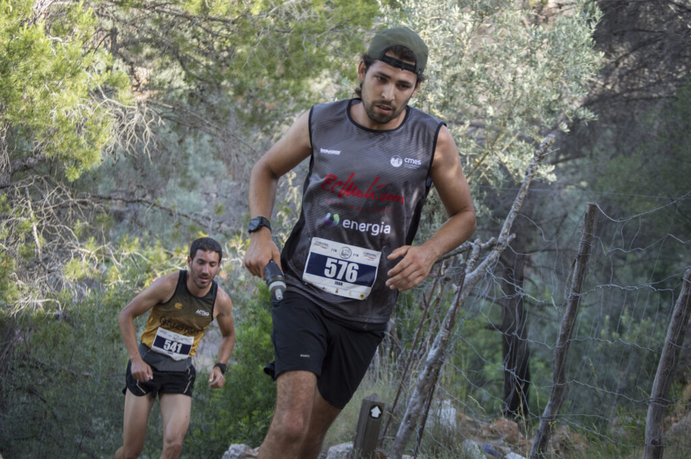
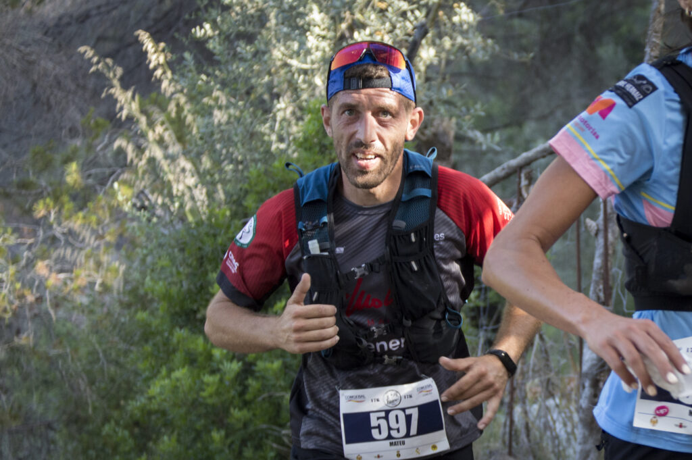
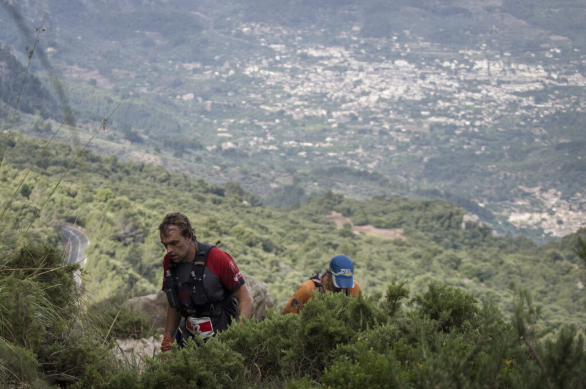
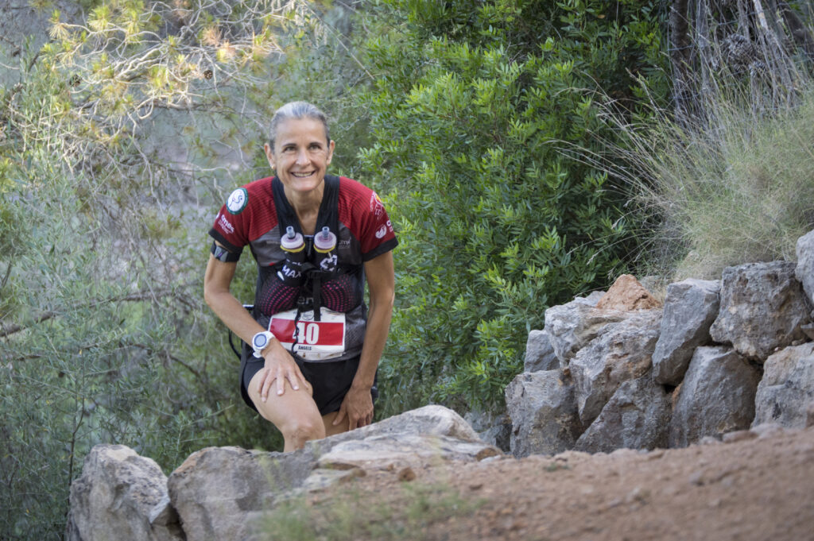

Una gran quantitat de corredors de la secció de Curses participaren ahir diumenge a les curses del Desafío FAS. La majoria ho va fer a la modalitat de 17 quilòmetres, però també vàrem comptar amb participants a la cursa de 43 quilòmetres.

<!-- truncate -->

La cursa de 17 quilòmetres es va disputar entre el Port de Sóller, Fornalutx, Sóller i retorn novament al Port de Soller. Joan Acosta fou el més ràpid dels representants del CMES, obtenint la vuitena posició de la classificació general. També podem destacar la segona posició de la categoria Promesa que va aconseguir Marta López.

Aquests foren els resultats dels participants del CMES a la cursa de 17 quilòmetres:

8.- Joan Acosta 1:13:15  
22.-Tòfol Castanyer 1:19:53  
42.- Mateu Marcús 1:31:52  
82.- Tolo Seguí 1:40:55  
83.- Marta López 1:41:01  
92.- Laura Ludeña 1:44:02  
126.- Sebastià Borràs 1:52:06  
135.- Oana Oancea 1:54:09

Pel que fa a la cursa de 43 quilòmetres, Nico Coll fou el més ràpid dels participants del nostre club. Josep Lluís Gómez i Àngels Vaquer també aconseguiren finalitzar la prova amb una gran actuació.

La calor fou protagonista d’una prova que, amb sortida i arribada al Port de Sóller, duia els participants fins el cim del Puig Major.

Aquests foren els resultats dels participants del CMES:

80.- Nico Coll 6:08:11  
119.- Josep Lluís Gómez 6:37:01  
130.- Àngels Vaquer 6:45:02
