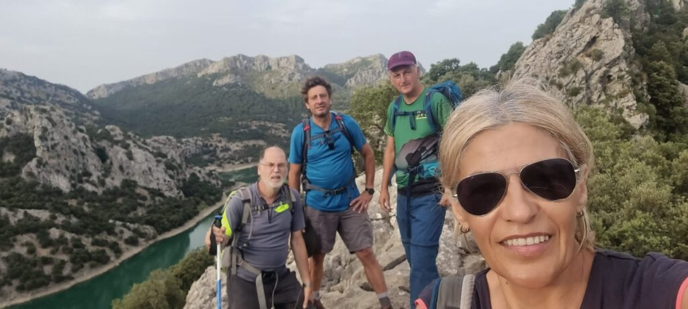

Cap de setmana d’intensa activitat per als socis del nostre club que han sortit a recórrer diferents indrets de la nostra Serra de Tramuntana.

<!-- truncate -->

La secció de Senderisme va programar una sortida pel puig de Ses Vinyes i els seus voltants, on els assistents tengueren l’oportunitat de recórrer les serres de Turixant i de Cúber. Ho feren assolint el cim del puig de Ses Vinyes com a punt més elevat d’aquest recorregut.

Precisament, el pas pel puig de Ses Vinyes (1.105 metres) ha suposat una nova fita en el projecte dels 54 cims de més de mil metres de la Serra de Tramuntana que la secció de Senderisme va posar en marxa l’any passat.

D’altra banda, la secció de Curses va organitzar una sortida per terres bunyolines. El grup va conèixer el recorregut de la Pujada a Sa Comuna, una cronoescalada que es dispuarà el diumenge vinent.

El recorregut va començar a la plaça de Bunyola, va transitar pel camí d’Es Grau i va finalitzar a 768 metres d’alçada, al cim del Penyal d’Honor. A continuació, es va optar per retornar al poble passant per la caseta del Garriguer i el camí dels Cocons.
