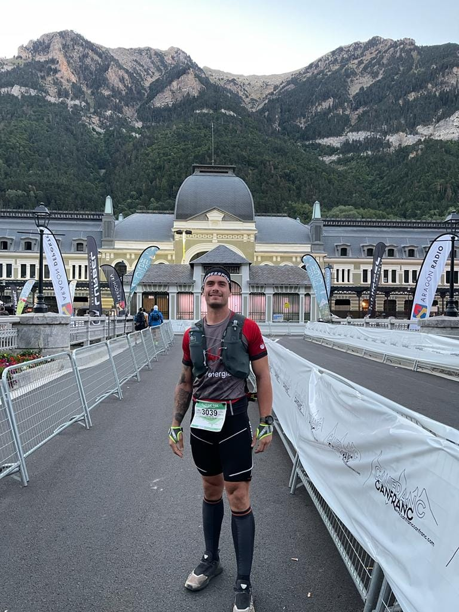

Aquest passat cap de setmana hem tengut una doble cita competitiva en matèria de curses per muntanya. Diumenge, Bunyola va acollir una nova aturada de la Copa Balear de Curses per Muntanya amb la seva clàssica pujada a Sa Comuna. I també diumenge vàrem comptar amb representació a la prestigiosa Canfranc-Canfranc, al Pirineu aragonès.

<!-- truncate -->

La cursa bunyolina es va desenvolupar sobre el tradicional recorregut de 17 quilòmetres. Amb un desnivell positiu aproximat d’uns 800 metres els participants completaren un itinerari circular que els va dur a coronar el penyal d’Honor.

La cita va comptar amb una representació de quatre corredors del CMES. Joan Torrens va ser el millor classificat amb la setzena posició que va aconseguir, mentre que Bàrbara Matt va ser la primera de la seva categoria d’edat. Els resultats i les posicions de cada un d’ells foren els següents:

16.- Joan Torrens 1:28:23  
106.- Josep Lluís Gómez 2:02:46  
115.- Àngels Vaquer 2:07:46  
125.- Bàrbara Matt 2:13:40

**CANFRANC – CANFRANC**

La petita localitat pirenaica de Canfranc va celebrar durant tot el cap de setmana una nova edició de la seva cursa. Amb proves d’una gran diversitat de distàncies, la cita va reunir centenars de corredors a totes elles.

El CMES va estar representat per Joan Mayol a la prova de 16 quilòmetres que es va disputar diumenge dematí. En aquesta cursa, els participants varen tenir l’oportunitat de comprovar el desnivell d’aquesta zona del Pirineu aragonès. En aquesta modalitat s’havia d’arribar fins el cim de La Moleta (2.572 metres), acumulant un total de 1.600 metres de desnivell en els citats 16 quilòmetres.

El nostre corredor va completar la distància classificant-se a la posició 137 de la general. Ho va fer en un temps de 3:16:58.
