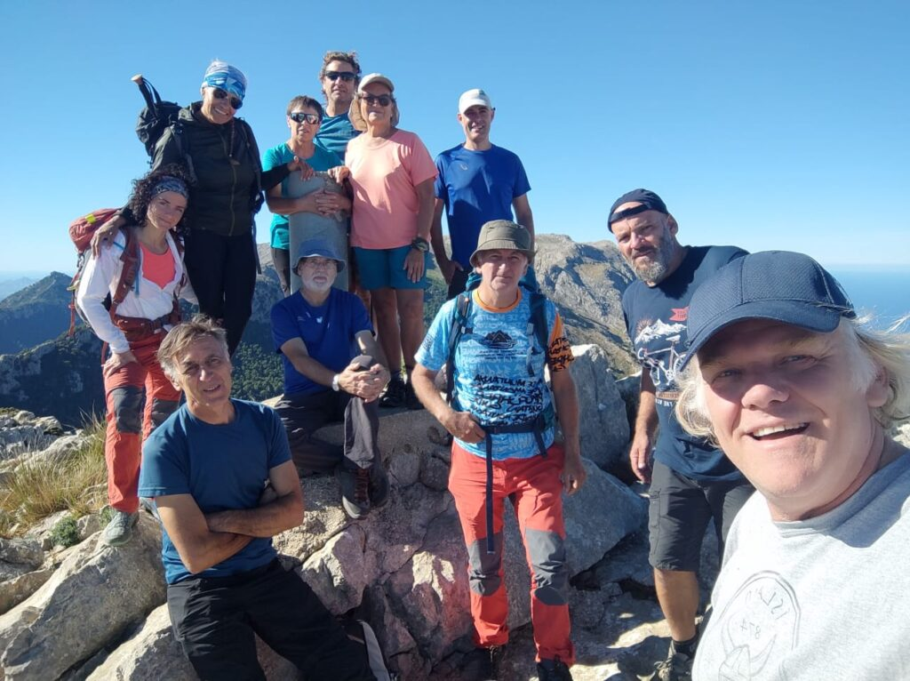
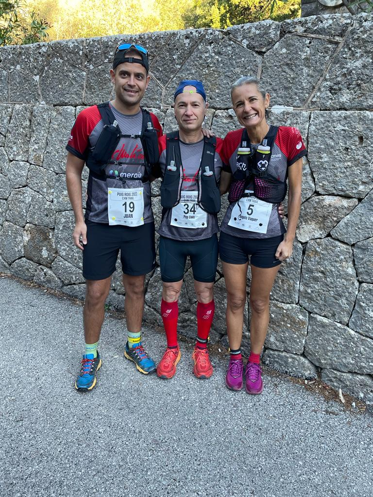
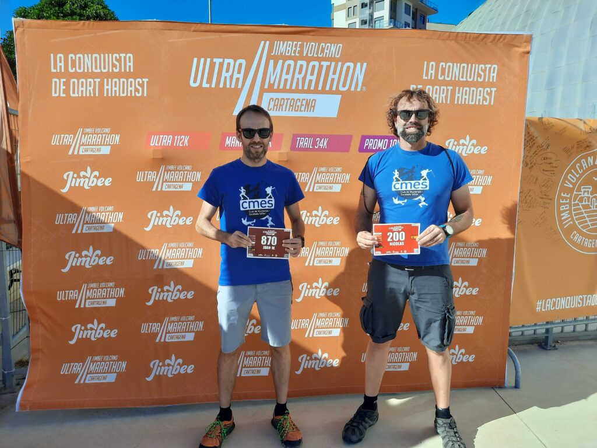

Nombrosos punts d’interès per als socis del CMES durant el passat cap de setmana amb una nova sortida de senderisme pels racons de la Serra de Tramuntana i dues competicions de curses per muntanya en les que hem tengut representants.

<!-- truncate -->

SORTIDA SENDERISTA

La secció de Senderisme va organitzar dissabte una sortida circular que la va dur a visitar tres cims de més de mil metres de la zona central de la serralada.

La caminada en la que participaren una desena de socis va començar i acabar a l’aparcament de la Font des Noguer i va permetre assolir els cims del puig de Tossals Verds (1.118 metres), el Morro d’Almallutx (1.064 metres) i el puig de Sa Font (1.071 metres).

Els participants gaudiren de la bona climatologia que va acompanyar en aquesta jornada en la que Martí Bestard fou el guia de la sortida.

CURSA DEL PUIG ROIG

Tres membres de la secció de Curses varen participar a Lluc a la segona edició de la Cursa del Puig Roig, una prova desenvolupada a través dels camins que permeten completar la tradicional volta a aquest cim del terme municipal d’Escorca.

Josep Lluís Gómez, Àngels Vaquer i Juan Simón foren els tres corredors que completaren un dur recorregut de 21’3 quilòmetres. La classificació d’ells tres fou la següent:

94.- Josep Lluís Gómez 2:32:11  
132.- Àngels Vaquer 2:44:49  
150.- Juan Simón 2:55:19

JIMBEE VOLCANO ULTRA MARATHON CARTAGENA

La ciutat murciana de Cartagena va acollir aquest passat cap de setmana la primera edició de la Jimbee Volcano Ultra Marathon Cartagena. Entre divendres i diumenge s’hi disputaren cinc curses que reuniren uns 1.300 corredors.

Dos membres de la secció de Curses s’hi desplaçaren des de Mallorca per participar a les diferents modalitats d’una prova que va permetre recórrer camins de la costa i l’interior de la regió de Múrcia.

Nico Coll va participar a la prova Ultra de 112 quilòmetres de recorregut. Amb sortida al cabo de Palos i arribada a la ciutat de Cartagena va recórrer bona part de la costa situada entre aquests dos punts, així com la zona muntanyosa situada a l’interior. Va completar la cursa amb un temps de 18:00:45, situant-se a la posició 52 de la general i a la setzena de la seva categoria d’edat.

Joan Vicens, per la seva banda, va competir diumenge en la prova de 34 quilòmetres denominada Trail. Es va classificar a la posició 19 de la general i a la cinquena de la seva categoria d’edat, després d’invertir un temps de 3:21:30 en completar el recorregut.

