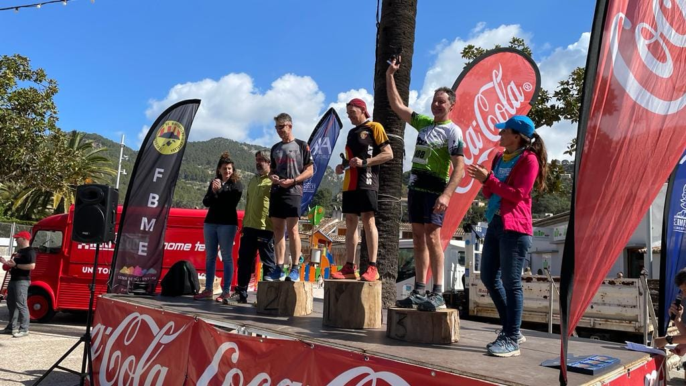
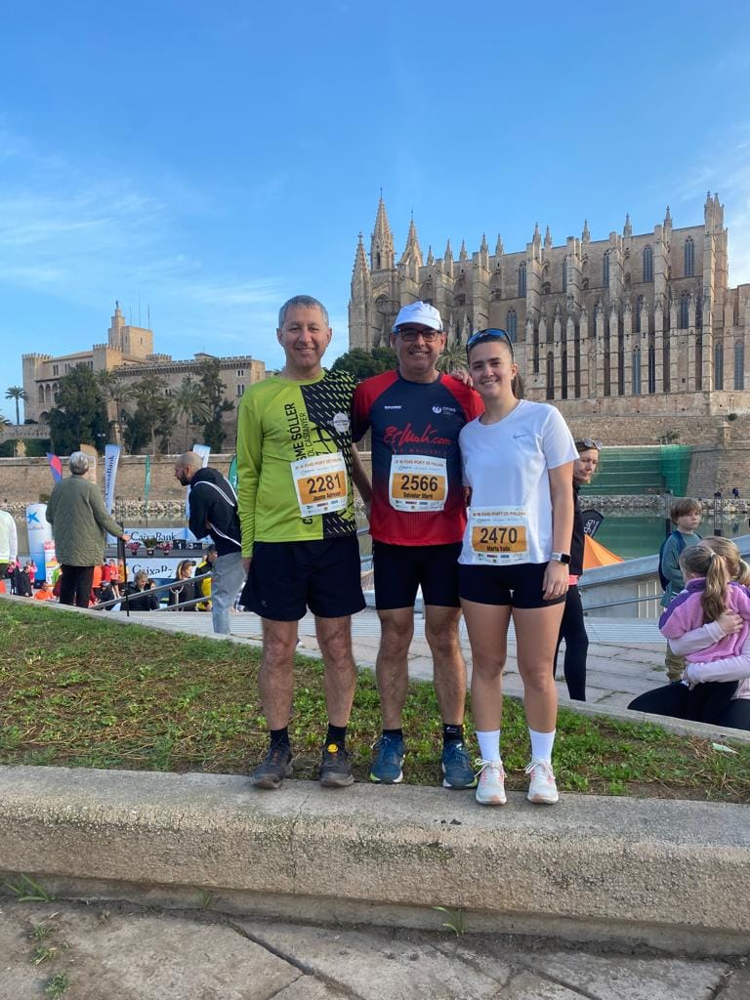

Llarg cap de setmana de competició per als esportistes del club. L’Spartan Race de dissabte, i la pujada a la Fita del Ram o els 10 Km Ciutat de Palma d’ahir diumenge han tengut color del CMES.

<!-- truncate -->

Dissabte n’Aina Forteza va participar exitosament a l’Spartan Race que es va organitzar al quarter Jaume II de Palma. Ho va fer a la modalitat Super 10K, aconseguint superar tots els obstacles del recorregut en un temps de 2:14:49 que li va permetre classificar-se a la setena posició de la seva categoria d’edat.

Diumenge, Esporles va acollir una nova edició de la pujada a la Fita del Ram, una prova que enguany acollia el Campionat de Balears de Clubs. Sobre un recorregut d’uns quinze quilòmetres i un desnivell positiu de 900 metres, els cinc corredors del CMES participants aconseguiren acabar la cursa:

140.- Josep Lluís Gómez 1:55:15  
196.- Àngels Vaquer 2:07:29  
197.- Bàrbara Matt 2:07:41  
217.- Juan Pedro Isern 2:12:23  
235.- Marc Mascaró 2:18:53

De tots ells cal destacar la primera posició a la categoria F55 aconseguida per Bàrbara Matt i la segona en M60 per a Juan Pedro Isern.

Mentrestant, a Palma es disputava una multitudinària mitja marató i 10 quilòmetres Ciutat de Palma. Allà, en Salvador Martí va completar la distància de 10.000 metres amb un temps de 58:45.

