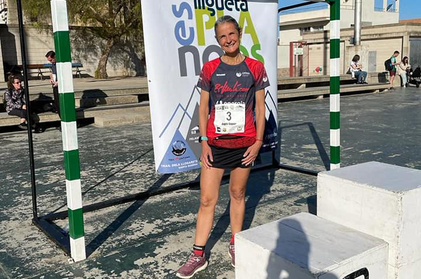
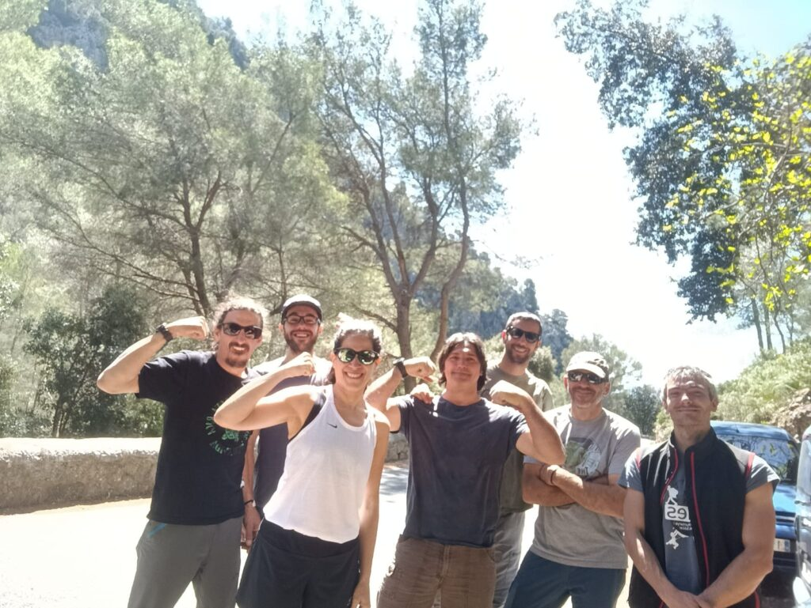

Cap de setmana de molta activitat per a les seccions del club. Les vacances de Setmana Santa no han estat impediment per sortir a la muntanya a practicar les nostres aficions favorites.

<!-- truncate -->

El llarg cap de setmana començava divendres amb la disputa de la cursa FelanitXtrem, una nova prova puntuable per la lliga Es Pla no és pla. Sobre un recorregut de 12’5 quilòmetres, Àngels Vaquer va ser l’única corredora del CMES present a la línia de sortida.

N’Àngels es va classificar a la posició 204 de la general absoluta, a la dissetena de la general femenina i a la quarta de la seva categoria d’edat. Va completar el recorregut de pujada i baixada fins el puig de Sant Salvador en un temps de 1:29:23.

Paral.lelament, Menorca ha acollit durant tres dies un grup de la secció de Senderisme que ha aprofitat les vacances per anar a recórrer el Camí de Cavalls.

Concretament, dividit en tres etapes, la sortida va permetre recórrer tot el sector sud del Camí de Cavalls. La caminada va començar dijous a Ciutadella i va acabar dissabte a Maó després de caminar quasi cent quilòmetres.

I, finalment, la secció d’Escalada va aprofitar el festiu del Divendres Sant per desplaçar-se fins a Caimari per desenvolupar una jornada de pràctiques en roca. Les vies d’aquesta zona del municipi de Selva foren l’indret apropiat perquè els escaladors del CMES gaudissin d’una intensa jornada d’escalada.

