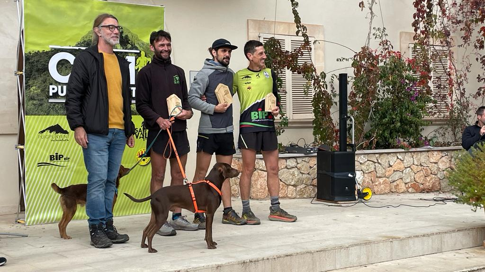
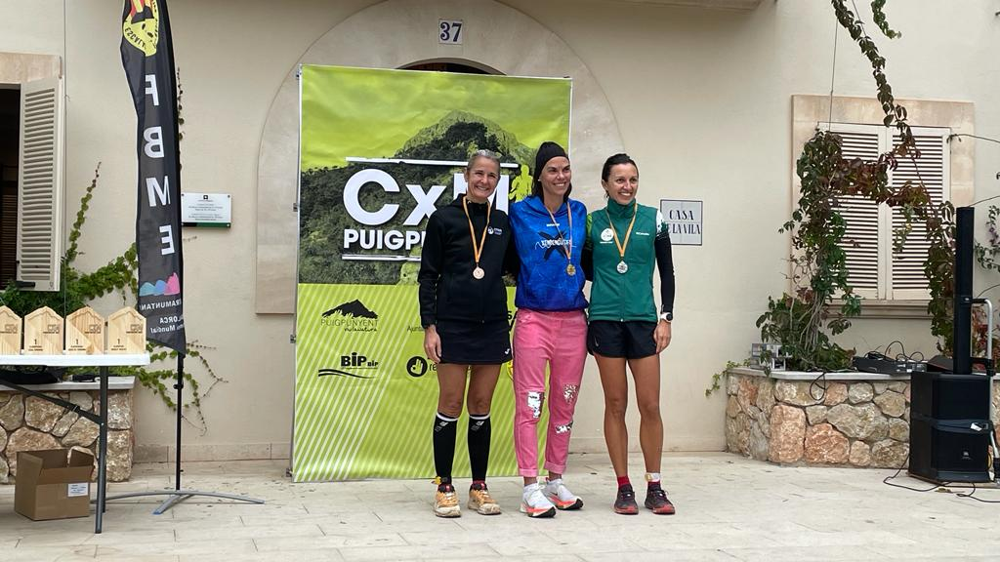

Quan manquen poques curses per posar el teló a l’any 2023, diumenge passat es va disputar la darrera puntuable per a la Copa Balear de Curses per Muntanya. Puigpunyent va ser l’escenari de la seva cursa anual, que es va celebrar sobre un recorregut que nov a deixar indiferent a ningú. 15’5 quilòmetres amb uns 900 metres de desnivell positiu era l’itinerari que varen haver d’afrontar els participants.

<!-- truncate -->

El CMES va comptar amb la participació de dos corredors: Àngels Vaquer i Ramon Morey. Ambdós completaren la prova i compliren amb els seus objectius personals. A la classificació general de la prova ocuparen les següents posicions:

17.- Ramon Morey 1:27:19  
109.- Àngels Vaquer 2:04:49

A títol individual Ramon Morey també va rebre el primer de primer classificat local. Àngels Vaquer, per la seva banda, va ocupar la tercera posició de la categoria F40.

