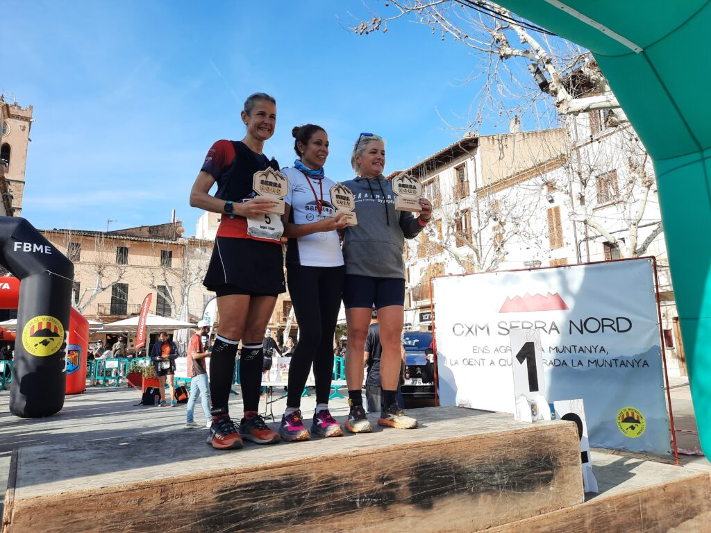
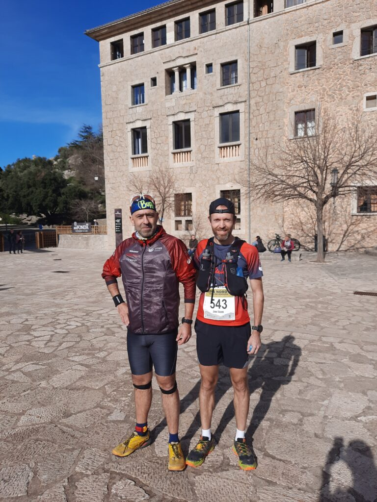

El darrer cap de setmana de gener ens ha duit fins a la primera cursa de la nova temporada de 2024. La cursa Serra Nord, amb sortida a Sóller i arribada a Pollença després de 44 quilòmetres, i la cursa Serra Nord XS, entre Lluc i Pollença (19 quilòmetres), han estat el tret de sortida a un nou any que es presenta apassionant.

<!-- truncate -->

El bon temps viscut durant la jornada esportiva de diumenge va fer oblidar l’edició de 2023 que es va haver de suspendre a darrera hora a causa de la forta nevada que va caure sobre la Serra de Tramuntana. Enguany, el sol i la bona temperatura va acompanyar els corredors en el seu repte d’arribar fins a la línia d’arribada.

Per part del CMES, vàrem comptar amb corredors a les dues modalitats de cursa. A la de 44 quilòmetres, comptàrem amb l’estrena de nous integrants del nostre club, i també d’altres que debutaven en aquesta distància. Aquests foren els seus resultats:

126.- Yael Sprauel 5:25:50  
167.- Pep Lluís Gómez 5:43:18  
195.- Pierre Mariotto 6:03:35  
247.- Jana Gibalova 6:31:04  
262.- Juan Pedro Isern 6:37:22  
266.- Àngels Vaquer 6:42:54

Àngels Vaquer també va ser la tercera classificada de la seva categoria d’edat.

I en la modalitat XS, de 19 quilòmetres entre Lluc i Pollença, els representants del nostre club varen ser:

33.- Joan Vicens 1:37:38  
91.- Tolo Seguí 1:58:56

