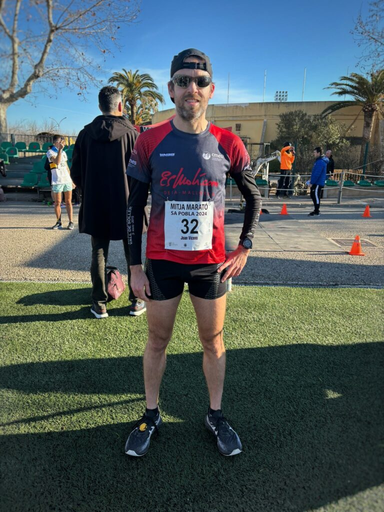
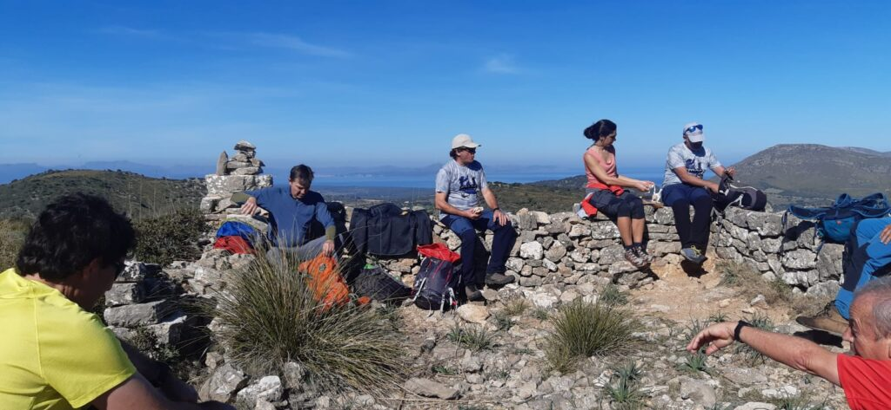

El primer cap de setmana del mes de febrer ha arribat carregat d’activitat per al CMES. Activitats de barranquisme, curses i una nova sortida de senderisme han ocupat el temps lliure dels nostres associats.

<!-- truncate -->

Dissabte dematí, la secció de Barranquisme es va desplaçar fins el torrent de Son Torrella per dur a terme una jornada de pràctiques en un entorn natural. Fou una formació pràctica dirigida pel guia titulat de Barrancs, Pep Homs. Ell es va encarregar de donar les instruccions i guiar les pautes a seguir. Fou una activitat orientada als barranquismes novells, però també per aquells més experimentats.

Diumenge a Sa Pobla, el nostre soci Joan Vicens va participar a la cursa atlètica Mitja Marató de Sa Pobla. Va tenir una gran actuació, ocupant l’onzena posició de la classificació general i la tercera de la seva categoria d’edat. Va completar els 21’097 quilòmetres del recorregut en un temps de 1:20:41.

També diumenge, la secció de Senderisme va realitzar una sortida per terres de Sant Llorenç des Cardassar. La serra de Calicant fou concretament l’emplaçament escollit per dur a terme aquesta sortida. Sota les directrius del nostre soci i guia titulat Martí Bestard, el grup va conèixer l’entorn del puig den Sard, el puig de Calicant i el puig des Telègraf.

