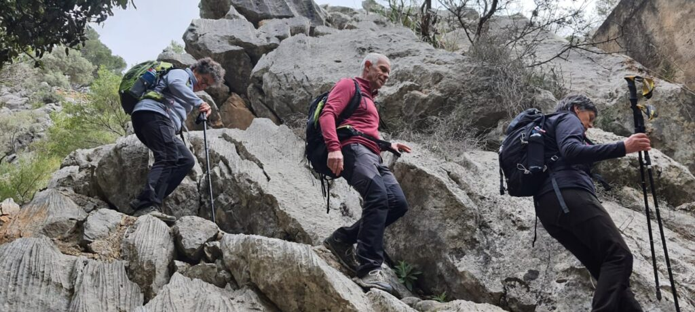
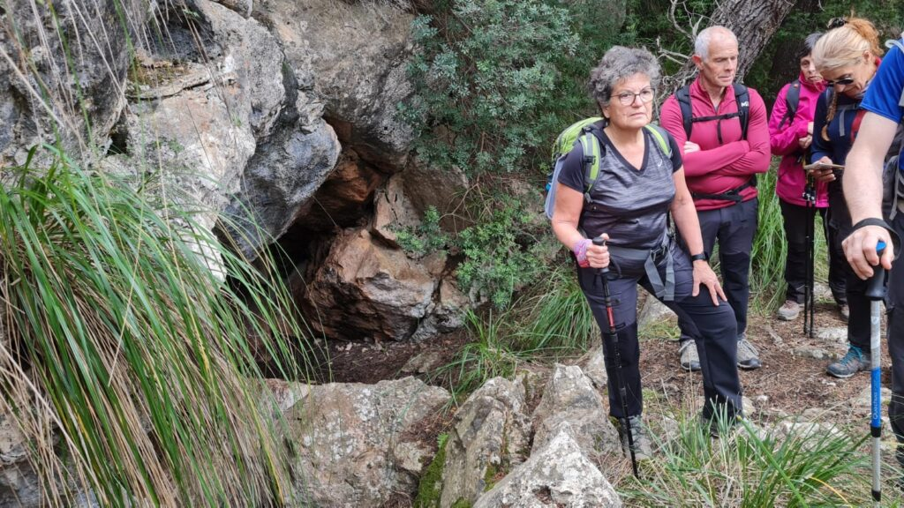
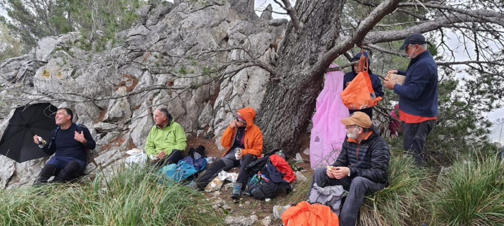
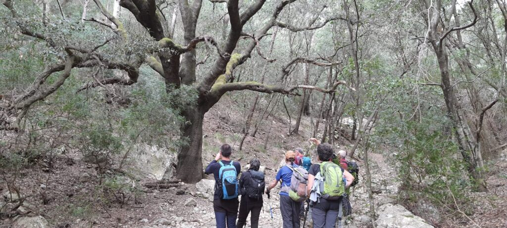
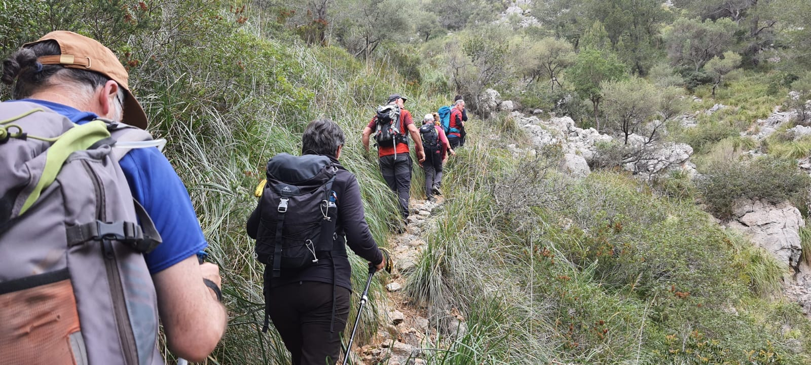

La secció de Senderisme ha completat avui diumenge una ruta circular per la zona de Campanet. Amb sortida i arribada a l’Ermita de Sant Miquel, s’ha transitat pels paratges de Monnàber Vell, el comellar de la Font de sa Pega, els voltants del puig de Sa Font, el puig des Costurer i Sa Plana.

