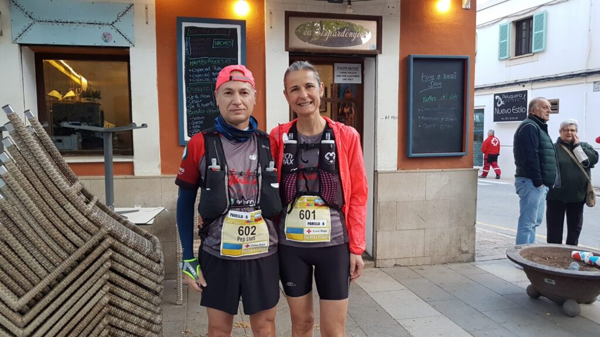

Magnífics resultats els que aconseguiren ahir els nostres representants a la Tramuntana Travessa, una prova que enguany ha canviat la seva data en el calendari.

Pere Estarelles es va classificar a l’onzena posició de la general de la prova de 65 quilòmetres, després de completar l’itinerari comprès entre Bunyola i Andratx en un temps de 6:33:37.

Àngels Vaquer i Josep Lluís Gómez es classificaren a la segona posició de la categoria de parelles mixtes. Ambdós completaren la distància en un temps de 9:33:21.

