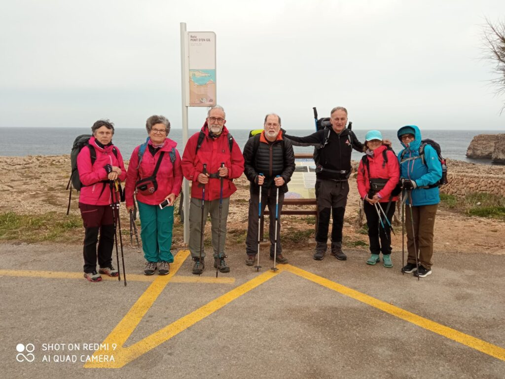
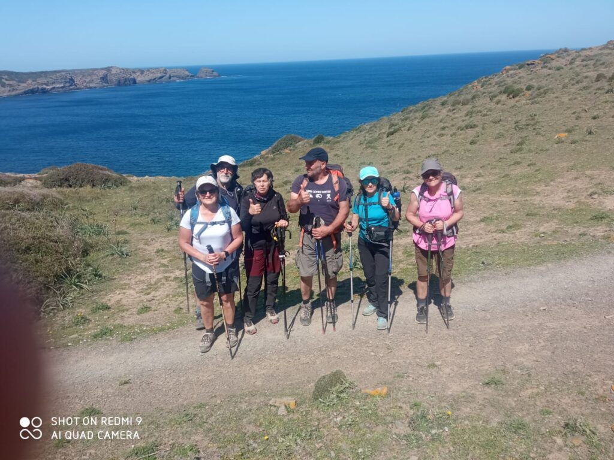

La secció de Senderisme ha aprofitat els festius de Setmana Santa per desplaçar-se fins a Menorca per completar el sector nord del Camí de Cavalls.

Els assistents tengueren l’oportunitat de transitar pels bells paratges que es poden trobar en cada una de les etapes d’aquest camí que recorr el perímetre de l’illa veïnada.

L’expedició del CMES va assolir uns 100 quilòmetres de recorregut en el tram comprès entre Ciutadella i Maó. Concretament, afrontaren tres etapes d’uns trenta quilòmetres cada una.

