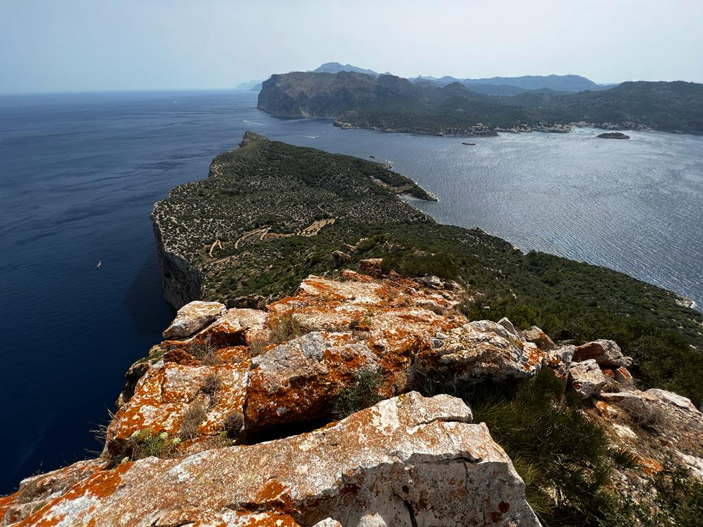
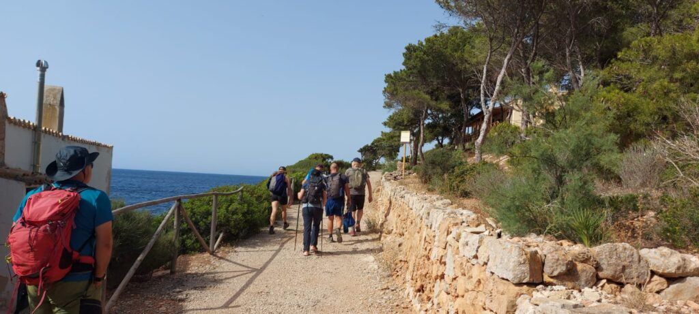

La secció de Senderisme va canviar ahir d’illa per realitzar una nova activitat del seu calendari de 2022. Els nostres socis es desplaçaren en barca fins a Sa Dragonera per conèixer els paratges d’aquest territori situat a l’extrem sud de la Serra de Tramuntana.

El grup va poder recórrer els camins i va conèixer una illa que durant la dècada dels anys 80 va ser amenaçada per un pla urbanístic que va acabar fracassat després que la pressió ciutadana i una campanya del GOB aconseguís que el Govern Balear la compràs.

Durant l’excursió es va visitar el far Vell o de na Pòpia, i també el far de Tramuntana. La sortida va finalitzar amb un cap fico dins l’aigua de la mar per combatre la forta calor que va acompanyar els presents durant la jornada.

