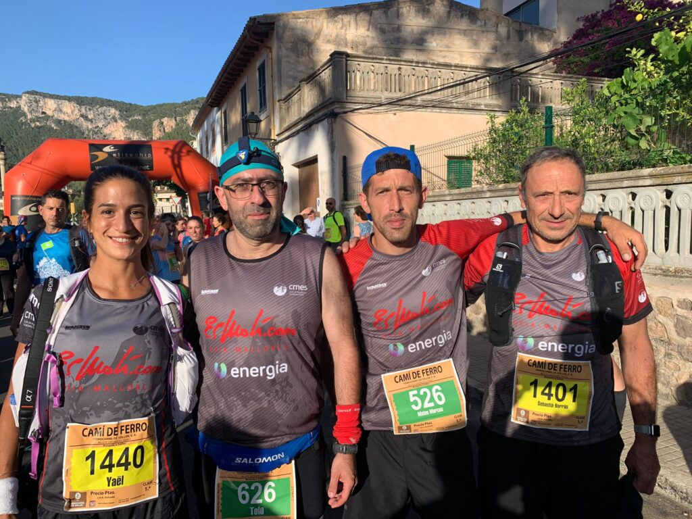

El darrer cap de setmana de juny hem tengut representants a la Crono de Cas Secretari i a les curses del Camí de Ferro. Alaró i Sóller han estat l’epicentre de l’activitat competitiva.

**CRONO CAS SECRETARI**

La crono de Cas Secretari encetava el calendari de cronoescalades de 2022. Set esportistes del CMES es citaren a Alaró per disputar el ràpid recorregut de pujada i baixada.

Els resultats assolits pels nostres corredors foren els següents:

16.- Joan Acosta 33:53  
18.- Ramon Morey 34:04  
26.- Dani Martí 35:26  
87.- Josep Lluís Gómez 43:01  
94.- Fabián Galindo 43:35  
104.- Marc Galindo 45:09  
123.- Aina Estarellas 50:16

**CURSA CAMÍ DE FERRO**

A la quarta edició de les curses Camí de Ferro vàrem comptar amb representants a la modalitat de 13’5 quilòmetres disputada entre Bunyola i Sóller, i també a la marxa senderista no competitiva sobre el mateix recorregut.

En la cursa, Toni Pomar va realitzar una gran cursa i va obtenir la sisena posició de la general i la primera de la seva categoria d’edat. Aquests foren els resultats dels corredors del CMES:

6.- Toni Pomar 54:03  
29.- Mateu Marcús 1:01:56  
74.- Tolo Seguí 1:13:08  
146.- Diego Delgado 1:26:53

