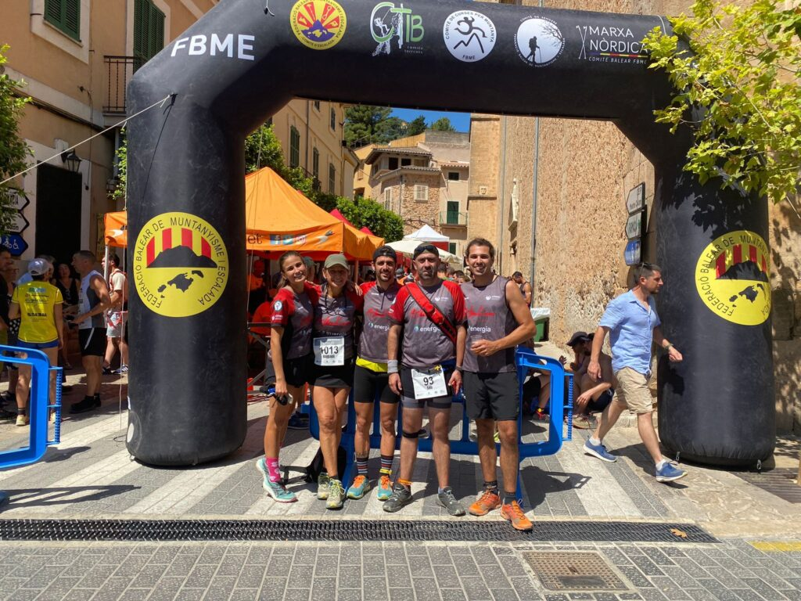

Cap de setmana de competició per als nostres socis de la secció de Curses. El Port de Sóller i Bunyola han estat els epicentres de l’activitat esportiva d’aquest darrer cap de setmana.

Diumenge dematí el Port de Sóller va acollir la primera edició de la seva cursa popular de les festes de Sant Pere. Diversos socis del club es personaren al camp Infante Lois per participar a la prova, i també a la marxa no competitiva.

Tòfol Castanyer va ocupar la tercera posició de la general en la modalitat masculina d’una cursa que va comptar amb un elevat nivell de participació.

Mateu Marcús, Joan Pere Isern i Laura Ludeña també disputaren aquesta cursa que els va dur fins a la urbanització de Muleta i fins el far del cap Gros de Muleta.

A Bunyola, un altre grup de la secció de Curses va disputar la Cronoescalada a Sa Comuna, una prova que enguany també era el Campionat de Balears de Clubs.

Ramon Morey fou el millor classificat, aconseguint la vintena posició d’una prova que va començar a la plaça de Bunyola i va acabar al cim del Penyal d’Honor. Els participants varen recórrer els 4’9 quilòmetres de recorregut que separen l’inici del final de la cursa.

També cal destacar els podis de categoria d’edat aconseguits per Marta López i Bàrbara Matt.

Aquests foren els resultats de tots ells:

20.- Ramon Morey 33:23  
39.- Joan Acosta 35:40  
85.- Josep Lluís Gómez 41:22  
99.- Marta López 43:15  
101.- Fabián Galindo 43:48  
113.- Marc Galindo 45:09  
126.- Tolo Seguí 47:07  
137.- Bàrbara Matt 49:15
