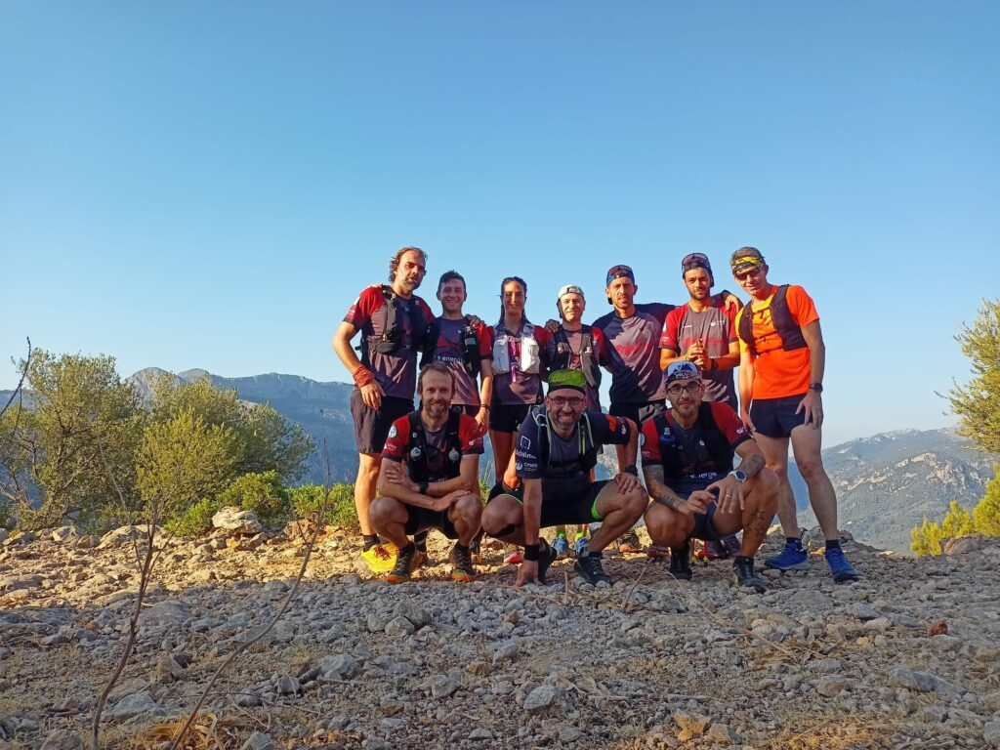

La secció de Senderisme ha complit aquest cap de setmana amb una de les tradicions estivals del nostre club. Un any més s’ha organitzat la baixada al Torrent de Pareis per posar el punt i final a la primera part del calendari de sortides de la temporada.

El grup senderista del CMES va haver de fer front a la forta calor registrada durant la jornada dominical. Per tal de donar una major dificultat a la jornada, es va afegir en primer terme el torrent de Lluc, per enllaçar posteriorment amb el Torrent de Pareis i arribar a la seva desembocadura.

Una vegada acabada l’excursió, els assistents gaudiren d’un dinar de germanor a un dels restaurants del port de Sa Calobra. Seguidament, retornaren al Port de Sóller en barca.

Ara, s’inicia el període vacacional per a la secció de Senderisme. L’activitat retornarà a partir de setembre amb la represa del calendari.

**La secció de curses, per Fornalutx**

La secció de Curses va realitzar ahir diumenge una sortida per l’entorn del nostra vall. En aquesta ocasió el grup va transitar cap a Fornalutx per realitzar una sortida circular.

Des de la Plaça de la Constitució de Sóller els corredors es dirigiren cap a Binibassí i, a continuació, cap a Fornalutx. Una vegada arribats a la vila fornalutxenca començaren la pujada cap el camí de l’Alzina Fumadora que els va dur a la comuna de Fornalutx.

Des d’allà iniciaran el descens, baixant en aquesta ocasió pel camí de l’Alzinaret que els va deixar novament a Fornalutx. Seguidament, posaren el punt i final a la sortida arribant a Sóller.
