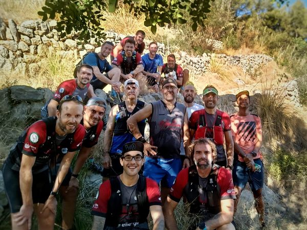

El darrer cap de setmana d’agost ha vengut acompanyat de la represa de la Copa Balear de Curses per Muntanya. Mancor de la Vall va ser diumenge l’escenari de la sortida i l’arribada de la Mancor Xtrem, una prova de 23 quilòmetres que va permetre que els participants assolissin el cim del puig de Massanella.

La prova va ser guanyada per Miguel Ángel Cuenca en categoria masculina i per Isla Smith en categoria femenina. Juan Navarro i Hamal Villar completaren el podi masculí, mentre que Karina Gómez i Margalida Perelló feren el mateix en la modalitat femenina.

Pel que fa a la participació de corredors del CMES, la cita va comptar amb la presència de cinc representans del nostre club. Els seus resultats a la prova mancorina foren els següents:

17.- Joan Torrens 2:31:34  
32.- Tòfol Castanyer 2:40:35  
62.- Mateu Marcús 2:59:48  
134.- Josep Lluís Gómez 3:56:16  
137.- Àngels Vaquer 3:58:50

D’altra banda, el cap de setmana també va comptar amb l’organització d’una nova sortida d’entrenament de la secció de Curses. En aquesta ocasió es va recórrer un itinerari de baixa muntanya amb començament i final a la platja den Repic del Port de Sóller.
