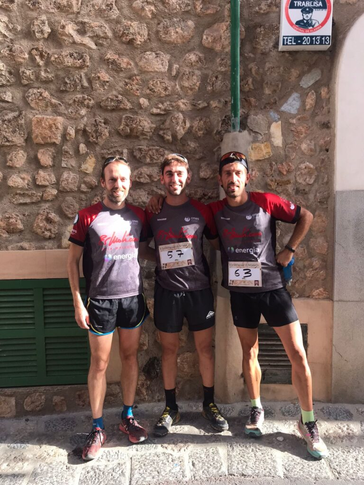
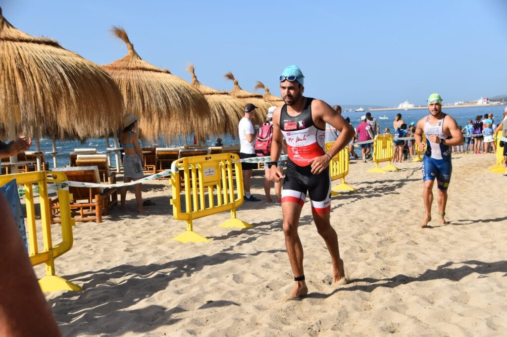

L’activitat esportiva del cap de setmana s’ha repartit en àmbits molt diferents per als representants del CMES que hi han participat.

La secció de Senderisme reiniciava diumenge el seu calendari de sortides després de les vacances estivals. El grup comandat pel cap de secció Tomeu Muntaner es va desplaçar fins a terres pollencines.

Allà, amb un recorregut de mitja muntanya que començava i acabava a la Cala de Sant Vicenç, els participants feren el retrobament amb els companys i amb les sortides quinzenals que organitza el club.

Sempre ben a prop de la zona costanera d’aquesta part de la Serra de Tramuntana, es va tenir l’oportunitat de passar per paratges tan diversos com ara la Talaia Vella o el pas del Port.

**CURSA POPULAR DE FORNALUTX**

També diumenge, Fornalutx va acollir la seva tradicional cursa popular d’atletisme. Després de les edicions de 2020 i 2021 suspeses per la pandèmia, la cita esportiva va tornar ser una realitat.

Tres corredors del CMES es citaren a la plaça de Fornalutx per completar els 4 quilòmetres d’un recorregut que comptava amb una primera part urbana i una segona pels camins dels voltants.

La cursa va acabar amb un doble podi per als corredors del CMES. Aquests foren els resultats que assoliren ells tres:

1.- Joan Torrens 16:06  
2.- Joan Vicens 17:40  
17.- Mateu Marcús 22:11

**PORT DE PALMA TRIATHLON MALLORCA**

I, finalment, diumenge dematí Joan Acosta es va desplaçar fins a Palma per participar a la Port de Palma Triathlon Mallorca.

El nostre representant va participar a la modalitat Sprint, completat els tres sectors de la triatló en un temps de 1:19:24. A nivell classificatori es va situar a la posició 26 de la general i a la vuitena de la seva categoria d’edat.

