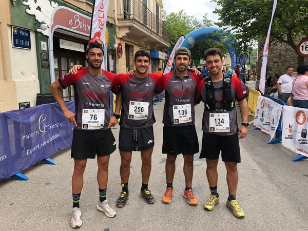

La secció de Senderisme ha completat la segona sortida del mes de setembre, i també la segona posterior a la tradicional aturada estival.

En aquesta ocasió el grup es va desplaçar fins a Deià per transitar pels passos que envolten aquest municipi de la costa nord de la Serra de Tramuntana.

A primera hora del dematí es va iniciar un recorregut que va permetre conèixer zones d’una gran bellesa i de gran dificultat tècnica.

Entre d’altres paratges, el grup de senderistes del CMES va transitar per la travessia de sa Fer, el pas den Marc, la cara nord de Sa Galera, el cim de Sa Galera, el pas de Sa Geneta o el Pas de Can Boqueta.

Sense dubte, una gran sortida dominical del nostre grup senderista.

CURSA TRAPA TRAIL S’ARRACÓ

Mentrestant, quatre corredors de la secció de Curses es desplaçaren dissabte capvespre fins a s’Arracó per participar a una nova edició de la Trapa Trail, una prova que cada any exhaureix les seves places.

Els participants del CMES retornaren a la vall amb grans resultats a la butxaca. Tòfol Castanyer va obtenir la vuitena posició de la general, i també va pujar al tercer escaló del podi de la categoria sènior masculí.

En Tòfol va disputar una gran cursa que el va mantenir sempre entre els millors durant els 20 quilòmetres del recorregut dissenyat per aquesta zona de la Serra.

Els resultats dels participants del CMES foren els següents:

8.- Tòfol Castanyer 1:43:46  
36.- Joan Acosta 1:57:13  
44.- Dani Martí 1:58:50  
88.- Javi Reina 2:12:47
