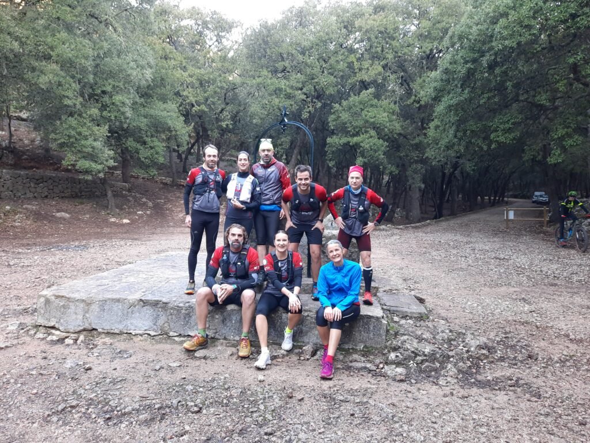
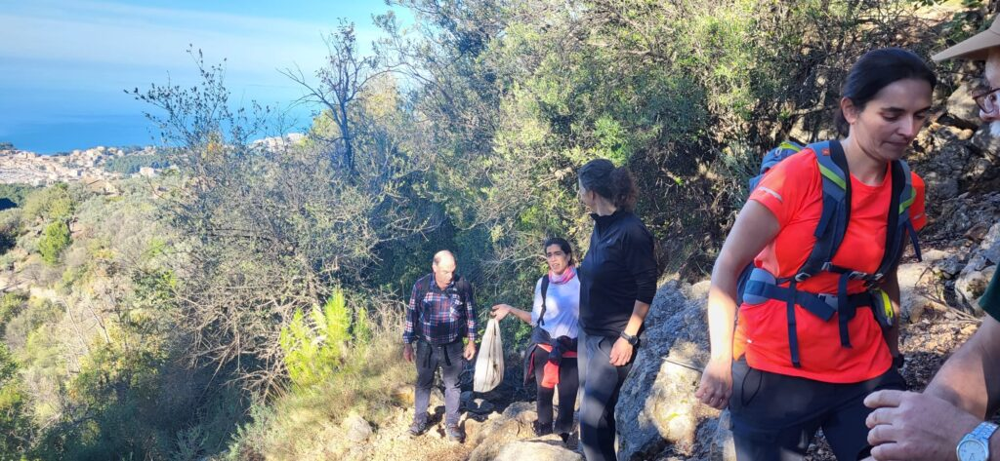
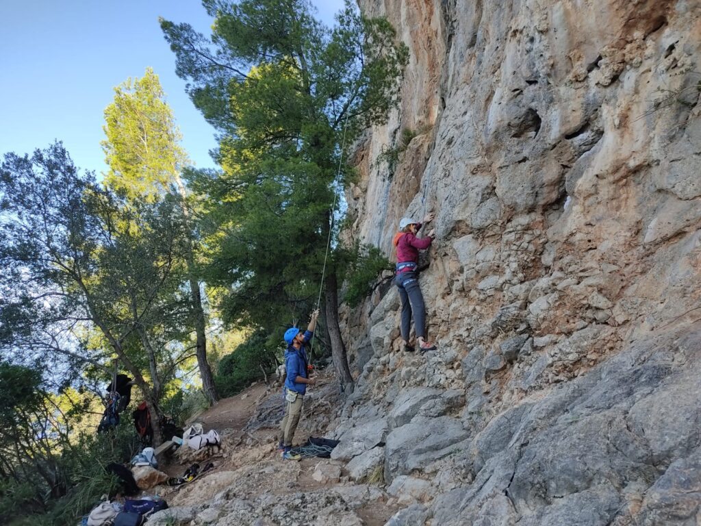
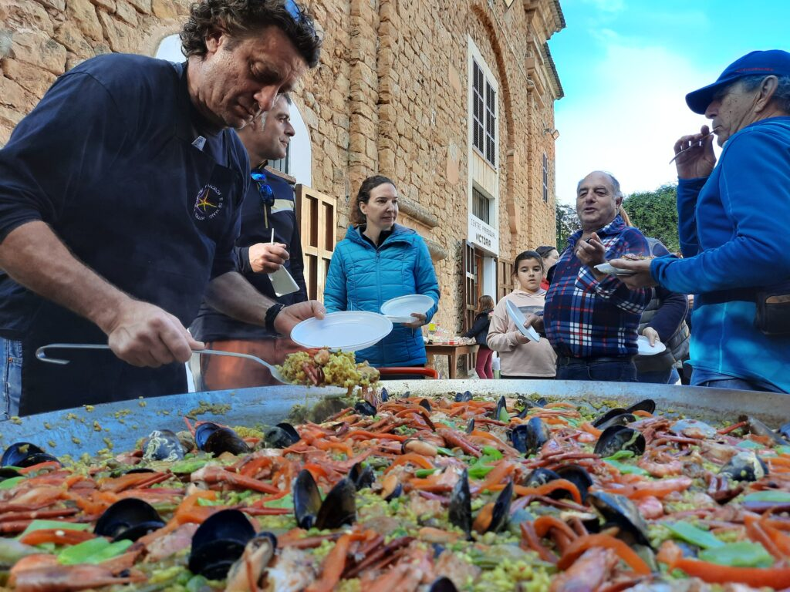
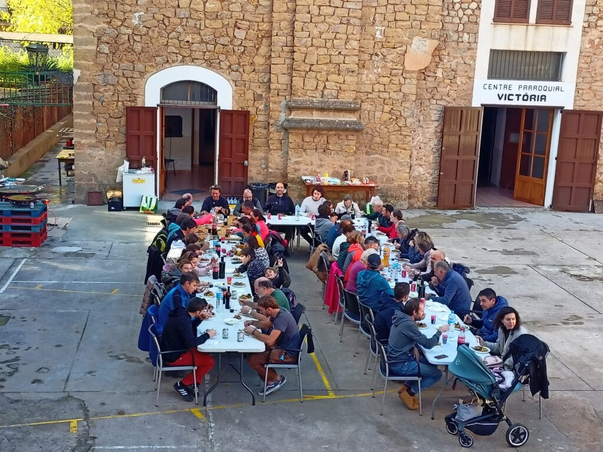

El Club de Muntanya i Escalada Sóller (CMES) ha tancat el curs 2022 amb un cap de setmana carregat d’activitats. Divendres es va celebrar l’assemblea ordinària de socis per donar compte de l’actualitat de l’entitat, i ahir diumenge es va organitzar un dinar de germanor per a socis del club.

Durant l’assemblea de divendres, el president Tomeu Colom i els caps de secció varen presentar la memòria d’activitats del curs. En aquest 2022 el CMES ha arribat als 191 socis, una xifra rècord en els quinze anys d’història del club. De tots ells, 48 han estat socis per primera vegada, comptant el CMES amb un 32% de sòcies de sexe femení.

Tomeu Colom va aprofitar l’avinentesa per tancar el seu cicle a la presidència. Després de vuit anys, el proper 1 de gener cedirà el relleu a Tomeu Muntaner, que a les eleccions celebrades el passat mes de novembre va encapçalar l’única candidatura presentada. Colom va tenir unes paraules d’agraïment per a totes les persones que l’han acompanyat durant aquesta etapa.

El tresorer del club, Biel Coll, va presentar l’estat de comptes, enumerant una a una totes les partides de despesa que s’han materialitzat durant el 2022. Els caps de secció presentaren les activitats que durà a terme el club durant el proper 2023, i s’anunciaren els preus de les quotes que hauran de pagar els socis per federar-se en les diferents modalitats d’esports de muntanya.

Diumenge, en la jornada festiva del club, es va organitzar un entrenament de curses per la Comuna de Bunyola, una sortida senderista pels camins de Sóller i Fornalutx, i una jornada de pràctiques d’escalada a les vies del Port de Sóller. La diada va finalitzar amb una paella gegant que el cuiner Xisco Martorell va preparar al C.P. Victòria.

