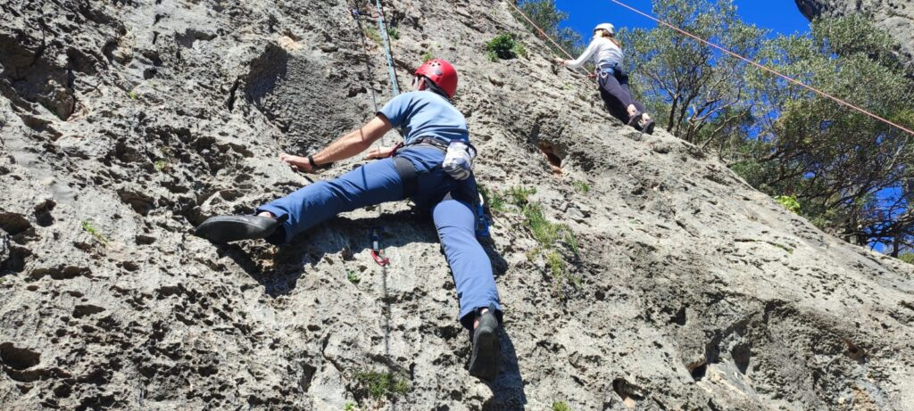
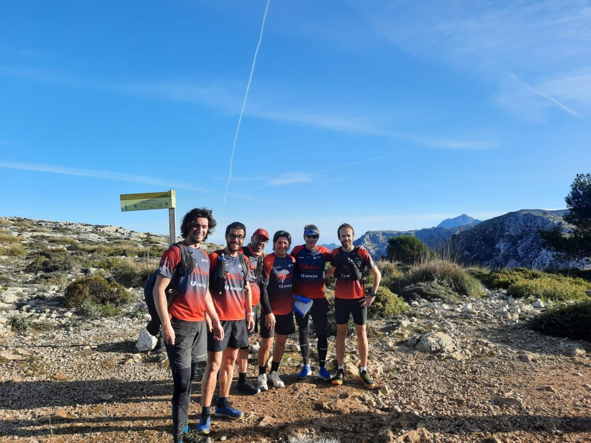
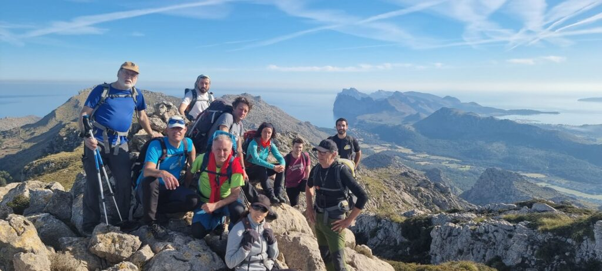

Cap de setmana de molta activitat per a les seccions esportives del CMES. Escalada a Sa Gubia, sortida d’entrenament de la secció de Curses per Valldemossa i sortida de Senderisme per l’entorn de la Cala de Sant Vicenç han estat les propostes que el club ha oferit als seus socis.

Dissabte un grup d’escaladors es va desplaçar fins a Bunyola per gaudir d’un dematí d’escalada a les vies que s’ubiquen a Sa Gubia. Fou una jornada asolellada en la que els presents pogueren continuar amb el seu aprenentatge en aquestes espectaculars vies.

Dissabte dematí tres corredors de la secció de Curses varen participar a la Talaia K20, a Alcúdia. Ramon Morey, Yael Sprauel i Pep Lluís Gómez representaren el CMES a la prova alcudienca.

Diumenge dematí la secció de Curses va combatre el fred de primera hora amb un entrenament per Son Moragues, el camí de s’Arxiduc i el Camí de Ses Basses. Fou una ruta circular en la que, com és habitual, el bon ambient va regnar entre els participants.

I també diumenge els socis de la secció de Senderisme es traslladaren fins a l’extrem nord de la Serra de Tramuntana per participar en una sortida per l’entorn de Cornavaques. El grup va transitar pel puig de Can Groc, el coll de Cuixac, el cim de Cornavaques i La Mola, gaudint de les vistes que llueixen des d’aquests punts propers a la costa.

