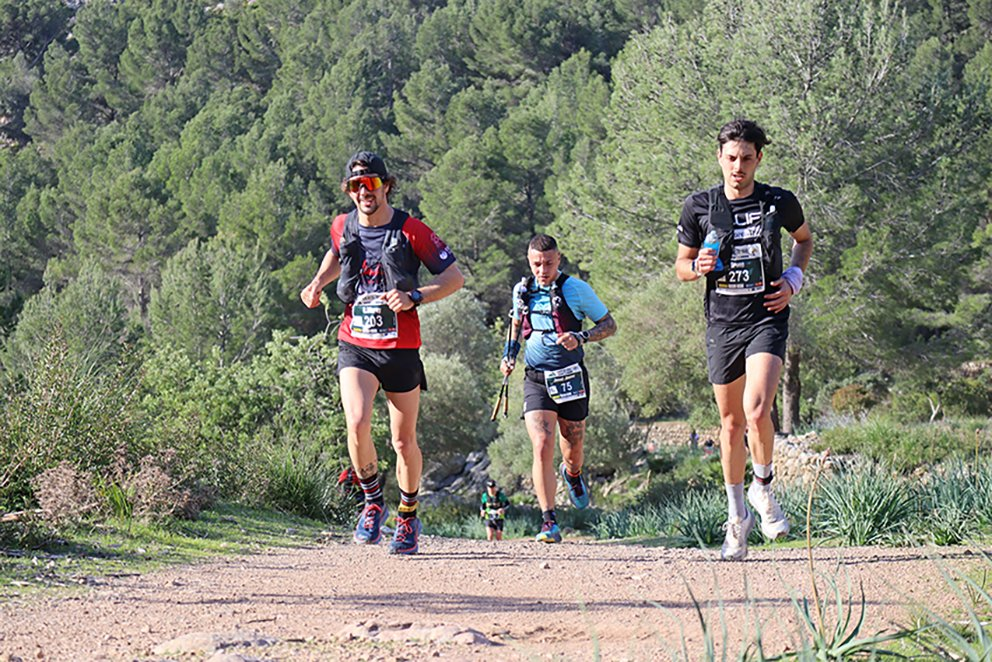
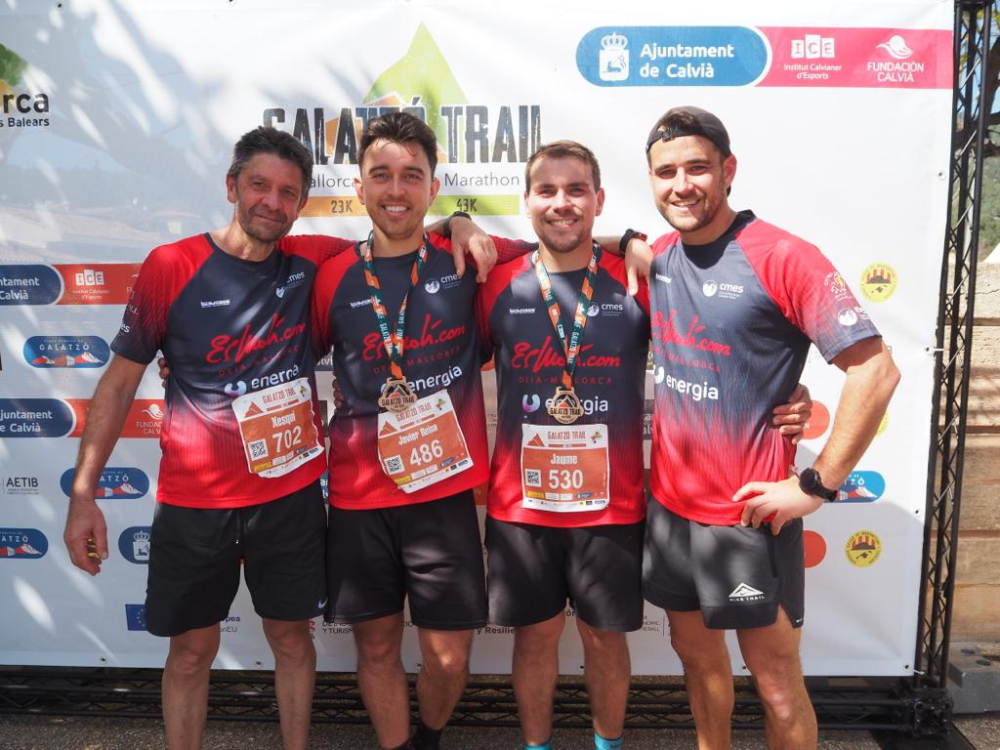
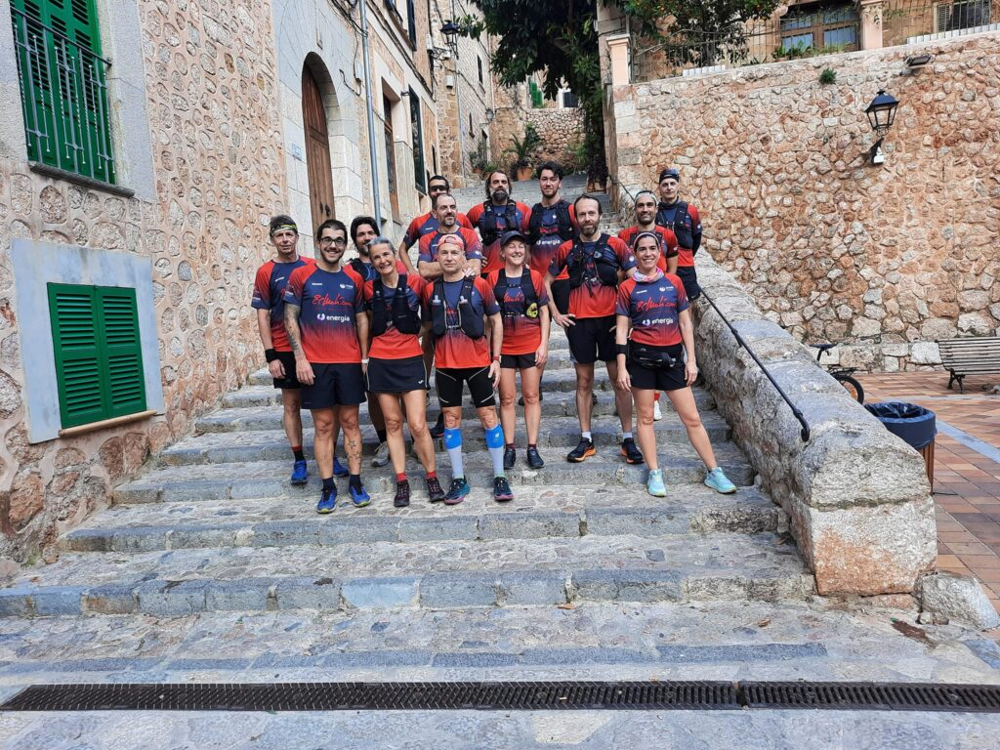

La crònica del cap de setmana passa per l’activitat atlètica dels nostres socis. Alguns participaren a les curses de la Galatzó Trail, altres a la cursa no competitiva de la Dona del Port de Sóller, i un tercer grup va realitzar una sortida circular pels voltants de Sóller.

A la versió de 43 quilòmetres de la Galatzó Trail, Ramon Morey va ser el millor de l’expedició del CMES. Va completar una gran cursa, classificant-se a la posició 21 de la general. Una mica més endarrera, a la posició 79, va creuar la línia d’arribada Xevi Nieto.

En la prova de 23 quilòmetres, Dani Martí va aconseguir una gran setena posició de la classificació general. El representant del CMES va invertir un temps de 2:30:45 en el que va ser una gran cursa. Darrera ell, a la posició 19 s’hi va situar Xesqui Horrach. En una de les primeres curses que disputa amb la camiseta del CMES va aconseguir pujar a la primera posició del podi de la seva categoria d’edat.

Javi Reina, a la posició 28, Jaume Arbona a la 44 i Mónika Gaska al lloc 195 foren les posicions aconseguides per la resta de representants del nostre club.

D’altra banda, diumenge dematí es va organitzar una sortida d’entrenament pels camins del voltants de Sóller i Fornalutx. Una representació de la secció de Curses va aprofitar l’assolellada jornada de diumenge per compartir quilòmetres amb la resta de companys.

