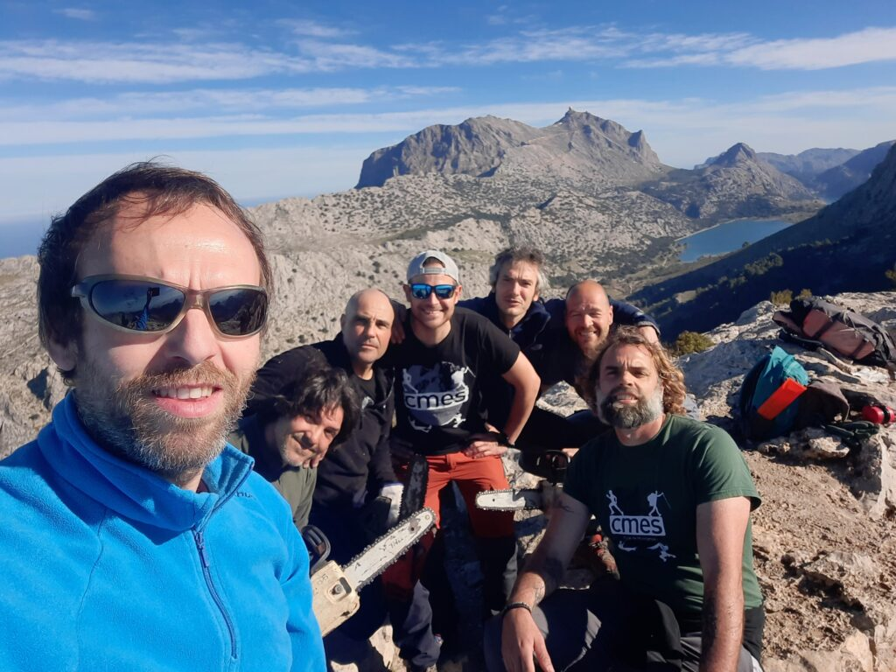
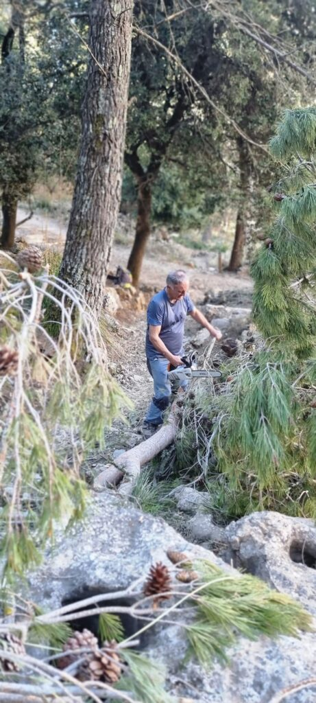

Nou cap de setmana replè d’activitat en el si del nostre club. A Pollença s’hi ha disputat la Cursa Tomir, una prova que enguany ha acollit la disputa del Campionat de Balears de Curses en Línia. Mentrestant, a la nostra vall, el club ha organitzat una jornada de neteja per aportar el nostre granet d’arena a la recuperació de la Serra de Tramuntana.

A la cursa pollencina, quatre socis de la secció de Curses es presentaren a la línia de sortida per participar a una cursa que va haver de modificar el seu recorregut degut als arbres caiguts per culpa de la nevada. Josep Lluís Gómez, Bàrbara Matt, Àngels Vaquer i Marga Bestard foren els quatre corredors que completaren els 27 quilòmetres. Aquesta fou la classificació obtinguda:

168.- Josep Ll. Gómez 3:48:13  
183.- Bàrbara Matt 3:57:29  
185.- Àngels Vaquer 3:58:32  
215.- Marga Bestard 4:34:36

De tots ells, Bàrbara Matt va aconseguir pujar al primer lloc del podi de la seva categoria d’edat, aconseguint, per tant, el campionat de Balears de la categoria F55.

Paral.lelament, socis de les quatre seccions participaren diumenge en una jornada de neteja pels camins que creuen la finca de l’Ofre. Concretament, treballaren en els diversos accessos que permeten assolir el cim del puig de l’Ofre, i també en un tram del GR que enllaça el Barranc de Biniaraix amb el Coll de l’Ofre.

La jornada va comptar amb la participació d’una vintena de socis que treballaren en la retirada de les branques caigudes a causa de la nevada.

