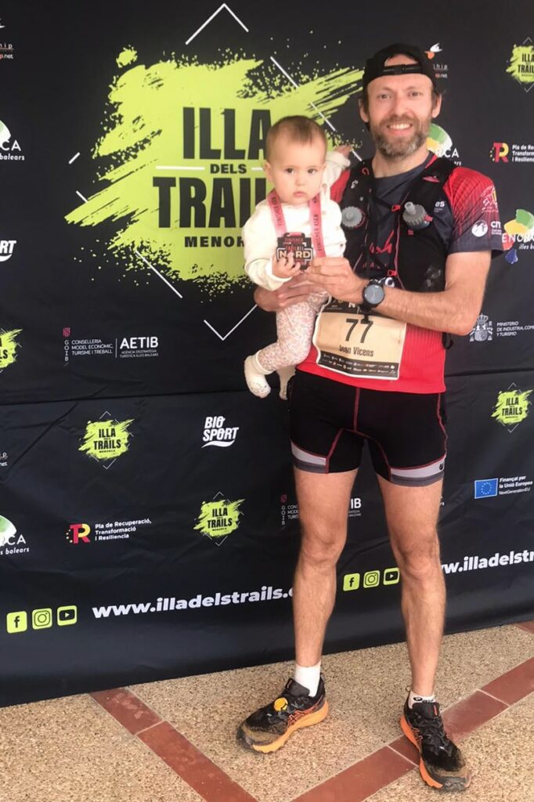

Cap de setmana de competició per als corredors del club que han participat a la Trail dels Llogarets disputada a Santa Eugènia i a la Trail del Nord celebrada a Menorca.

A Santa Eugènia, Dani Martí, Javi Reina i Jaume Arbona participaren a una Trail dels Llogarets que enguany retornava al calendari i que estrenava un nou recorregut.

28.- Dani Martí 1:43:16  
67.- Javi Reina 1:54:40  
70.- Jaume Arbona 1:55:35

Aquests foren els resultats dels tres representants del nostre club que acudiren a una cita taujana que també ha estat la primera prova puntubla per a la lliga Es Pla no és pla.

A Menorca, Joan Vicens va participar a la cursa més llarga de la Trail del Nord. Sobre un recorregut de 45 quilòmetres que presentava un desnivell positiu d’uns 1.300 metres, es va classificar a la catorzena posició de la general amb un temps de 4:31:34

