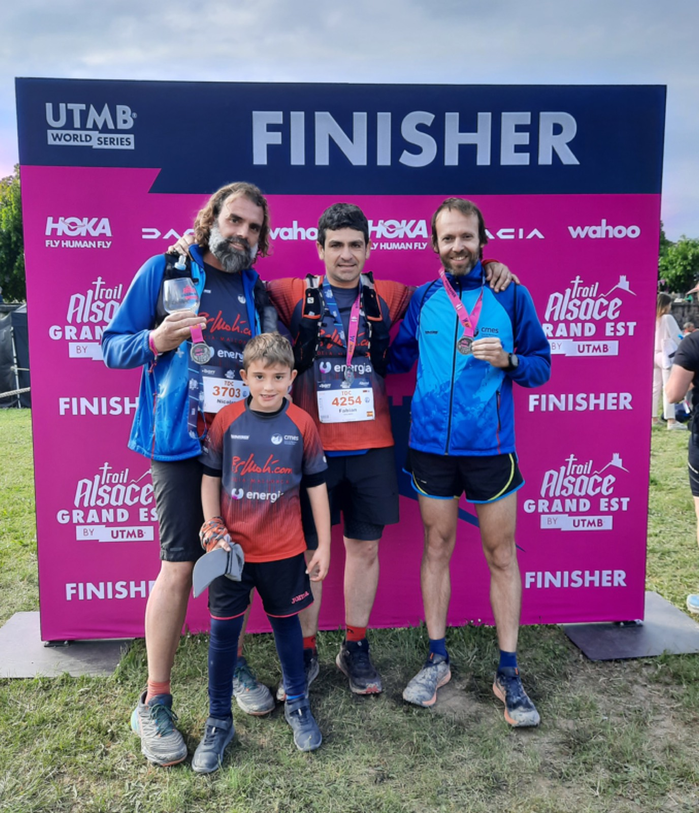
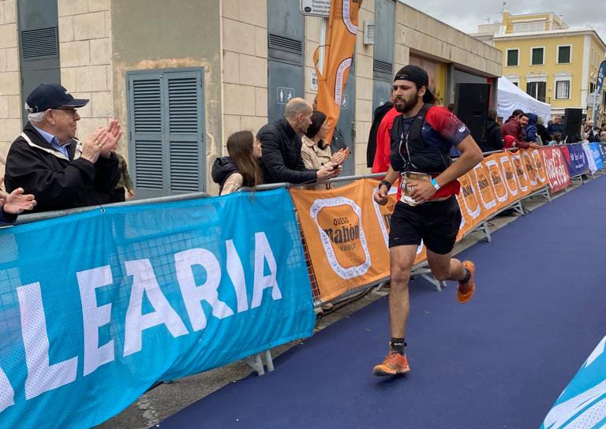
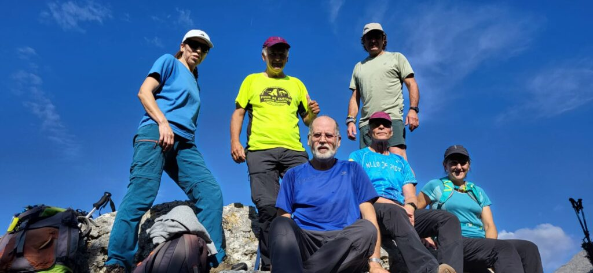

Cap de setmana de plena activitat per als esportistes del CMES que han participat a competicions a França i a Menorca, o per aquells que han optat per participar a la sortida organitzada per la secció de Senderisme.

En l’àmbit competitiu de la secció de Curses, tres socis es varen desplaçar fins al nord-est francès per participar divendres dematí a la Trail Alsace Grand Est by UTMB.

Sobre un recorregut de 49 quilòmetres que presentava un desnivell positiu de 2.000 metres, Joan Vicens va ser el més ràpid dels corredors del CMES. Va completar la distància en un temps de 5:17:18 i es va classificar a la posició 86 de la general i a la quinzena de la seva categoria d’edat.

Nico Coll, per la seva banda, va cobrir la mateixa distància entre les localitats de Barr i Obernai en un temps de 7:10:17. En el seu cas es va classificar a la posició 937.

I, finalment, Fabián Galindo fou el 1.222è classificat, després d’invertir un temps de 7:51:25 en arribar a la línea de meta situada sobre la murada d’Obernai.

A Menorca, quatre corredors del club participaren a les curses de la Trail Menorca Camí de Cavalls. Joan Acosta i Yael Sprauel ho feren a la prova de 27 quilòmetres, mentre que Josep Lluís Gómez i Àngels Vaquer optaren per la cursa de 58 quilòmetres.

Joan Acosta va completar la seva cursa (la Short Trail Costa Nord) en un temps de 2:14:53 que li va permetre pujar fins a la posició 24 de la classificació general. Yael Sprauel va ser la 56ena de la general i la sisena de l’absoluta femenina. En el seu cas, va completar els 27 quilòmetres del recorregut entre La Vall i Ciutadella en un temps de 2:31:05.

La la prova de 58 quilòmetres, la Petit Trail Costa Nord, Josep Lluís Gómez fou el millor classificat dels corredors del CMES. Es va situar a la posició 60 després d’invertir un temps de 7:34:02 en completar el dur recorregut. Àngels Vaquer va necessitar un temps de 8:33:56 en cobrir la distància existent entre Fornells i Ciutadella.

Per altra banda, la secció de Senderisme va organitzar diumenge una nova sortida, en compliment del calendari d’activitats presentat a principi d’any.

El grup es va desplaçar fins a Caimari per recórrer l’entorn muntanyós d’aquella zona. Durant la caminada es va fer el cim al puig de n’Escuder, un petit turó que té el seu punt més alt als 574 metres sobre el nivell de la mar.

