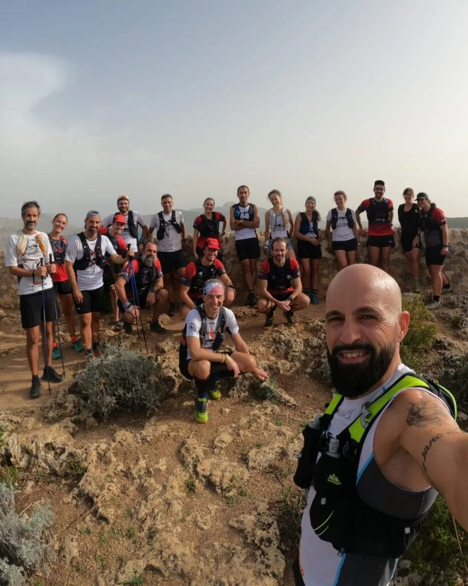
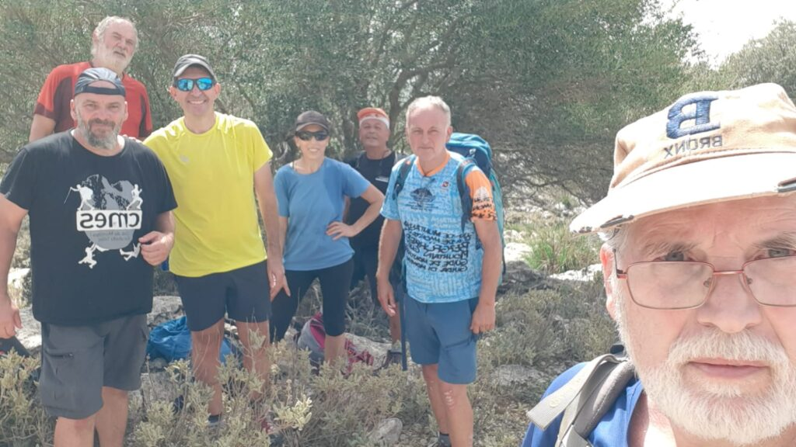

Cap de setmana de plena activitat el que hem viscut aquests darrers dies en el nostre club.

Dissabte, s’Arracó va ser l’escenari d’una nova edició de la Cursa Trapa Trail. Sobre un recorregut de 19 quilòmetres, cinc corredors del CMES participaren a una prova que va recórrer els bells paratges d’aquesta àrea de la Serra de Tramuntana del municipi d’Andratx.

Els resultats dels nostres representants foren els següents:

122.- Pep Lluís Gómez 2:21:30  
144.- Àngels Vaquer 2:27:35  
161.- Matas Sabaliauskas 2:32:03  
181.- Alfonso Martín 2:37:23  
209.- Juan Pedro Isern 2:47:38

Diumenge, la secció de Curses va participar en una sortida conjunta que es va organitzar amb els companys de Sa Milana. L’activitat va consistir en un reconeixement al recorregut de la Cursa del Castell d’Alaró que es celebrarà el proper 15 d’octubre. La sortida de germanor va finalitzar amb un bon berenar per a tots els participants.

I el mateix diumenge, la secció de Senderisme va realitzar una bella sortida per la zona de la cara sud del puig de l’Ofre i la finca de Comasema. Concretament, es va transitar pel torrent d’Almadrà, el camí del Bosc, el puig de la Cova dels Carboners, el camí del Coll de sa Ginebrissa, el camí dels Colls, el pas dels Caçadors i el coll den Poma.

