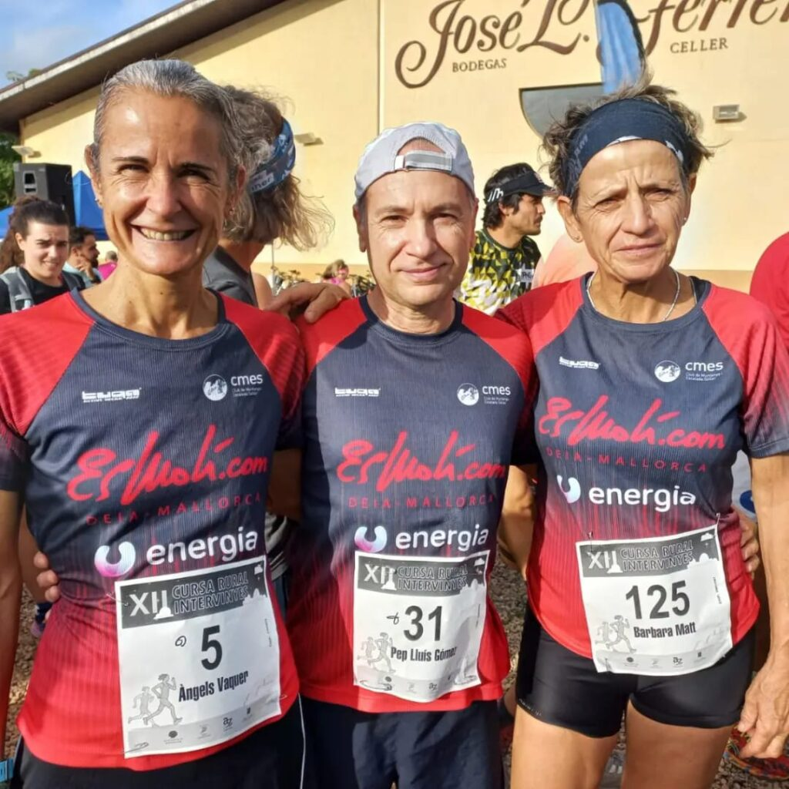
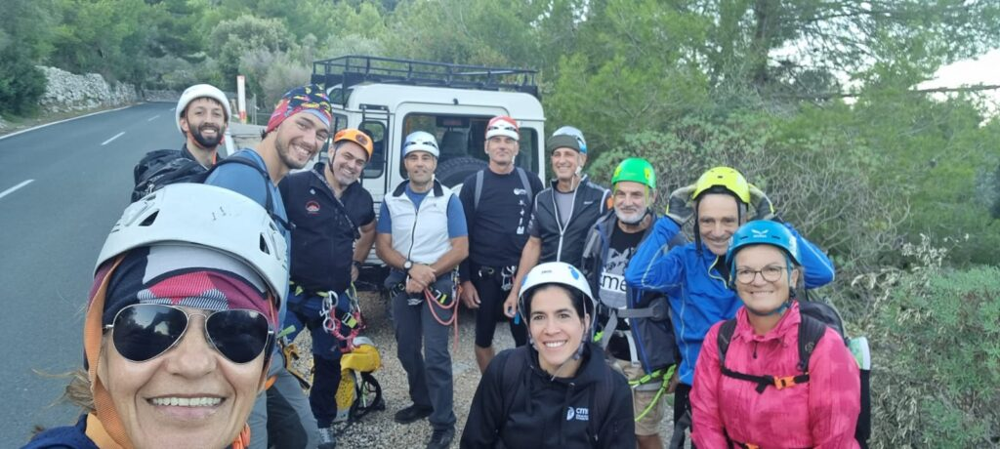
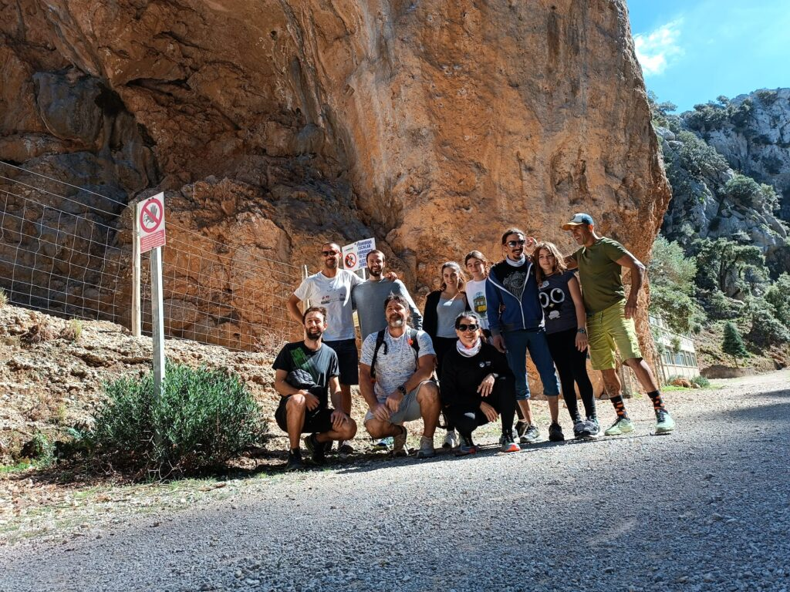

Dijous es va disputar la Cursa Rural Intervinyes. Aquest clàssica cursa que es duu a terme cada any a les bodegues José Luis Ferrer de Binissalem no va decebre i va atreure desenes de corredors que completaren el circuit de 6’5 quilòmetres.

Joan Torrens va demostrar el seu bon moment de forma en classificar-se entre els millors de la prova. Va ser el cinquè de la general absoluta després de completar els 6’5 quilòmetres del recorregut en un temps de 22:53.

Els corredors del CMES que participaren a la cita binissalemera foren els següents:

5.- Joan Torrens 22:53  
65.- Pep Lluís Gómez 27:46  
176.- Àngels Vaquer 32:50  
237.- Bàrbara Matt 35:15

Dos dies després, el torrent de Son Gallard, a la confluència entre els termes municipals de Deià i Valldemossa, fou l’escenari d’una sortida de la secció de Barranquisme.

Els socis que hi participaren gaudiren d’una gran matinal esportiva i de les vistes que ofereix aquest torrent cap a la costa. La cita va comptar amb la companyia del guia de barrancs Josep Homs que va acompanyar i donar suport al grup.

Finalment, diumenge dematí es va celebrar una nova activitat del calendari de la secció d’Escalada. El grup es va desplaçar fins el Gorg Blau per gaudir d’una experiència en les vies situades en el terme municipal escorquí. Fou una jornada ben entretenguda on tots els escaladors del CMES varen poder posar en pràctica la seva destresa.

