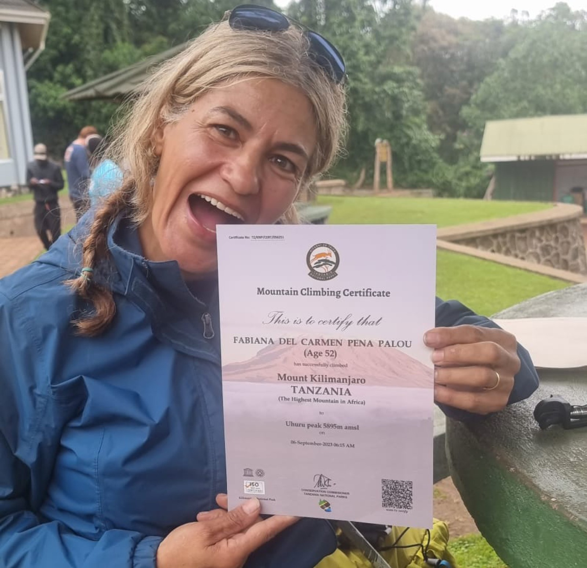
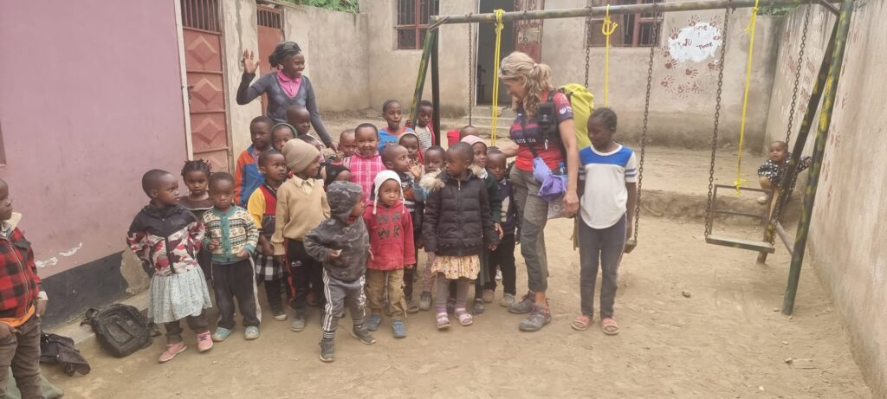
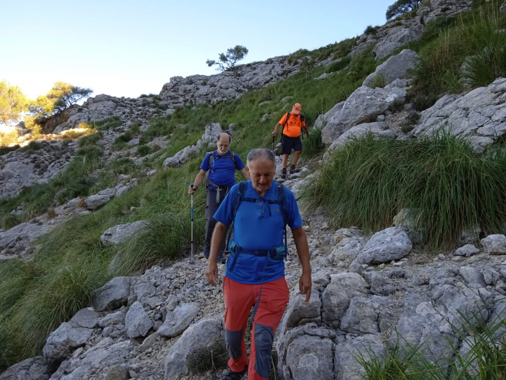

La nostra sòcia polivalent Fabiana Peña va participar dissabte a la nit als 10 quilòmetres de la Cursa Nocturna Sa Murada Ser Runner, disputada a la primera línia de la capital palmesana.

Es va situar a la posició 262 de la general i a la 45 de l’absoluta femenina. El cronòmetre marcava un temps de 57:30 en arribar a la línia d’arribada.

A més, aquesta setmana també hem fet pública l’aventura que ella mateixa ha protagonitzat aquest passat mes de setembre quan va viatjar a Tanzània per pujar fins el cim del Kilimanjaro, la muntanya més alta del continent africà.

Fabiana Peña va aconseguir el seu objectiu i va assolir els 5.895 metres en els que està situat el punt més alt del Kilimanjaro. Fou, sens dubte, una gran experiència per a ella mateixa.

Posteriorment, va aprofitar la seva estada al país africà per solidaritzar-se amb els més necessitats. Va visitar orfandats i col.legis de la zona on va conèixer quina és la realitat dels infants. També va tenir l’oportunitat de desplaçar-se fins a la tribu Masai.

Per altra banda, diumenge dematí la secció de Senderisme va organitzar la primera activitat del mes d’octubre. Fou amb una sortida circular que va començar i acabar a la barrera de Son Torrella, al costat de la boca del túnel de Monnàber.

El grup va avançar per la coma de Son Torrella fins a Ses Solanes. Es va superar el pas de s’Encletxa i, més tard, el pas de Sa Cabra. També es va aprofitar per visitar les coves den Pensó i el coval Simó.

Va ser un gran diumenge per descobrir alguns dels racons desconeguts que hi ha en el nostre entorn més proper.
