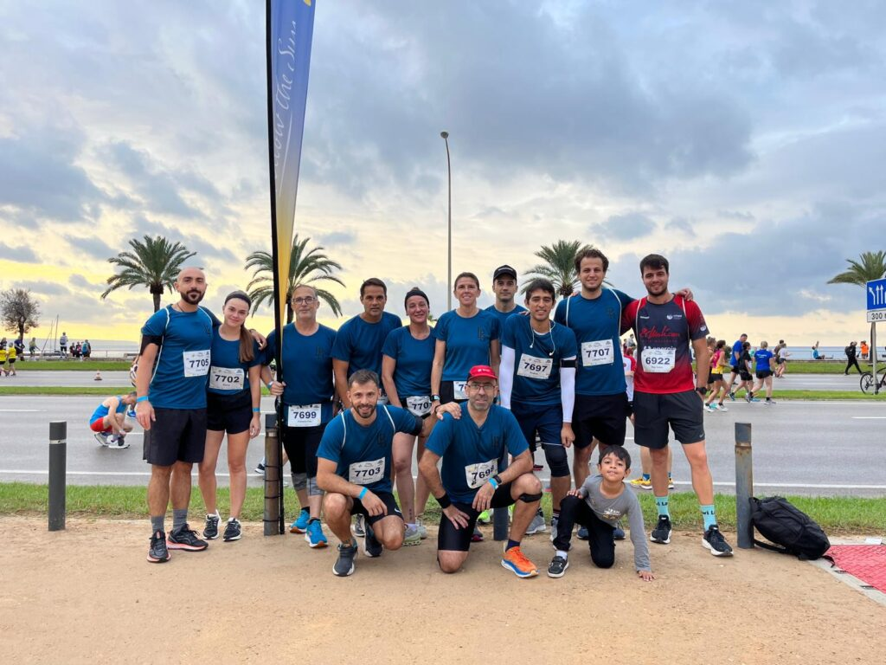

Cap de setmana competitiu amb les cites que diumenge dematí es celebraren a Alaró i a Palma.

A Alaró s’hi va disputar una nova edició de la Pujada al Castell d’Alaró organitzada pels nostres companys de Sa Milana. Sobre un recorregut de 14 quilòmetres, quasi dos centenars de participants gaudiren d’una matinal esportiva que va estar passada per aigua.

El nostre club va comptar amb cinc representants, essent Xim Borràs el millor classificat de tots ells. En Xim va aconseguir la sisena posició de la general.

Aquests foren els resultats dels corredors del CMES:

6.- Xim Borràs 1:17:40  
79.- Pep Lluís Gómez 1:38:56  
105.- Joan Vicens 1:45:20  
111.- Nico Coll 1:46:30  
123.- Àngels Vaquer 1:50:56

Per altra banda, diumenge també es va disputar la Palma Marathon Mallorca, una multitudinària cursa d’atletisme que va comptar amb centenars d’esportistes a les tres modalitats que s’organitzaren.

Fabiana Peña, Pep Salas i Tolo Seguí foren els tres corredors del CMES que disputaren la prova de 10 quilòmetres.

