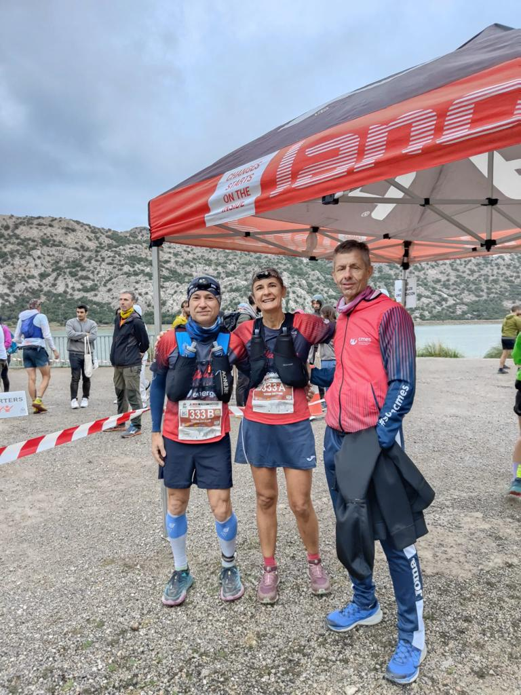
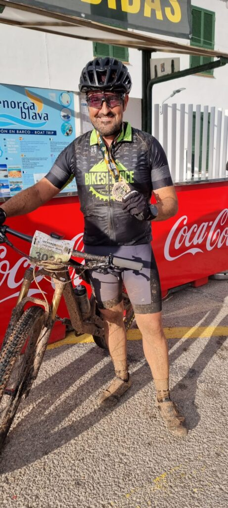

Cap de setmana multicompetitiu amb la disputa de dues proves molt esperades per als nostres corredors. A la Serra de Tramuntana s’hi va disputar dissabte la Mallorca 5.000, mentre que Menorca acollir la multitudinària October Trail.

Un any més la Mallorca 5.000 no ha defraudat a ningú. Els principals cims del sector nord de la Serra de Tramuntana han estat testimonis del pas de centenars de corredors disposats a completar un dur recorregut de 68 quilòmetres que presentava un desnivell positiu de 5.000 metres.

Amb sortida a Sóller i arribada a Pollença, nombrosos participants del nostre club no es varen voler perdre la possibilitat d’escriure el seu nom a la llista de finishers de la prova. I, a més, ho feren amb grans resultats i complint amb els objectius personals que s’havien marcat.

Aquesta fou la classificació dels participants del CMES:

35.- Dani Martí 11:54:28  
39.- Dani Rodríguez 11:58:28  
104.- Xevi Nieto 14:34:43  
124.- Marga Bestard 15:51:54

Na Marga Bestard va assolir la segona posició de la seva categoria d’edat. Amb la seva gran actuació va ser la segona classificada de la categoria Veteranes 50, i també es va fer amb el subcampionat de Balears de Ultra Distància.

En la modalitat d’equips de relleus també vàrem comptar amb representació de corredors de la família del CMES. Àngels Vaquer, Pep Lluís Gómez i Joan Pere Isern completaren per aquest ordre els tres segments de la prova. Amb un temps de 13:16:54 es situaren a la posició 53 de la classificació general.

Enguany la cita va comptar amb l’estrena de la Mallorca 1.000, una prova de 14 quilòmetres que es va disputar amb sortida i arribada al Coll de Sa Batalla. Els corredors havien de pujar fins el Prat de Massanella i baixar per les Voltes den Galileu.

En aquesta modalitat vàrem comptar enguany amb la participació de Salvador Martí, qui amb un temps de 2:08:24 es va classificar en una gran 60ena posició a la general de la prova.

A Menorca, la pluja va afectar el desenvolupament de totes les proves de la October Trail. Els participants es trobaren amb un recorregut banyat i amb presència de fang en molts dels seus sectors.

La cursa de 19 quilòmetres, amb sortida a Cala Mitjana i arribada a Calan Bosch, va ser la que més participants del CMES va reunir. Joan Torrens va ser el millor classificat de tots ells, aconseguint una gran setena posició a la general de la prova.

Aquesta fou la classificació de tots ells:

7.- Joan Torrens 1:23:56  
13.- Ramon Morey 1:29:16  
22.- Dani Vidal 1:32:42  
45.- Jaume Arbona 1:41:28  
53.- Pep Salas 1:43:24  
154.- Toni Gamundí 1:59:08  
296.- Deborah Gruaz 2:18:59  
313.- Brais Chaves 2:21:25

En la modalitat de 32 quilòmetres, amb inici a Son Bou i final també a Calan Bosch, Juan Simón es va convertir en finisher després d’invertir un temps de 4:22:16 en completar el recorregut. A la classificació general es va situar a la posició 189.

I per acabar, també vàrem comptar amb un representant a la prova ciclista, l’October Bike. En aquesta modalitat, Diego Delgado es va classificar a la posició 69 d’una prova que recorria un itinerari de 32 quilòmetres. En Diego va gaudir d’aquest tram de la zona sud del Camí de Cavalls. Va invertir un temps de 4:13:45 en completar la distància.

