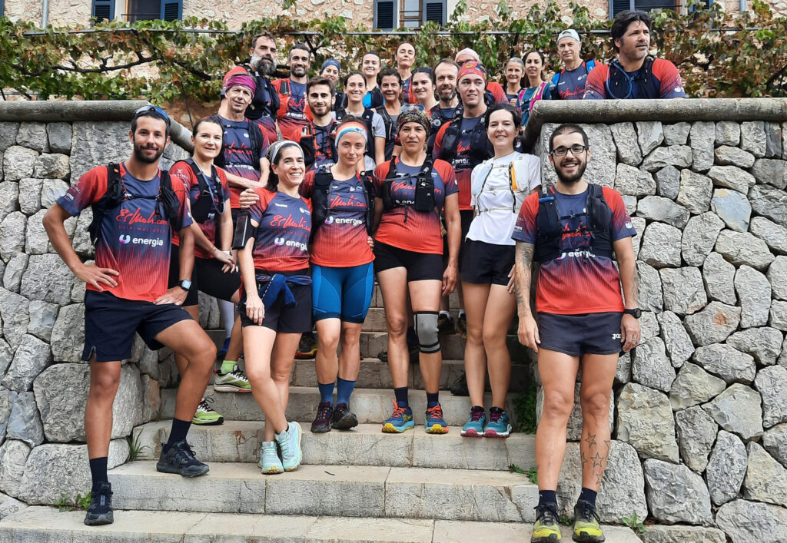
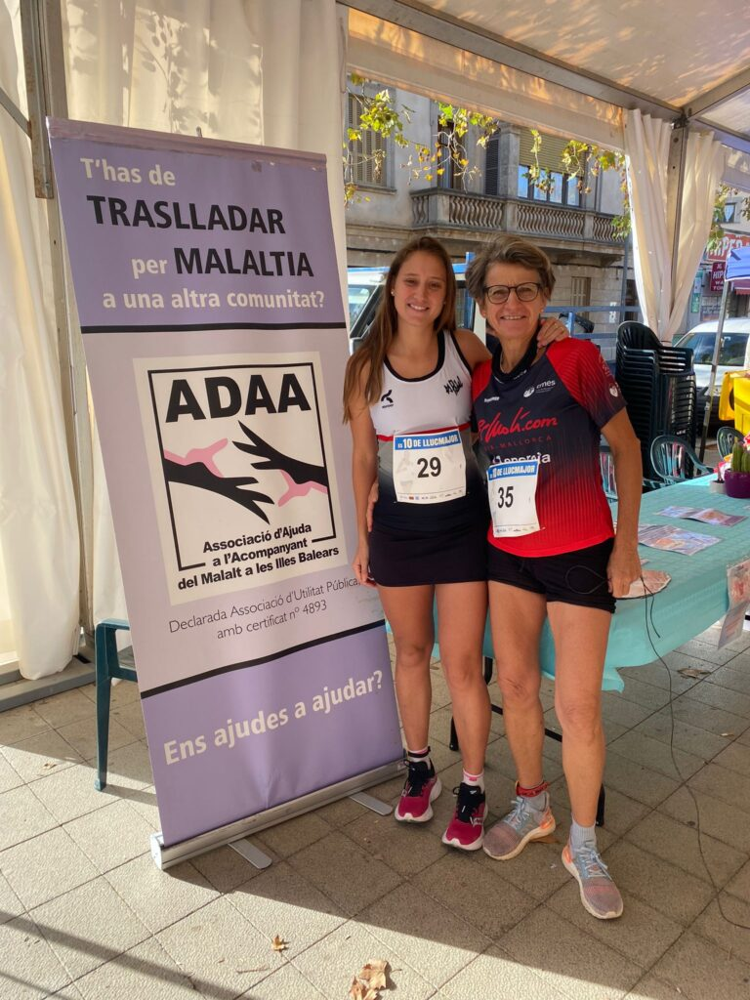

La crònica del cap de setmana s’ha basat en aquesta ocasió en la sortida que va organitzar la secció de Curses i en la participació de Bàrbara Matt a la prova Els 10 de Llucmajor.

A la sortida de diumenge el grup va transitar per terres escorquines. Concretament, amb inici i final a l’aparcament de la Font des Noguer, es va completar un recorregut circular d’uns 12 quilòmetres.

El grup va començar el recorregut pujant la Coma dels Ases. Després es va baixar cap el Pas Llis i es va continuar fins el refugi de Tossals Verds. A continuació es va seguir en direcció a la font del Prat i el coll dels Coloms, per completar l’entrenament pel costat de la canaleta de l’embassament.

A Llucmajor, Bàrbara Matt va participar a la cursa de 10 quilòmetres que es va disputar a benefici de l’Associació d’Ajuda a l’Acompanyant del Malalt a les Illes Balears (ADAA). Va aconseguir completar la cursa a la posició 58 de la general i a la primera de la seva categoria d’edat. Emperò, diumenge el més important no eren les posicions i sí la causa benèfica de l’esdeveniment.
