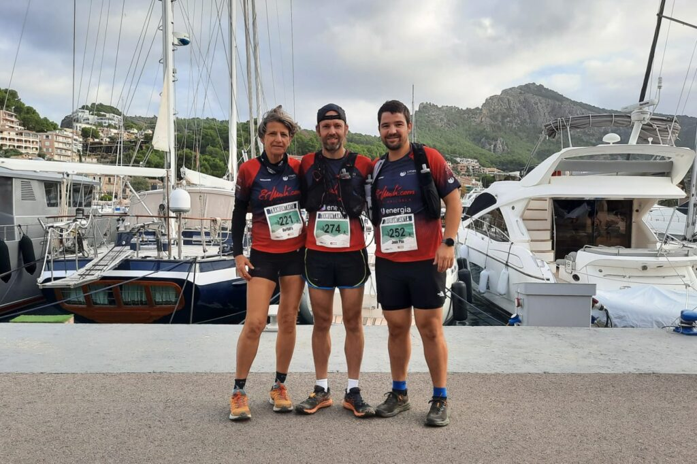
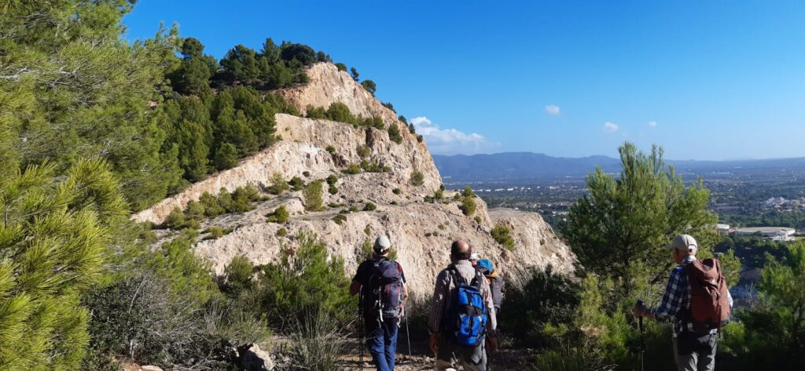

Nombrosos corredors del nostre club han participat a la primera edició de la Tramuntanya, una cursa de nova creació que dissabte es va estrenar pels camins de la nostra vall.

Amb recorreguts de 27 i 14 quilòmetres per a les modalitats de cursa a peu, i de 27 quilòmetres per a la prova en bicicleta, l’esdeveniment va tenir el seu epicentre en el Port de Sóller.

A la prova de 27 quilòmetres, Joan Vicens fou el més ràpid de la representació del CMES. Va completar el recorregut en un temps de 2:27:55, classificant-se a la cinquena posició de la general.

I en la prova de 14 quilòmetres, Pere Estarellas va ser el corredor del CMES més ràpid en completar el recorregut d’aquesta modalitat. També es va classificar a la cinquena posició, acabant la cursa en un temps de 1:16:32.

Aquesta fou la classificació de tots els corredors del club:

CURSA TRAMUNTANYA LONG – 27 QUILÒMETRES

5.- Joan Vicens 2:27:55  
53.- Bàrbara Matt 3:25:22  
65.- Joan Pau Mayol 3:53:45

CURSA TRAMUNTANYA SHORT – 14 QUILÒMETRES

5.- Pere Estarelles 1:16:32  
8.- Toni Pomar 1:17:12  
20.- Jaume Arbona 1:25:37  
51.- Monika Gaska 1:38:29  
79.- Xisca Coll 1:45:10  
94.- Aina Forteza 1:50:14  
101.- Fabiana del Carmen 1:54:17  
106.- Oana Oancea 1:57:04  
120.- Mireia Ventura 2:09:13  
127.- Maria Socias 2:11:10

Per altra banda, la secció de Senderisme va aprofitar la jornada de diumenge per realitzar una nova sortida del seu calendari d’activitats. Concretament, el grup es va desplaçar fins a Palma per recórrer les muntanyes situades a la zona nord de la capital.

Amb sortida i arribada a l’aparcament del cementeri de Sa Vileta el grup de senderistes del CMES va transitar pel polvorí de Bellagré, les pedreres de Sa Garrigueta Rasa, la cova dels cavalls, la dolina anomenada “vall del silenci”, el coll den Marill, el puig de Sa Coma Fosca, el puig des Revell i les coves del Pilar.

Va ser una caminada ben agradable per una zona sense dificultat tècnica, en la que es va conèixer una zona poc coneguda d’aquesta àrea situada prop del terme municipal de Puigpunyent.
