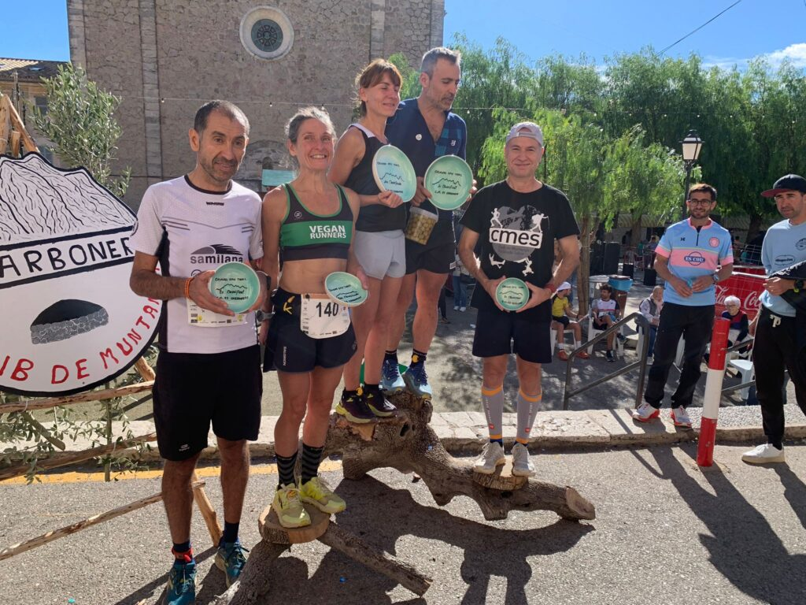
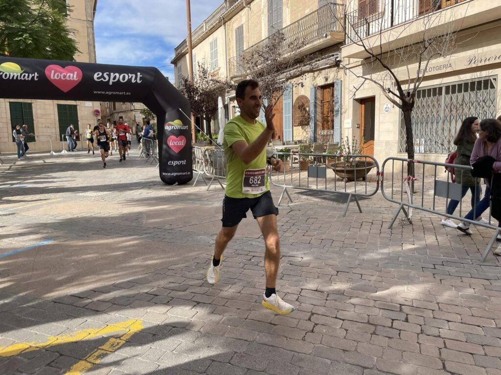

Nou cap de setmana esportiu per als socis del club. En aquesta ocasió amb presència a la cursa Caimari Epic Trail i a la prova per asfalt de la Mitja Marató de Porreres.

A Caimari, els participants varen gaudir d’un recorregut de 24 quilòmetres i 1.350 metres de desnivell positiu que havia preparat el club Es Carboners. Bona organització, bon ambient i una bona jornada de muntanya per a tots els assistents.

En aquesta ocasió, el CMES va comptar amb tres representants a la prova: Pep Lluís Gómez, Àngels Vaquer i Bàrbara Matt. D’ells tres, dos aconseguiren pujar al podi en la seva categoria d’edat. Pep Lluís Gómez ho va fer com a tercer classificat de la categoria M50, mentre que Bàrbara Matt fou la primera en F55. A més, Àngels Vaquer es va quedar a només set segons de pujar al podi en la seva categoria. Al final, fou la quarta classificada.

A la classificació general, els resultats dels tres corredors del CMES foren els següents:

86.- Pep Lluís Gómez 3:24:54  
108.- Àngels Vaquer 3:37:20  
114.- Bàrbara Matt 3:46:54

Paral.lelament, a Porreres el nostre socis Joan Roig va participar a la prova de 10 quilòmetres de la Mitja Marató que va acollir aquesta localitat.

En Joan va completar els 10.000 metres del recorregut en un temps de 43:39, que li va significar la posició 51 a la classificació general de la prova.
