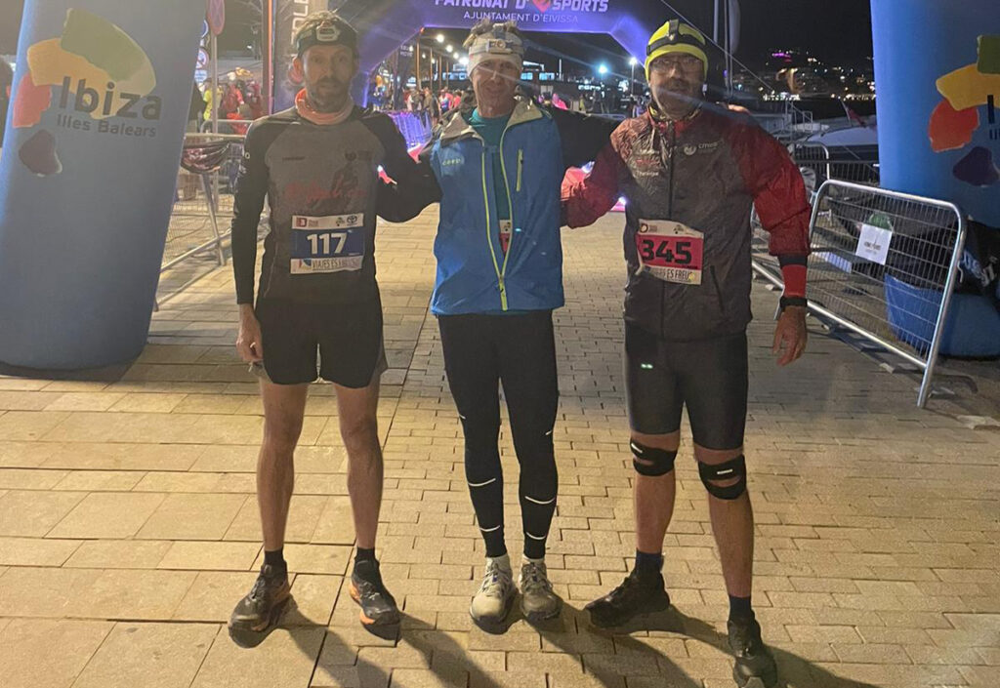
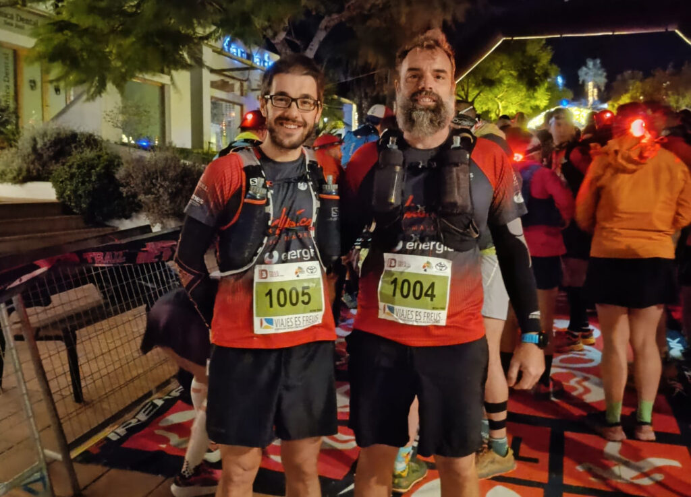
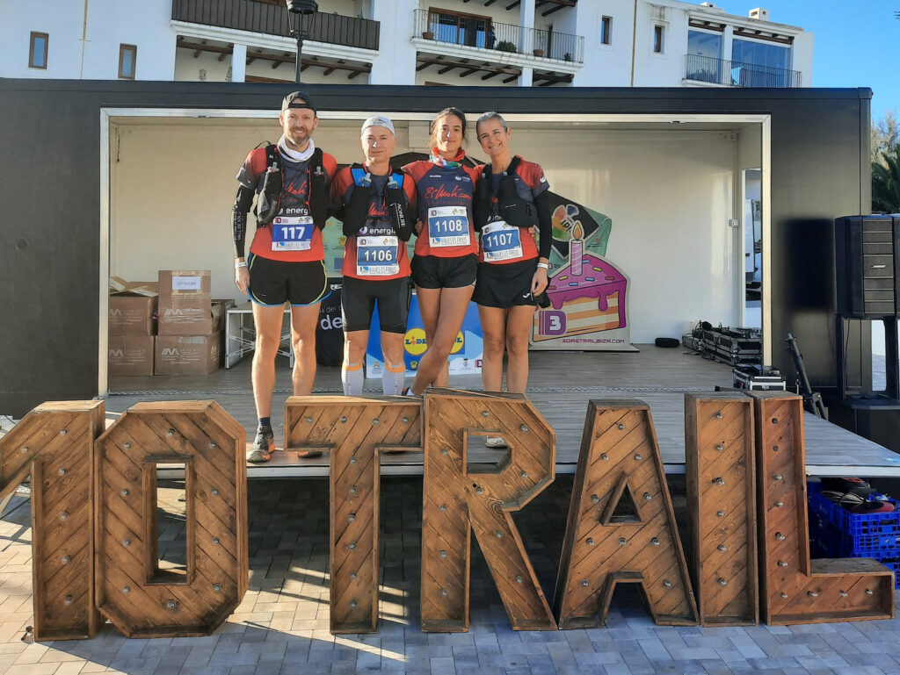
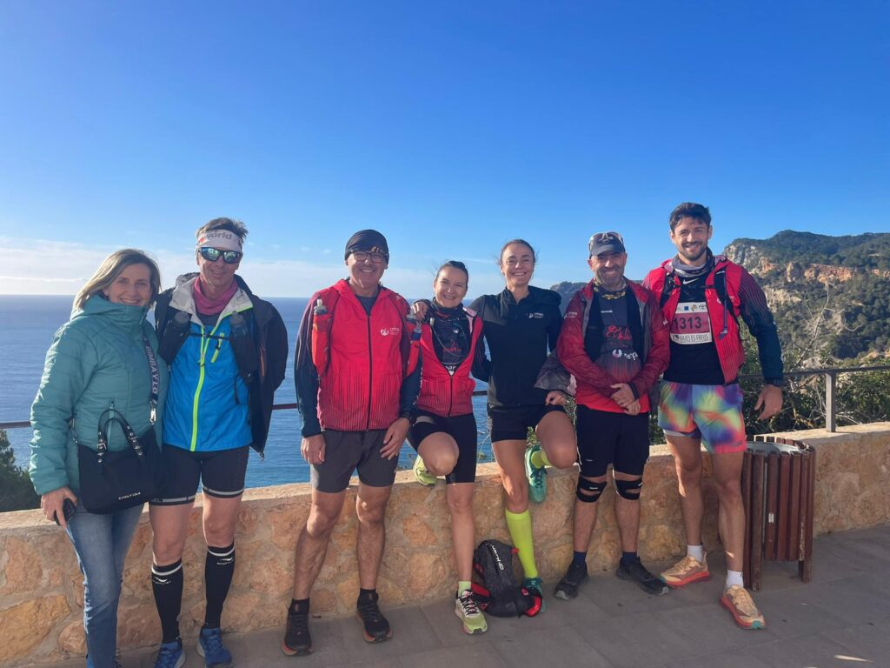
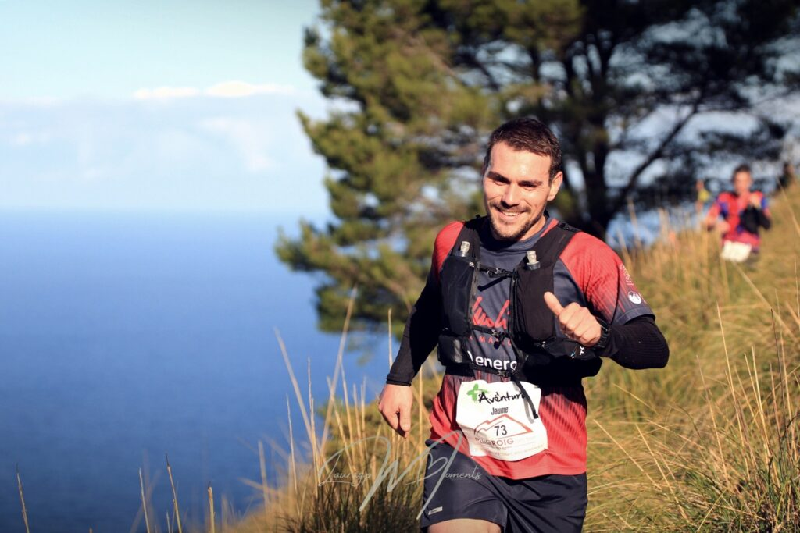
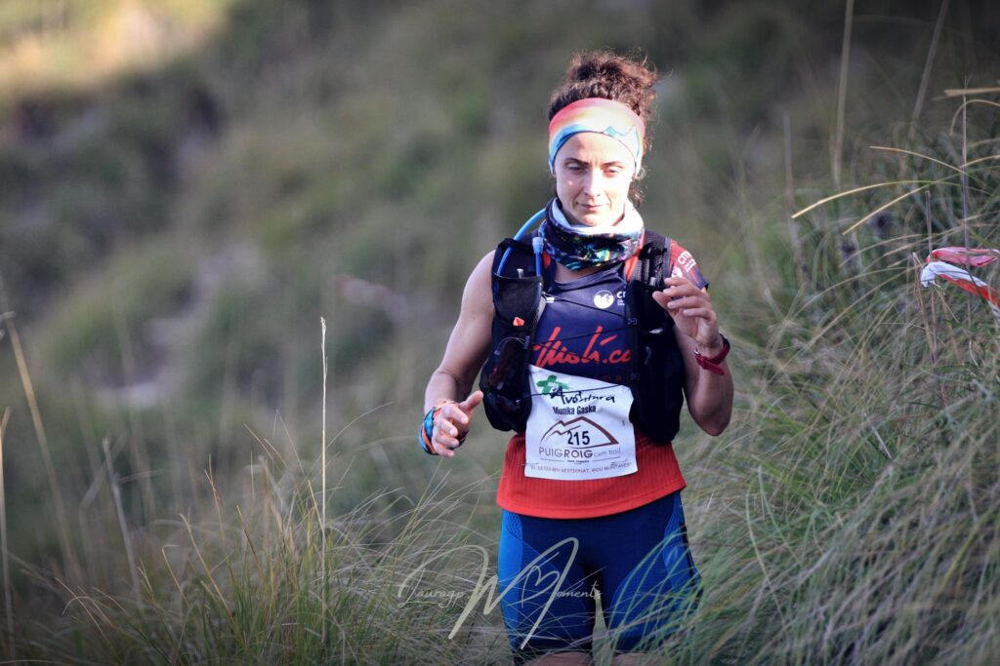

Onze corredors de la secció de Curses, amb varis acompanyants que els donaren suport, es desplaçaren el passat divendres fins a Eivissa per participar a la prova per etapes que cada mes de desembre es disputa a diversos punts de la Pitiüsa Major.

La cita va començar el divendres a la nit amb una etapa nocturna de 10 quilòmetres a través dels carrers empedrats de Dalt Vila i un tram de penya-segats vora la costa. Aquesta primera jornada va estar marcada pel vent que bufava i per les baixes temperatures.

Dissabte, segona jornada de la competició, els participants de la cursa per etapes havien d’escollir la distància del recorregut: 10 quilòmetres, 21 quilòmetres, 42 quilòmetres o 74 quilòmetres. La localitat de Sant Josep va ser l’epicentre de l’activitat. Allà acabaren totes les distàncies que varen estar marcades per la duresa i per la tecnicitat d’alguns trams dels recorreguts dissenyats per l’organització.

I, finalment, diumenge es va disputar la darrera etapa. Els participants varen haver d’afrontar novament un recorregut de 10 quilòmetres per la costa de Santa Eulàlia del Riu.

Joan Vicens, Joan Pere Isern i Tolo Seguí optaren per participar a la cita completant les tres etapes. La competició també permetia només competir el dissabte en una única etapa. Fou aquesta la modalitat escollida per Dani Rodríguez, Nico Coll, Yael Sprauel, Pep Lluís Gómez, Àngels Vaquer, Xisca Coll, Salvador Martí i Oana Oancea.

Aquests foren els resultats aconseguits per tots ells en els que cal destacar el podi absolut femení de Yael Sprauel a la marató o els podis de categoria d’edat que aconseguiren Àngels Vaquer i Joan Pere Isern:

3 dies modalitat marató (10 + 42 + 10 km)

17.- Joan Vicens 6:58:33

3 dies modalitat mitja marató (10 + 21 + 10 km)

68.- Joan Pere Isern 5:52:06  
98.- Tolo Seguí 6:25:48

1 dia modalitat Ultra (74 km)

26.- Dani Rodríguez 9:31:12  
74.- Nico Coll 12:15:54

1 dia modalitat marató (42 km)

29.- Yael Sprauel 5:11:07  
38.- Pep Lluís Gómez 5:24:45  
77.- Àngels Vaquer 6:24:51

1 dia modalitat mitja marató (21 km)

100.- Xisca Coll 3:17:13  
118.- Salvador Martí 3:29:05  
128.- Oana Oancea 3:33:08

Paral.lelament, a Mallorca es va disputar la darrera prova del calendari de 2023 de la Federació Balear de Muntanyisme i Escalada. El Santuari de Lluc fou l’epicentre de la cursa Trail Puig Roig, una prova de 22 quilòmetres que permet recórrer en format de competició la tradicional volta a aquest mític cim escorquí.

Jaume Arbona i Monika Gaska foren els representants del CMES a la cursa. En Jaume es va classificar a la posició 55 de la general amb un temps de 2:10:46, mentre que na Monika fou la 139ena classificada després de creuar la línia d’arribada en un temps de 2:37:39.

La cita organitzada pel Club Sa Riba també va comptar enguany amb l’estrena d’una prova de 10 quilòmetres denominada La Vall d’Albarca.

Foto: Lauragp.moments

Foto: Lauragp.moments
