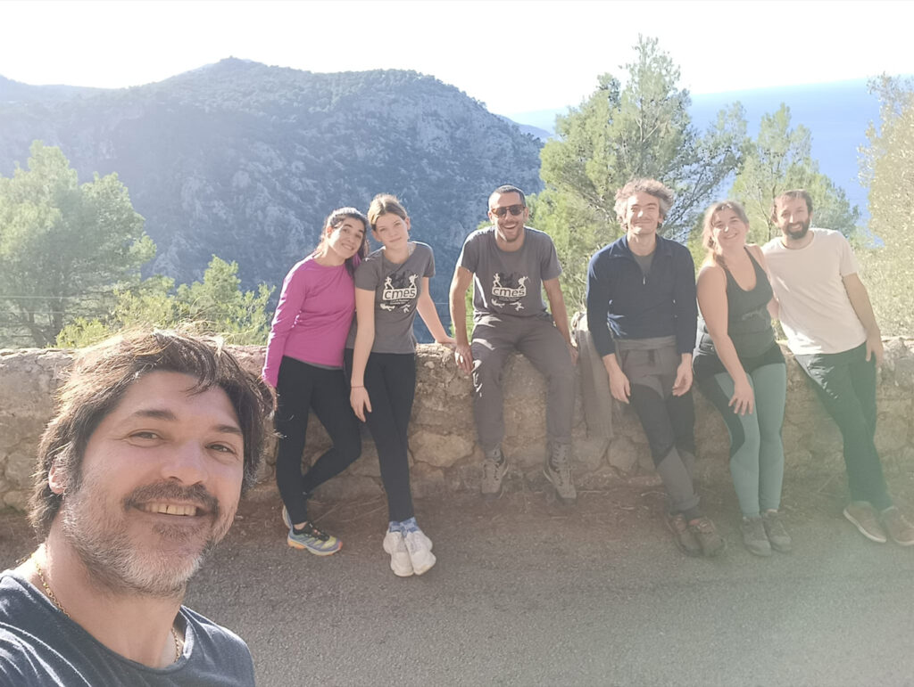

El cap de setmana esportiu es va integrar dins el llarg pont que vàrem viure des de mitjans de la setmana passada. En aquest sentit, aprofitant la jornada festiva de divendres es va disputar la cinquena edició de la Cursa des Tro.

El centre de Vilafranca de Bonany va ser un any més l’escenari de la sortida i l’arribada de les dues modalitats de cursa que l’organització havia preparat. En la prova de 6’7 quilòmtres hi va participar el nostre corredor Xim Borràs, qui després d’una gran cursa va aconseguir proclamar-se guanyador.

Ho va fer amb un temps de 25:42 per superar en quasi un minut a Pedro Bonnín, el segon classificat (26:34). Mathieu Galland (27:10) va ser el tercer classificat.

L’activitat esportiva del cap de setmana es va completar diumenge amb una sortida de la secció d’Escalada al Port de Valldemossa. Allà, a les vies que hi ha al costat de la carretera, escaladors novells i altres més experimentats compartiren un assolejat diumenge d’aprenentatge.

