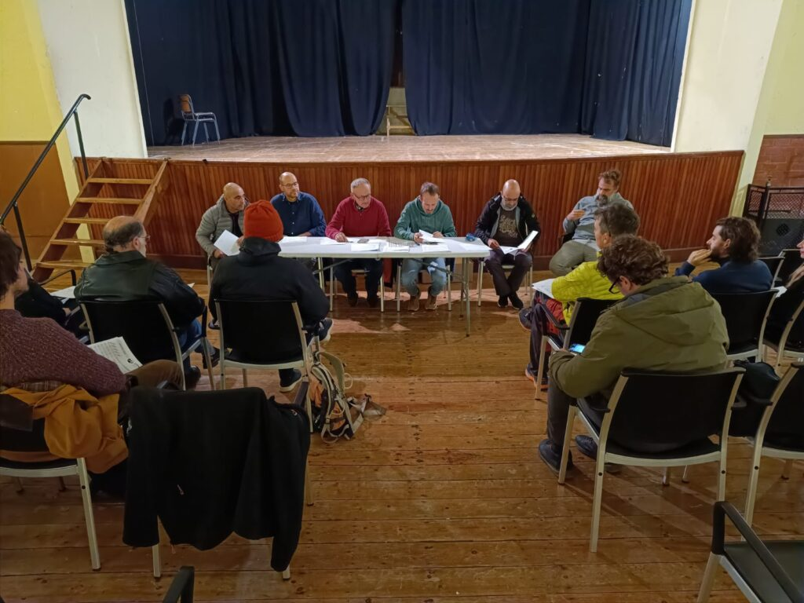

El cap de setmana ha estat marcat pel final de curs que ha celebrat el club. Just abans de les festes de Nadal el CMES ha reunit els socis en el tradicional dinar que cada any es celebra per aquestes dates.

El llarg cap de setmana va començar dijous amb la celebració de l’assemblea ordinària de socis. El teatre del C.P. Victòria va acollir la sessió en la que la junta directiva va donar compte de l’estat del club, va presentar la memòria d’activitats i es varen aprovar els comptes i el pressupost. També va ser el moment en el que cada secció va presentar els projectes que veuran la llum durant el proper 2024.

Ja diumenge, abans d’anar a dinar i per entrar en gana, cada secció va organitzar activitats per l’entorn de la nostra vall. La secció de Curses i la secció de Senderisme realitzaren recorreguts circulars en itineraris de baixa muntanya, mentre que la secció d’Escalada va compartir un dematí de pràctiques a les vies del Port de Sóller.

Més tard, el nostre soci i directiu Xisco Martorell ens va oferir dues suculentes paelles que es menjaren al pati del Victòria. Allà mateix també es va repartir el regal que la junta directiva ha preparat enguany per als socis del club i es va celebrar un sorteig entre els presents.
