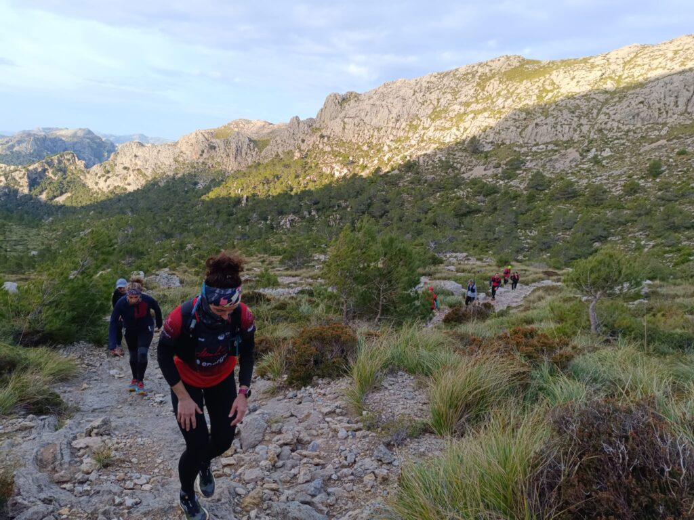

Passades les festes de Nadal, Cap d’Any i Reis, el club ha reprès la seva activitat setmanal. El rocòdrom, el gimnàs i l’àrea de pràctiques d’escalada del local social ha recuperat l’horari habitual d’obertura i les seccions han començat a preparar activitats per als nostres associats.

El cap de setmana va començar amb el lliurament de premis als millors corredors de 2023. La Gala de Muntanyisme organitzada per la Federació Balear de Muntanyisme i Escalada es va celebrar per segon any consecutiu al teatre de Peguera.

Allà hi foren presents els nostres corredors per recollir els premis de la Copa Balear de Curses per Muntanya 2023 i de la Copa Balear de Cronoescalada i Quilòmetre Vertical 2023. Àngels Vaquer, Bàrbara Matt, Fabiana Peña i Pep Lluís Gómez pujaren a l’escenari a recollir els seus guardons.

L’acte també va comptar amb la presència del president del club, Tomeu Muntaner, que va acompanyar personalment als premiats en aquesta gala.

Diumenge, la secció de Curses va organitzar la seva primera sortida del nou curs. Els corredors completaren un tram de la Cursa Serra Nord que es disputarà entre Sóller i Pollença el darrer cap de setmana de gener. Concretament, amb sortida i arribada a l’aparcament de la Font des Noguer, el grup es va dirigir cap a la font del Prat i, seguidament, fins el Coll del Prat de Massanella. Des d’allà retornaren al punt inicial per donar per conclòs aquest entrenament.
