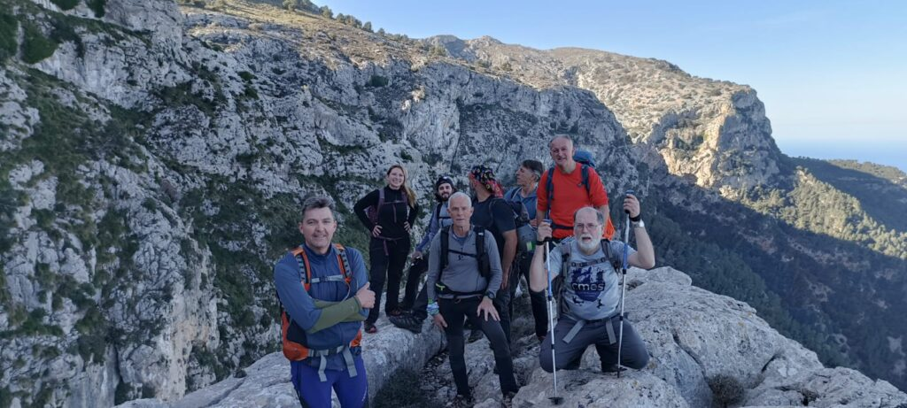
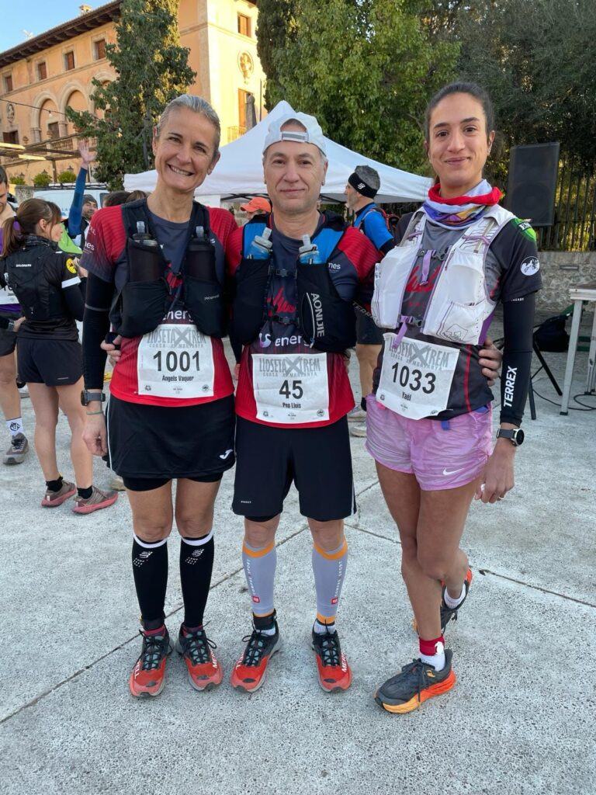
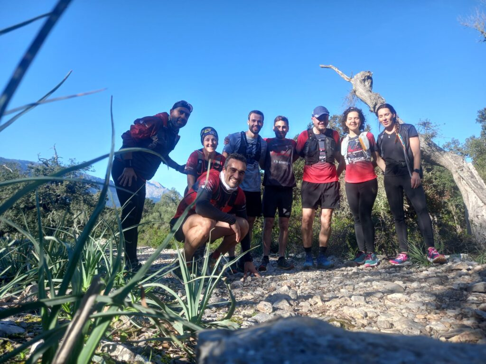

Un altre cap de setmana ple d’activitat per als socis del CMES. En aquesta ocasió, l’activitat es va centrar durant la jornada de diumenge, amb sortides organitzades per les seccions de Senderisme i Curses, i amb la disputa de la Lloseta Xtrem.

La secció de Senderisme va organitzar una de les clàssiques del seu calendari. Els socis completaren una sortida a través dels passos de muntanya que envolten el poble de Deià. Amb inici i final a l’aparcament municipal, el grup va recórrer el pas des Falcó, el pas de Sa Pintella o den Caleu i el pas Vell de Son Ripoll, entre d’altres. Fou una sortida d’alt nivell en la que es va poder gaudir de la muntanya més pura.

A Lloseta es va encetar l’edició de 2024 de la Copa Balear de Curses per Muntanya. Tres corredors del club s’hi personaren per completar un recorregut de 32 quilòmetres que havia dissenyat el Clubs Esports Altura.

Àngels Vaquer i Pep Lluís Gómez aconseguiren pujar al podi de les seves categories d’edat. N’Àngels va ser la segona classificada, mentre que en Pep Lluís va ocupar el tercer escaló. Yael Sprauel els va acompanyar en aquesta dura cursa, essent la quarta classificada de la categoria sènior femenina.

Concretament, aquests foren els resultats que aconseguiren a la classificació general:

92.- Yael Sprauel 3:56:22  
93.- Pep Lluís Gómez 3:56:22  
130.- Àngels Vaquer 4:29:34

I, finalment, un grup de corredors de la secció de Curses es va traslladar fins a Lluc per conèixer l’itinerari en el que el proper diumenge s’hi disputarà la cursa Lluc Trail. Completaren un recorregut de 12 quilòmetres amb inici i final a la plaça dels Peregrins de Lluc.

