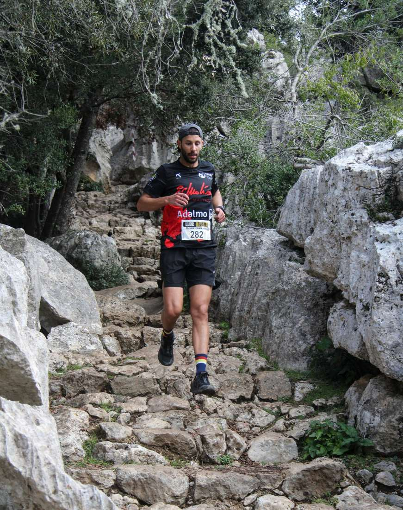
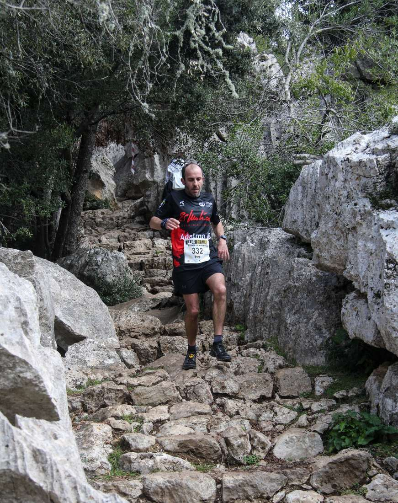
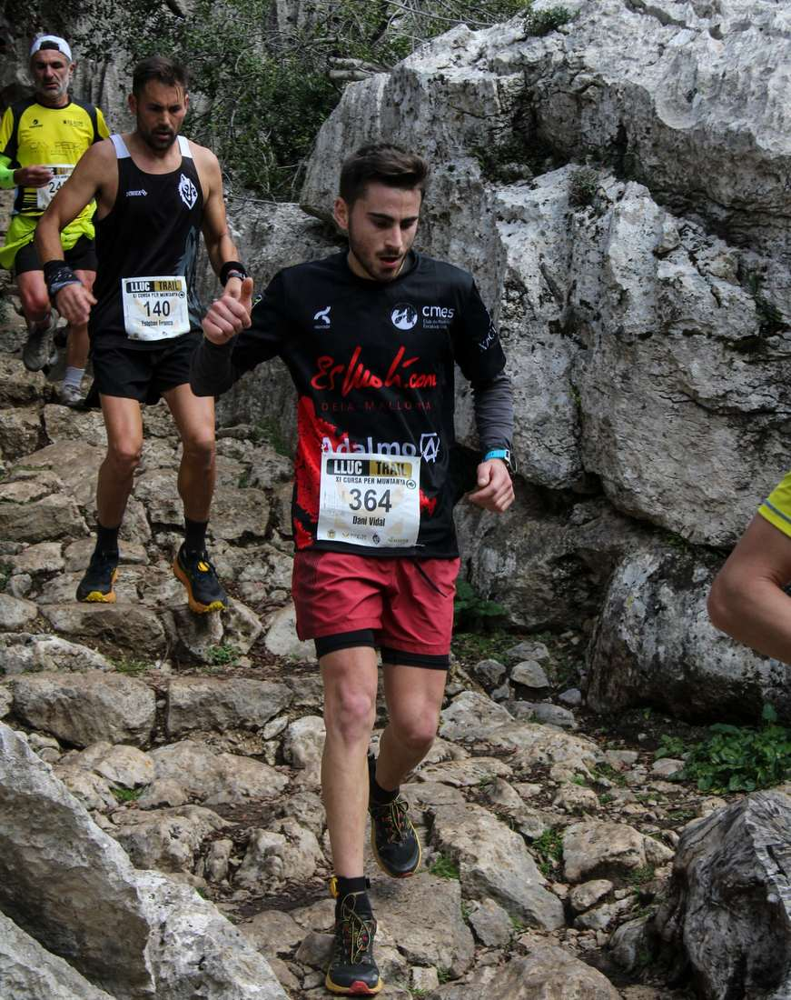
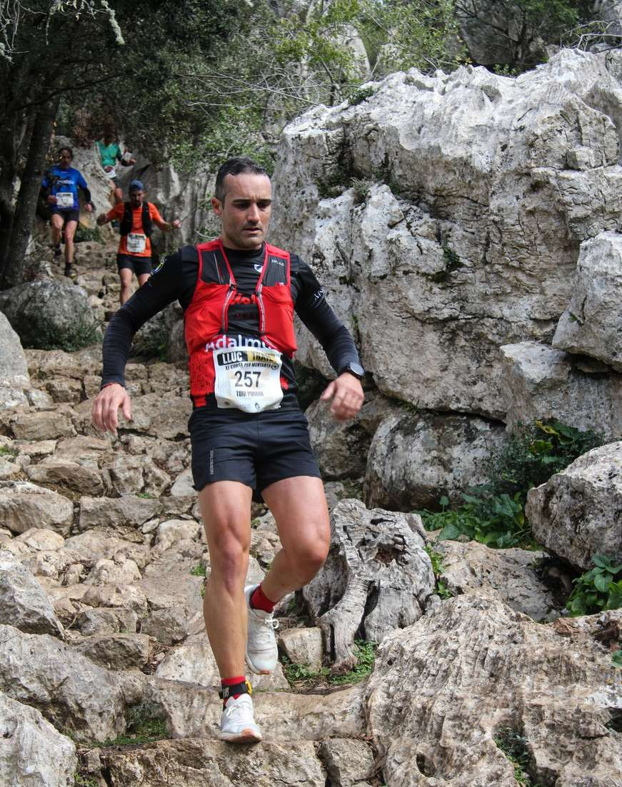
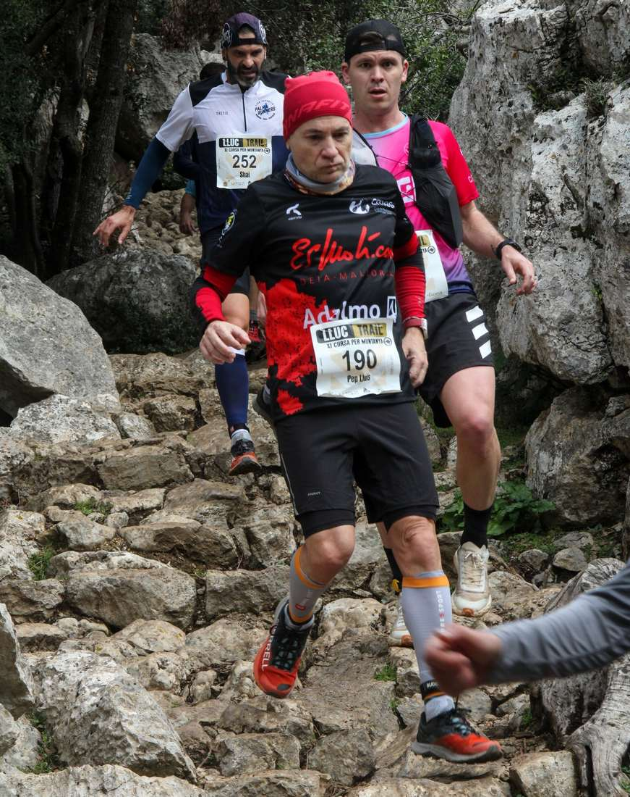
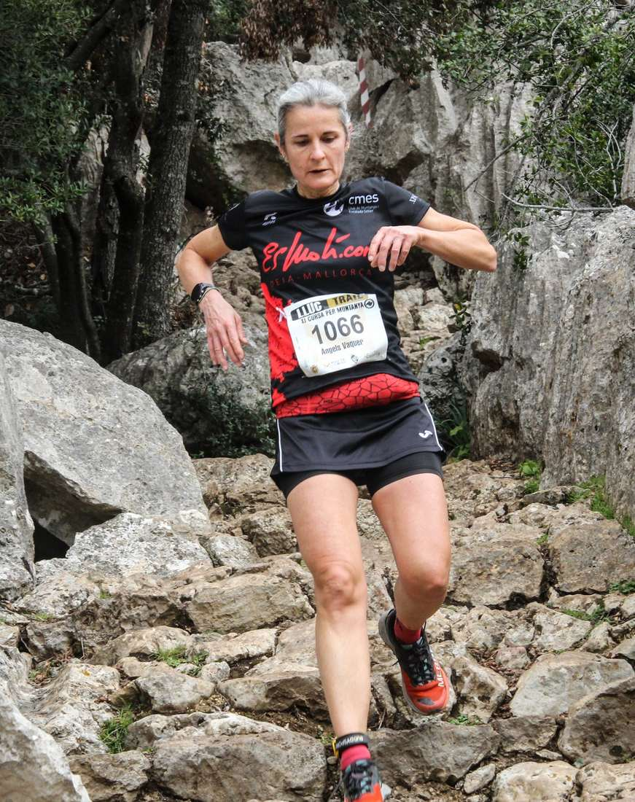
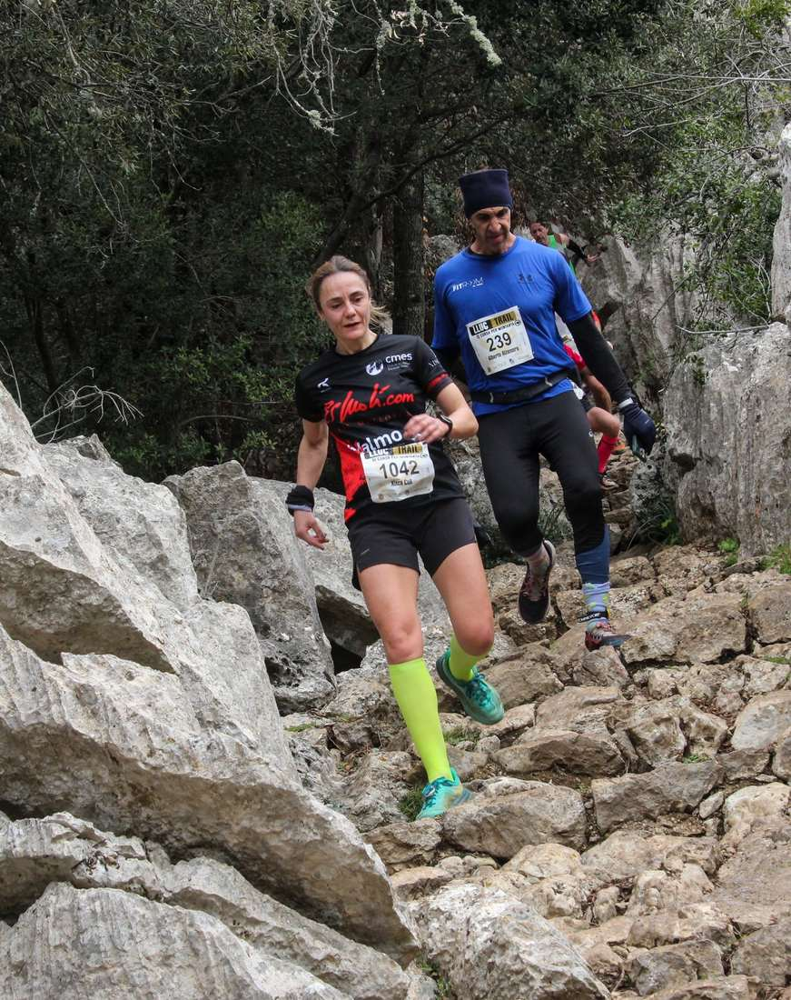
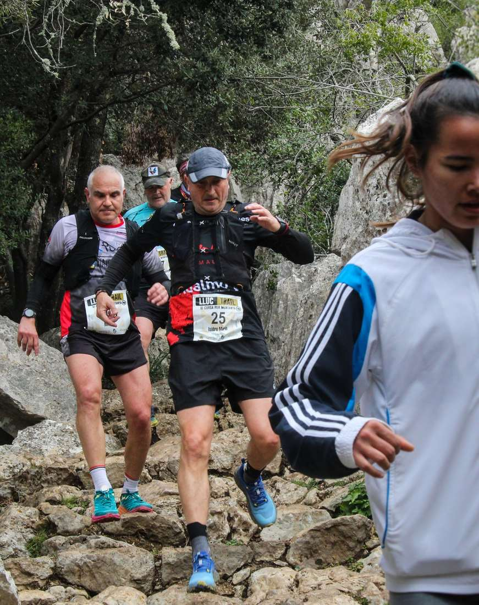
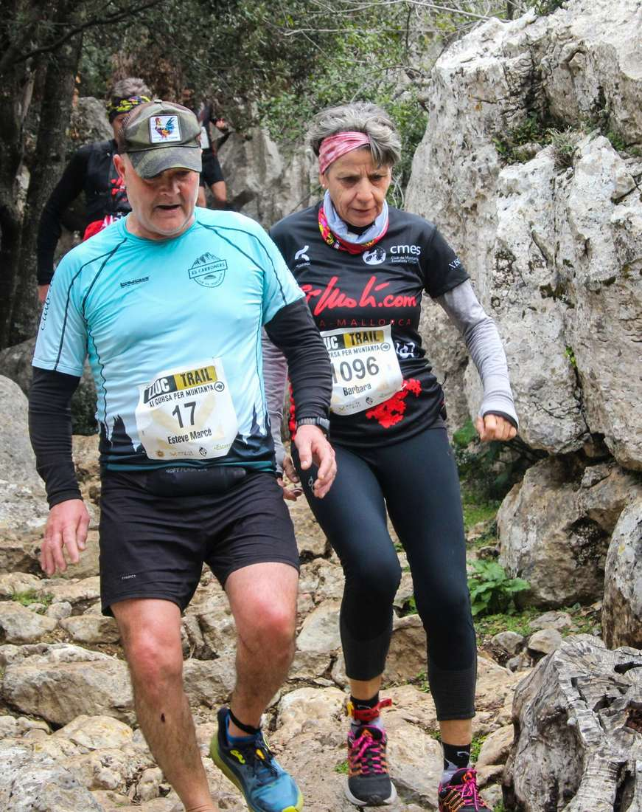

Grans resultats dels corredors del CMES a la massiva cursa Lluc Trail que s'ha disputat avui dematí sobre un recorregut d'11 km per l'entorn del Santuari de Lluc.

Joan Torrens s'ha quedat a les portes del podi, després de classificar-se a la quarta posició de la general absoluta, mentre que Xim Borràs ha estat el sisè.

Però tots els participants han gaudit del recorregut i d'un diumenge d'esport a la muntanya. Aquests han estat els resultats aconseguits per tots ells:

4.- Joan Torrens 48:14

7.- Xim Borràs 48:55

24.- Pere Estarelles 53:03

39.- Dani Vidal 55:54

54.- Toni Pomar 56:59

130.- Pep Lluís Gómez 1:03:58

203.- Àngels Vaquer 1:11:18

236.- Xisca Coll 1:13:42

256.- Isidro Marín 1:15:28

259.- Bàrbara Matt 1:15:39

261.- Juan Pedro Isern 1:15:39

296.- Tolo Seguí 1:18:28

299.- Salvador Martí 1:18:38

311.- Aina Estarelles 1:19:32

333.- Oana Oancea 1:21:55

388.- Maria de Lluc Socias 1:29:51

396.- Diego Delgado 1:30:34

A més, els corredors del CMES han comptabilitzat fins a set podis en aquesta cursa:

Joan Torrens 🥇V30

Xim Borràs 🥉V30

Pere Estarelles 🥉V40

Dani Vidal 🥈S23

Àngels Vaquer 🥇V50

Bàrbara Matt 🥇V60

Aina Estarelles 🥈V55

