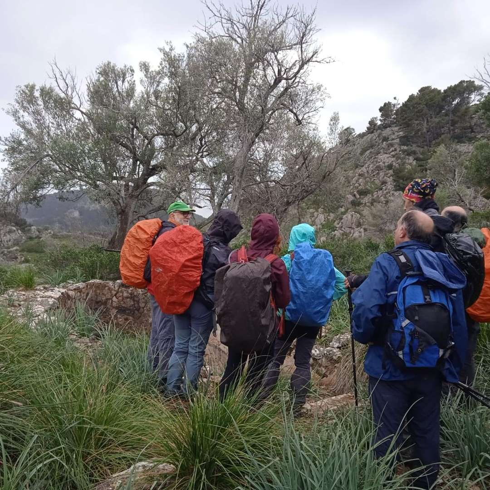
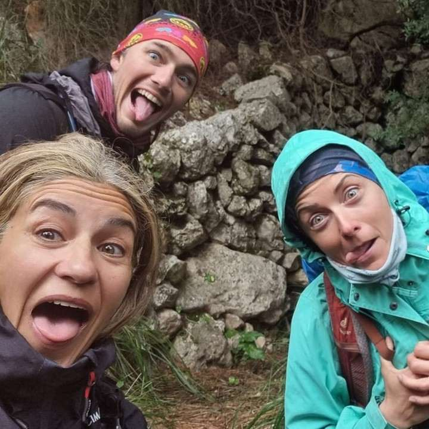
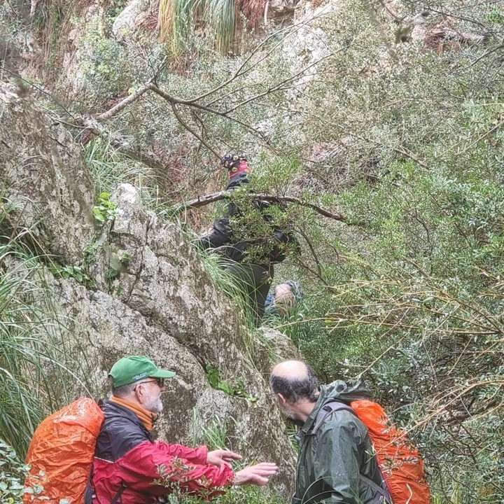
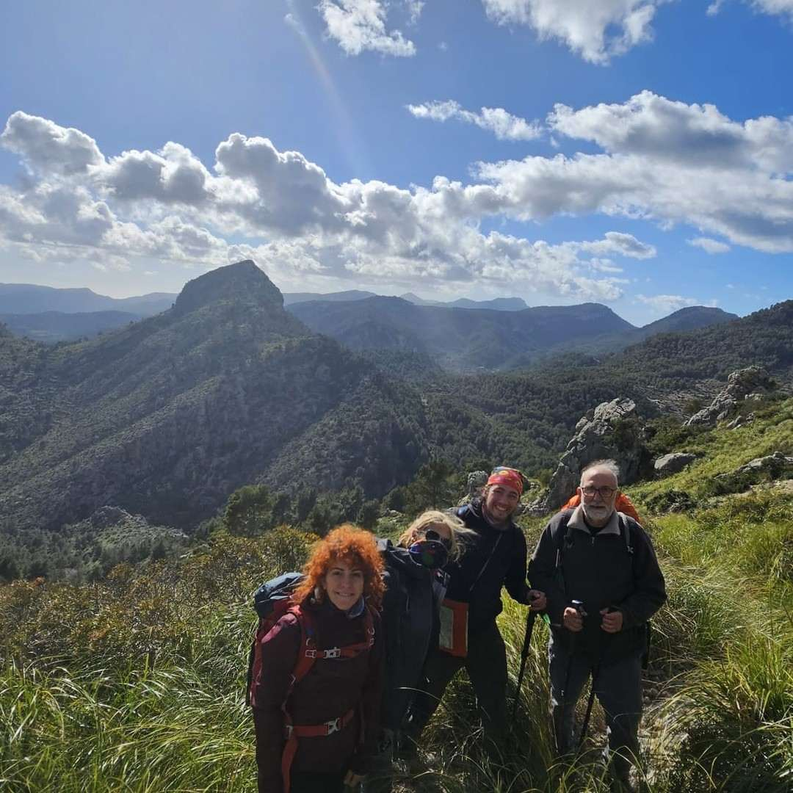
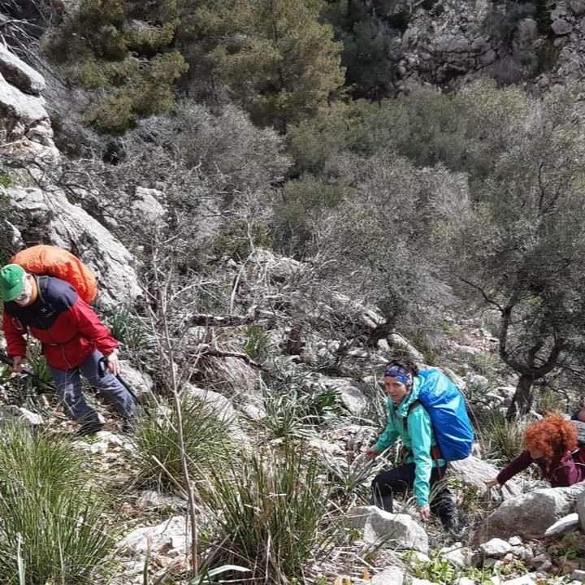

El mal temps no va ser obstacle perquè la secció de Senderisme completàs ahir diumenge una nova sortida del seu calendari d'activitats.

El grup va realitzar una ruta circular amb inici i final a la finca bunyolina de Raixa. Es va ascendir el penyal de Sa Rata (898 metres) a través del barranc de Sa Gubia i el comellar del torrent de s'Obi. Seguidament, es va afrontar el descens per la serra de Sa Coa de Sa Rata (732 metres) fins el cingle de Sa Milana.

