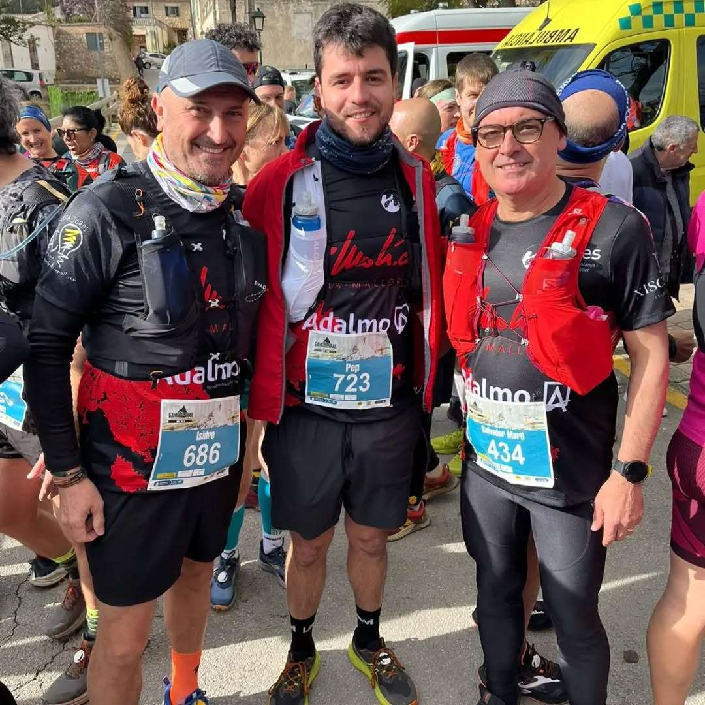

Avui hem estat presents a les proves de la Galatzó Trail, on els corredors del CMES ho han donat tot en les dues distàncies que s'han disputat.

Aquests han estat els resultats obtinguts:

📍GALATZÓ LEGEND - 43 quilòmetres

▪️131.- Pep Lluís Gómez 6:35:00

▪️185.- Jana Gibalova 7:12:02

▪️190.- Marga Bestard 7:15:04

▪️191.- Àngels Vaquer 7:15:04

📍GALATZÓ HALF - 23 quilòmetres

▪️56.- Pep Salas 2:57:58

▪️85.- Monika Gaska 3:06:41

▪️222.- Salvador Martí 3:51:15

▪️238.- Isidro Marín 3:57:04

