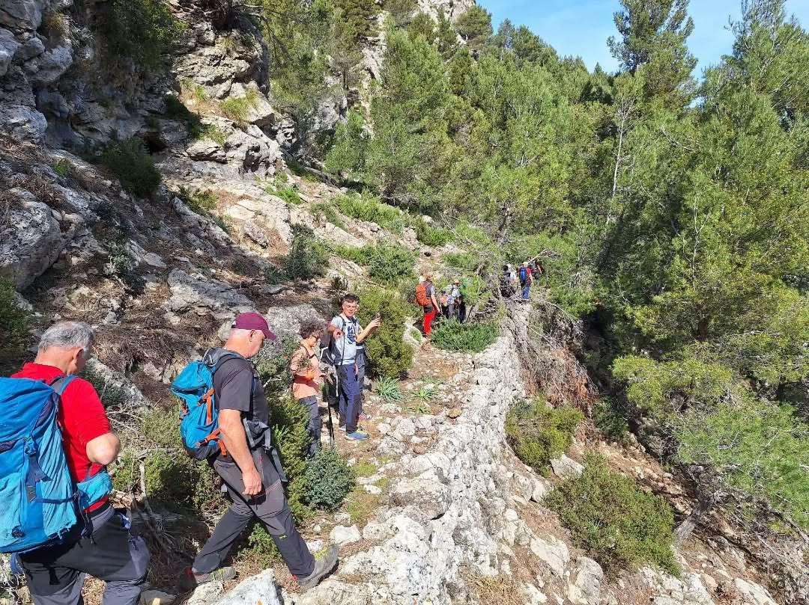
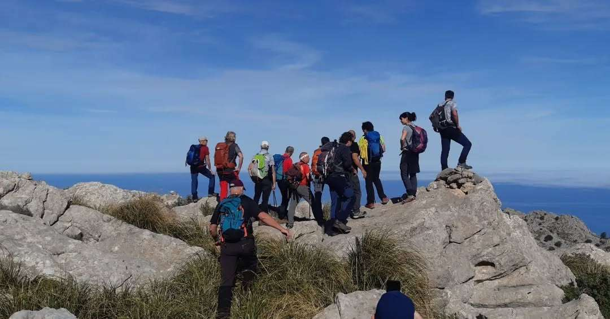
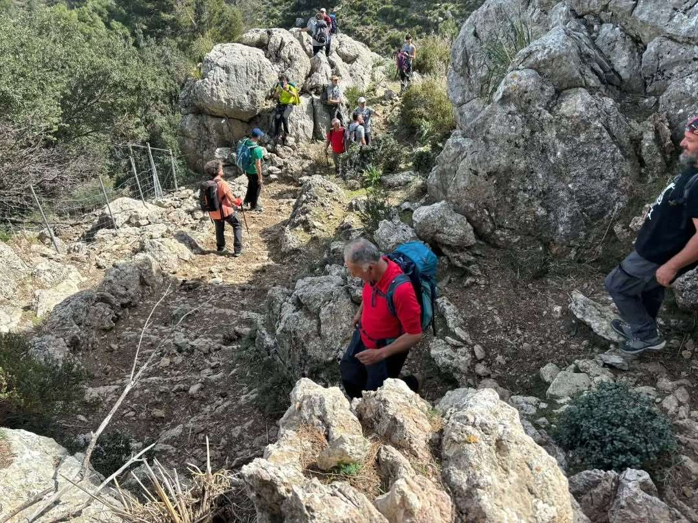
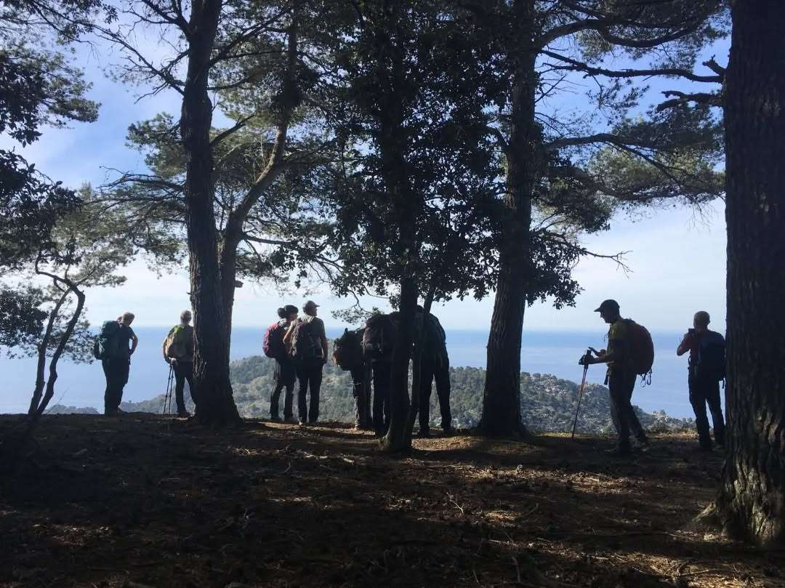

La secció de Senderisme ha completat avui un nou itinerari del seu calendari d'activitats. I ho ha fet pels voltants de la nostra vall.

El grup ha transitat pel camí dels Cingles, el torrent de Sa Coma den Grau, el puig de s'Alzina, la Coma Estreta i el Pla de Sa Creu, abans de passar per Moncaire i Bàlitx, i acabar la caminada al Mirador de Ses Barques.

