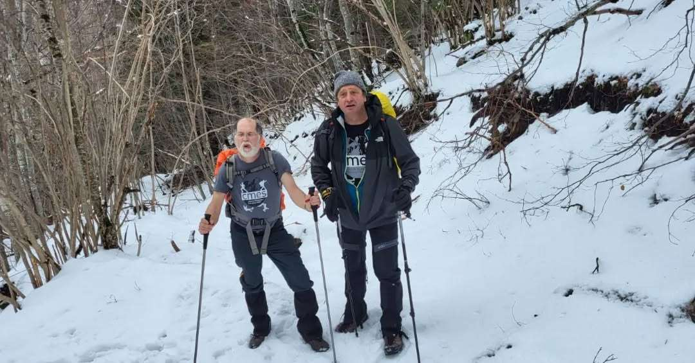
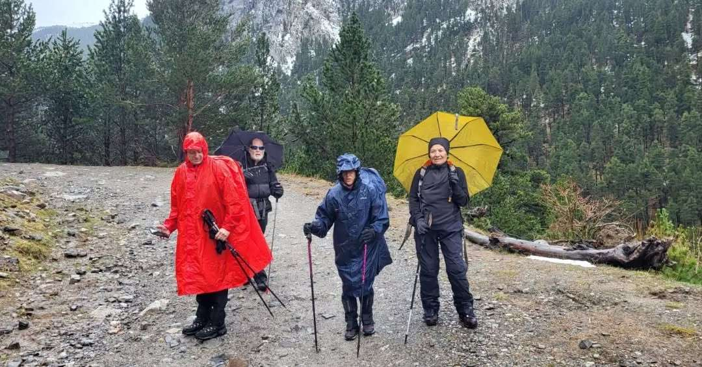
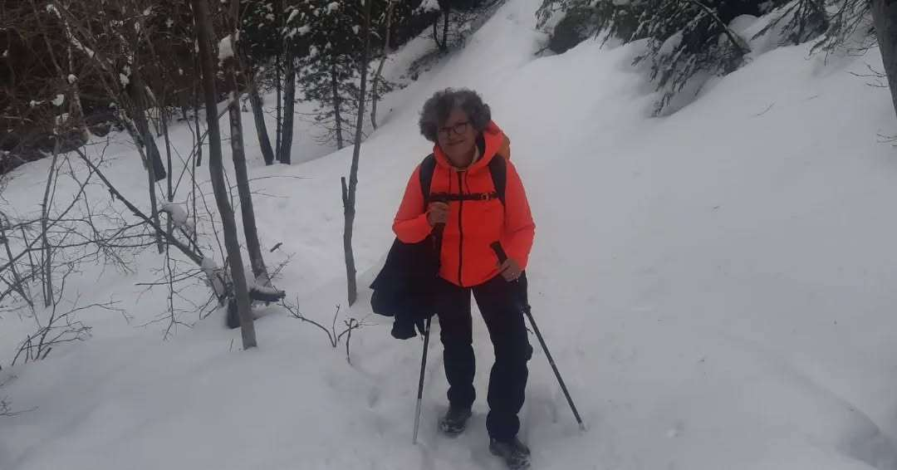
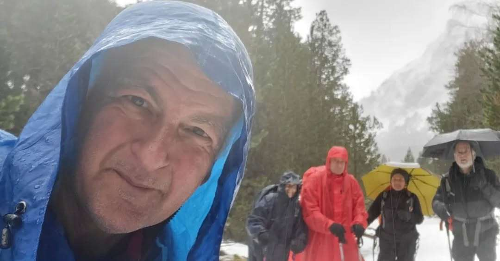
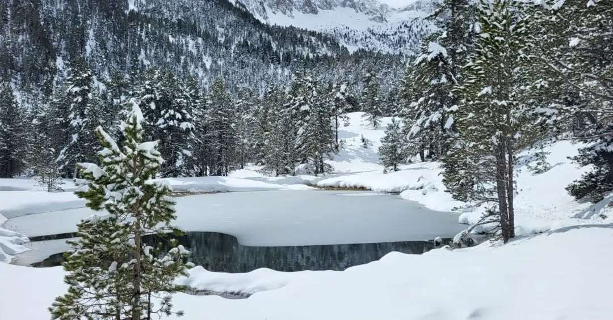
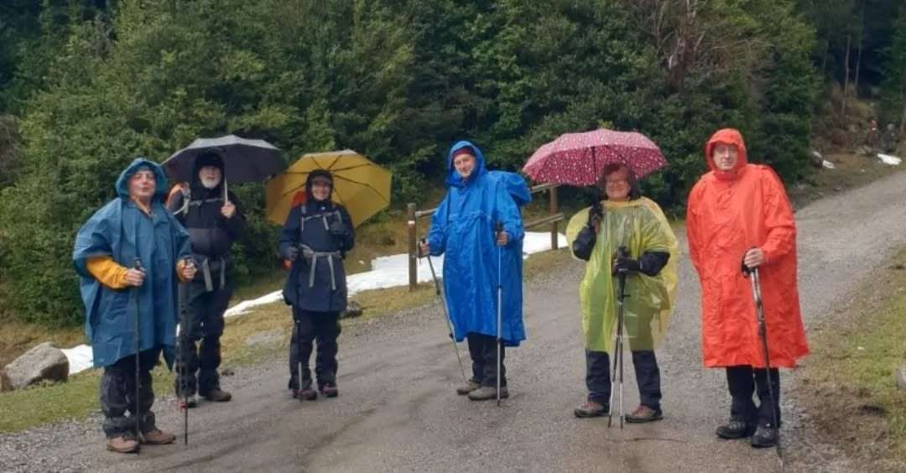
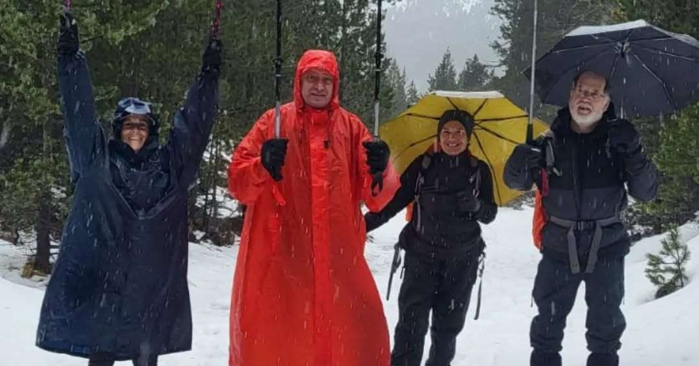
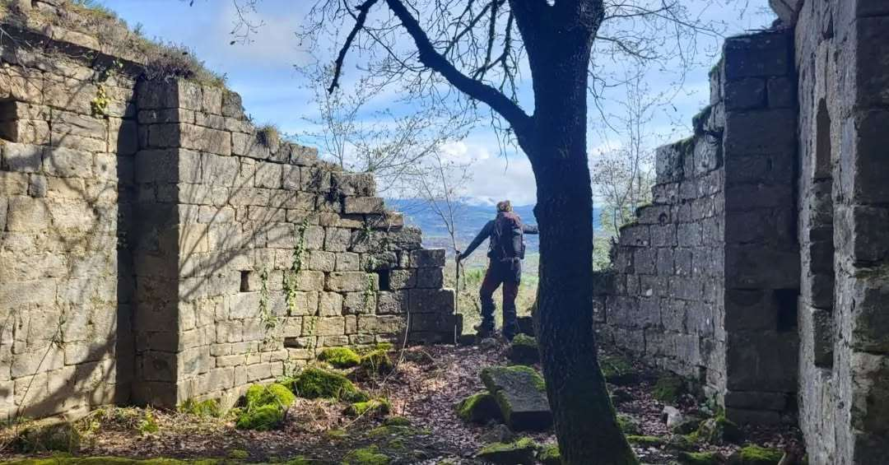
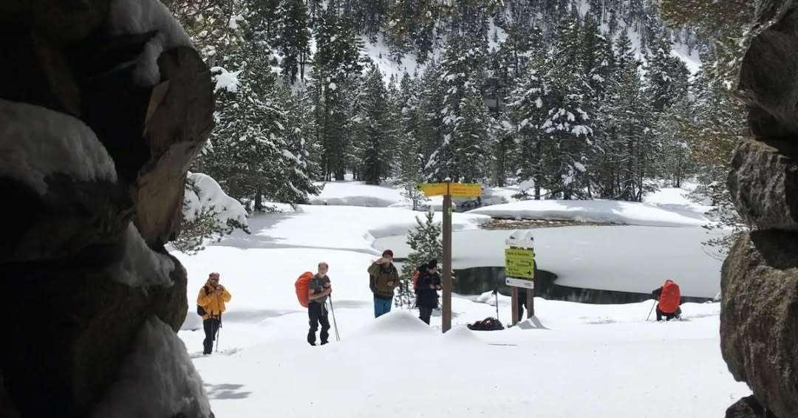
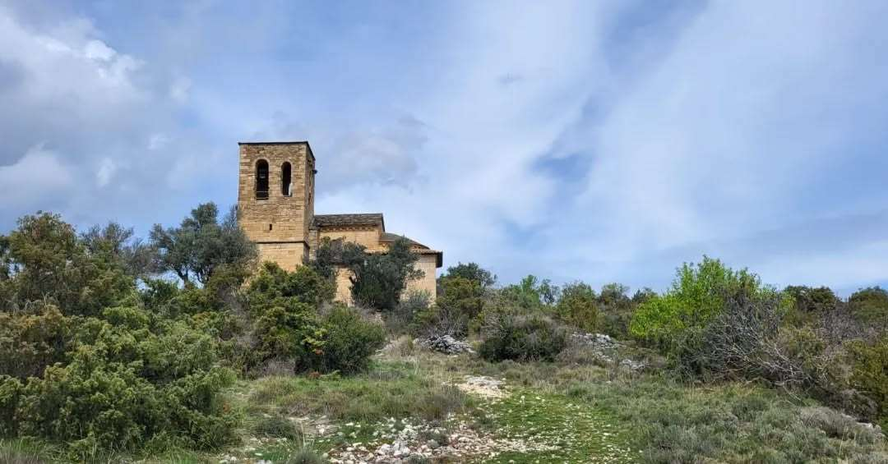

Un grup de socis de la secció de Senderisme ha aprofitat els festius de Setmana Santa per participar en una sortida als Pirineus organitzada pel club.

▪️Dijous es va transitar per la vall d'Estós, a les proximitats de Benasque. Es va transitar pels ibons de Batisielles, l'Aigueta de Batisielles i l'Escarpinosa.

▪️Divendres es va recórrer un tram del GR 11, concretament en un recorregut d'anada i tornada en direcció a la localitat d'Aneto.

▪️I dissabte, darrera jornada d'aquesta estada al Pirineu Aragonès, el grup va completar un recorregut circular a Graus, més conegut com la Ruta dels Templaris.

Han estat tres jornades de bon ambient, de coneixença de nous paratges, i on s'han completat els itineraris prevists.

