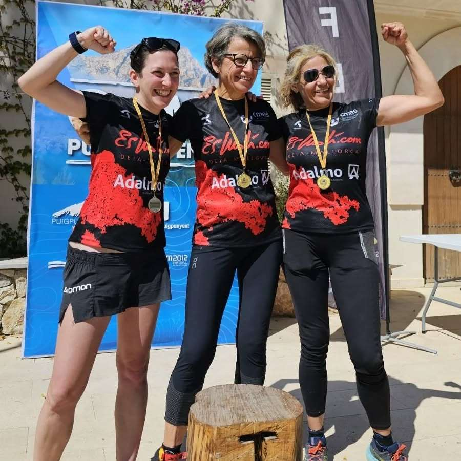
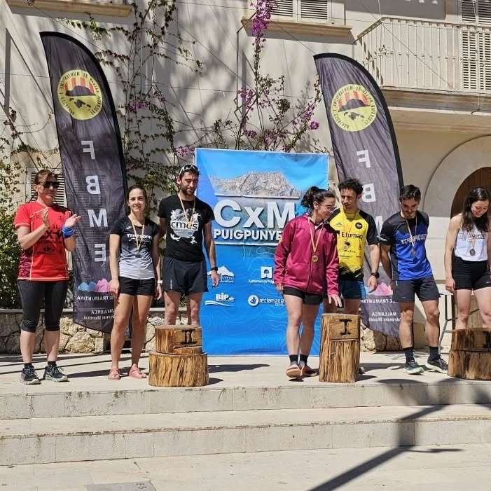
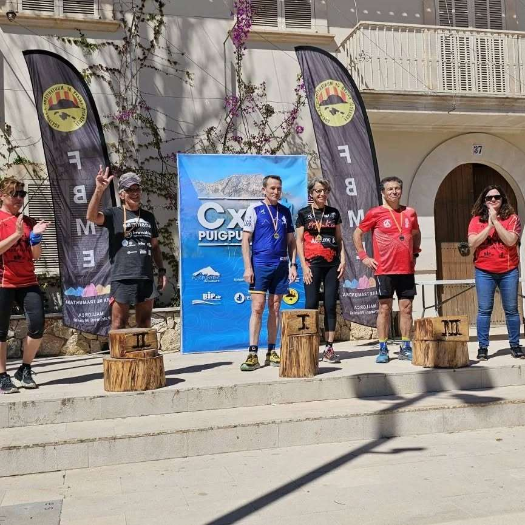
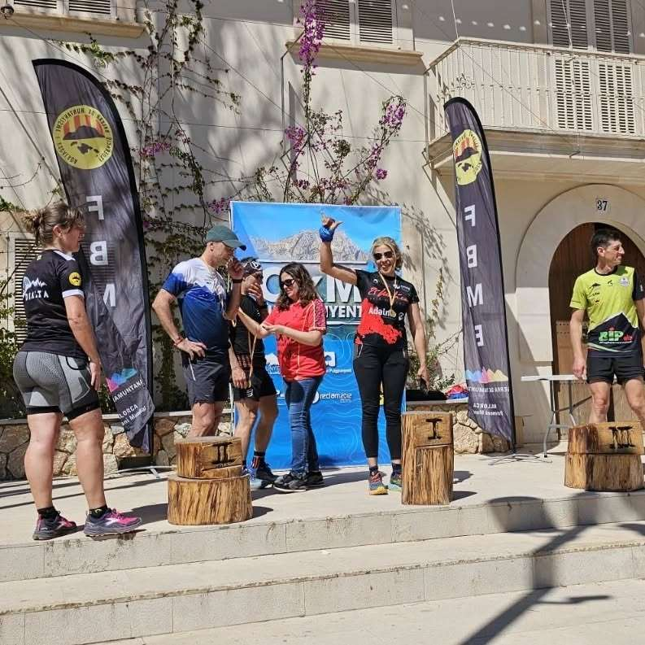
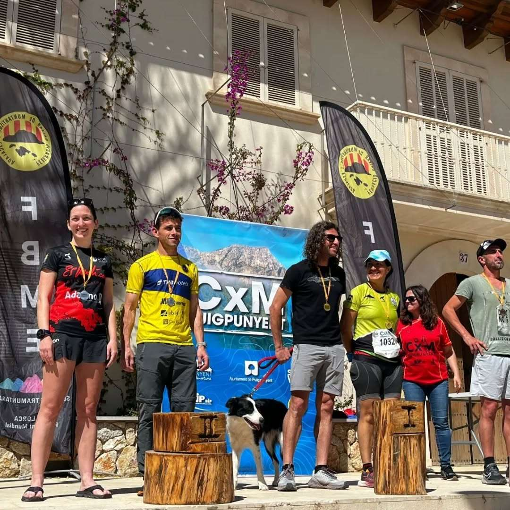

Diumenge de cursa avui a Puigpunyent. Els corredors del CMES han estat fidels un any més a la cita puigpunyentina i han retornat carregats de bons resultats.

Joan Torrens ha estat el sisè de la classificació general i també ha pujat al podi com a segon de la seva categoria d'edat.

Però ell no ha estat l'únic corredor del CMES premiat, ja que fins a quatre corredors del club han pujat al podi. A Joan Torrens s'hi ha sumat Bàrbara Matt com a primera en F60, Fabiana Peña com a primera en M50 i Jana Gibalova com a segona en F40.

Aquests han estat els resultats de tots ells:

▪️6.- Joan Torrens 1:22:46 🥈M30

▪️22.- Dani Vidal 1:32:39

▪️78.- Monika Gaska 2:04:00

▪️82.- Chris Clayton 2:08:42

▪️86.- Bàrbara Matt 2:11:48 🥇F60

▪️89.- Fabiana Peña 2:14:43 🥇F50

▪️90.- Jana Gibalova 2:15:23 🥈F40

Enhorabona a tots!!

