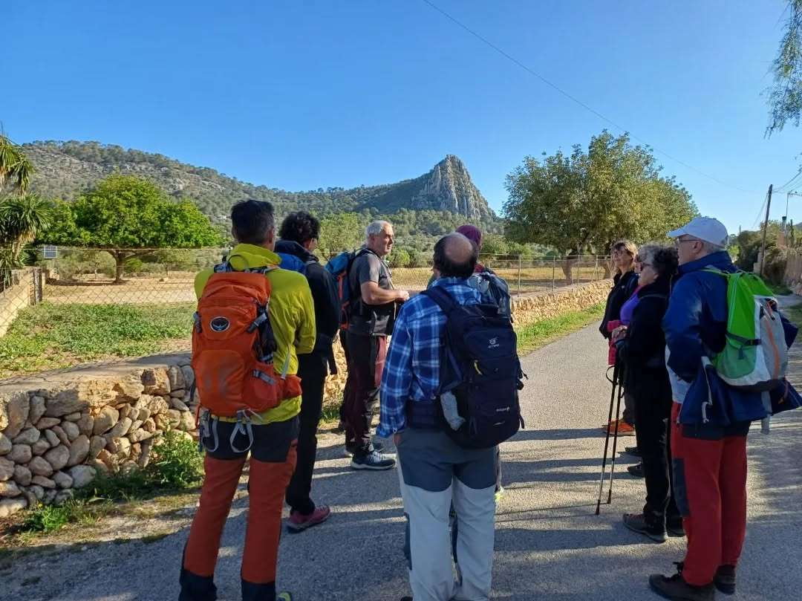
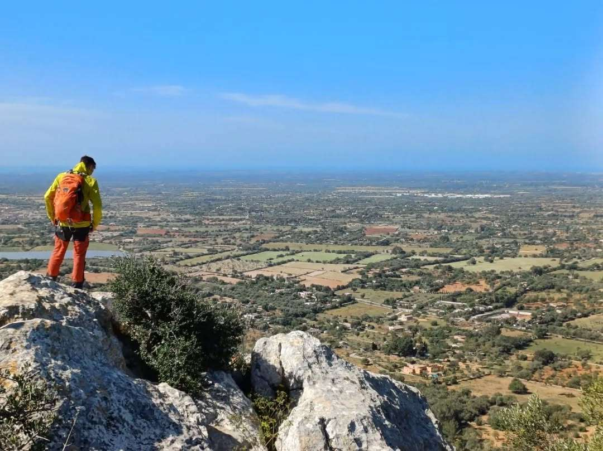
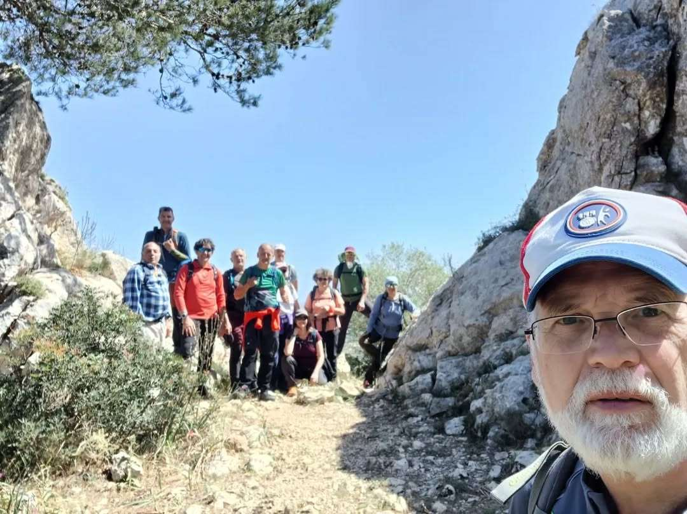
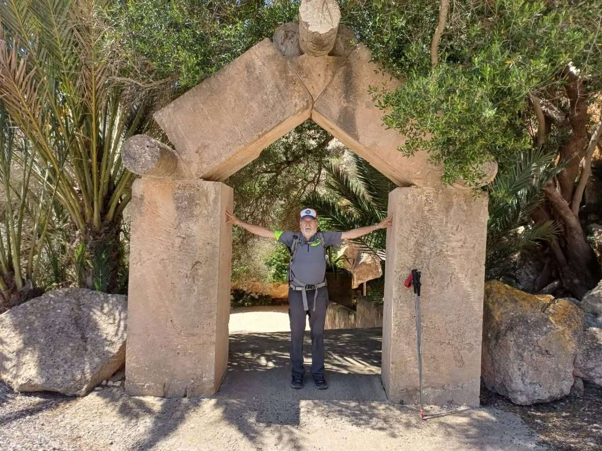
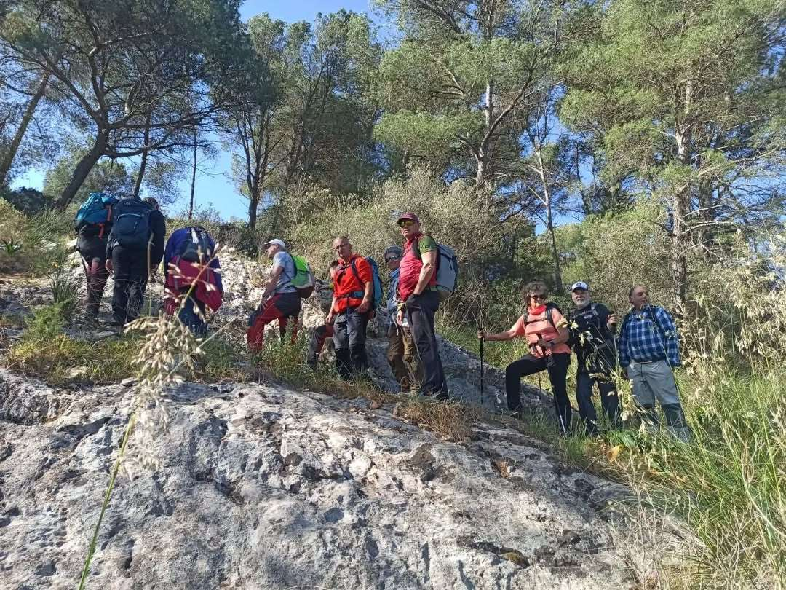
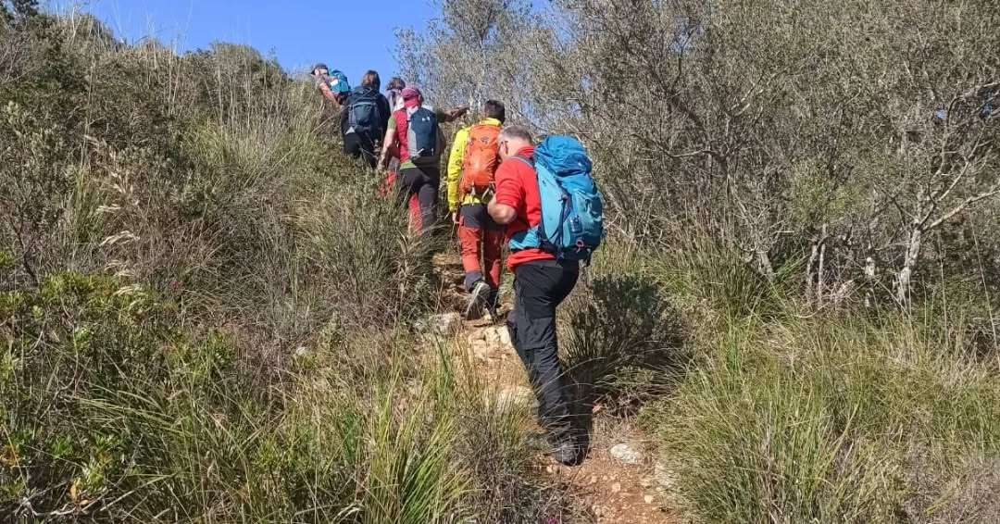

La secció de Senderisme s'ha desplaçat avui diumenge fins al sud de l'illa per recórrer un itinerari de baixa muntanya dins el terme municipal de Llucmajor.

Amb sortida i arribada al cementeri de la localitat, el grup ha transitat pel camí de Ses Ferruxelles i el camí Vell d'Algaida. S'han coronat el puig de Ses Bruixes i el puig den Claret, s'ha creuat l'ensopegada del gegant i s'ha acabat fent cim al puig de Son Roig.

