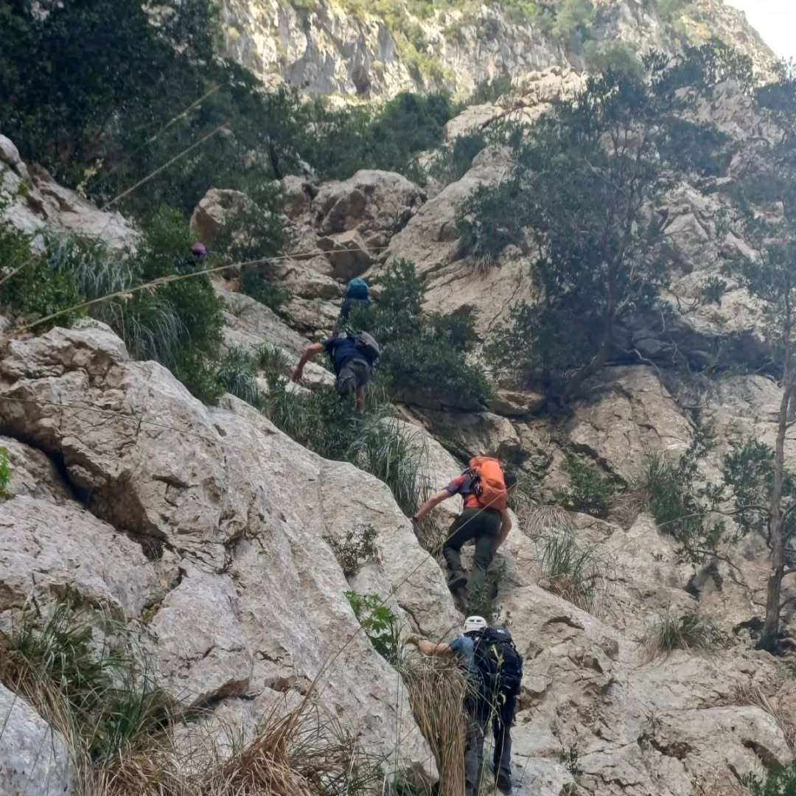
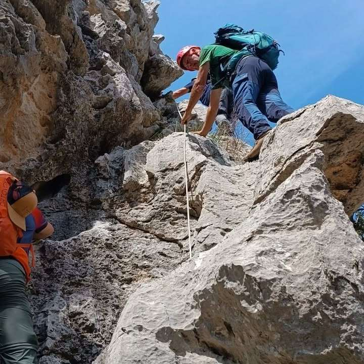
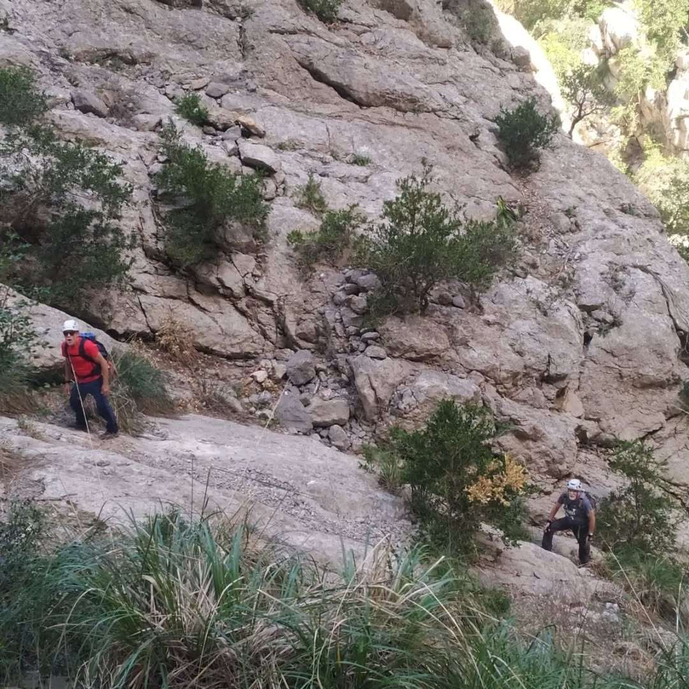
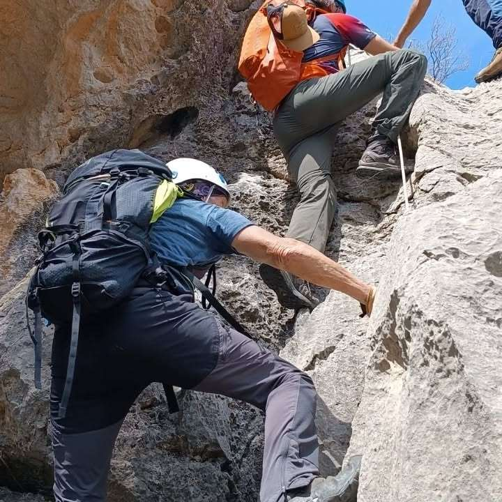
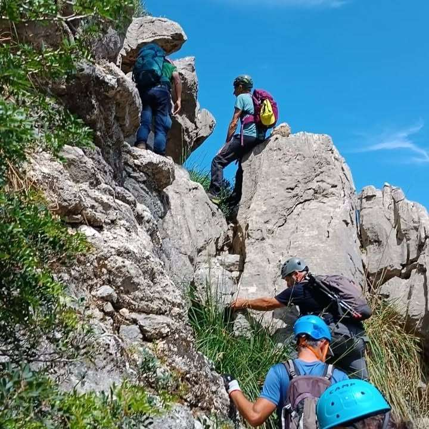

La secció de Senderisme va completar ahir diumenge una sortida pel Torrent de Pareis i els seus voltants. El Pas de s'Argolla va ser la principal dificultat tècnica amb la que es trobaren els participants. Durant la sortida, també visitaren el mirador del cingle del Niu del Voltor i la Moleta de Cals Reis.

