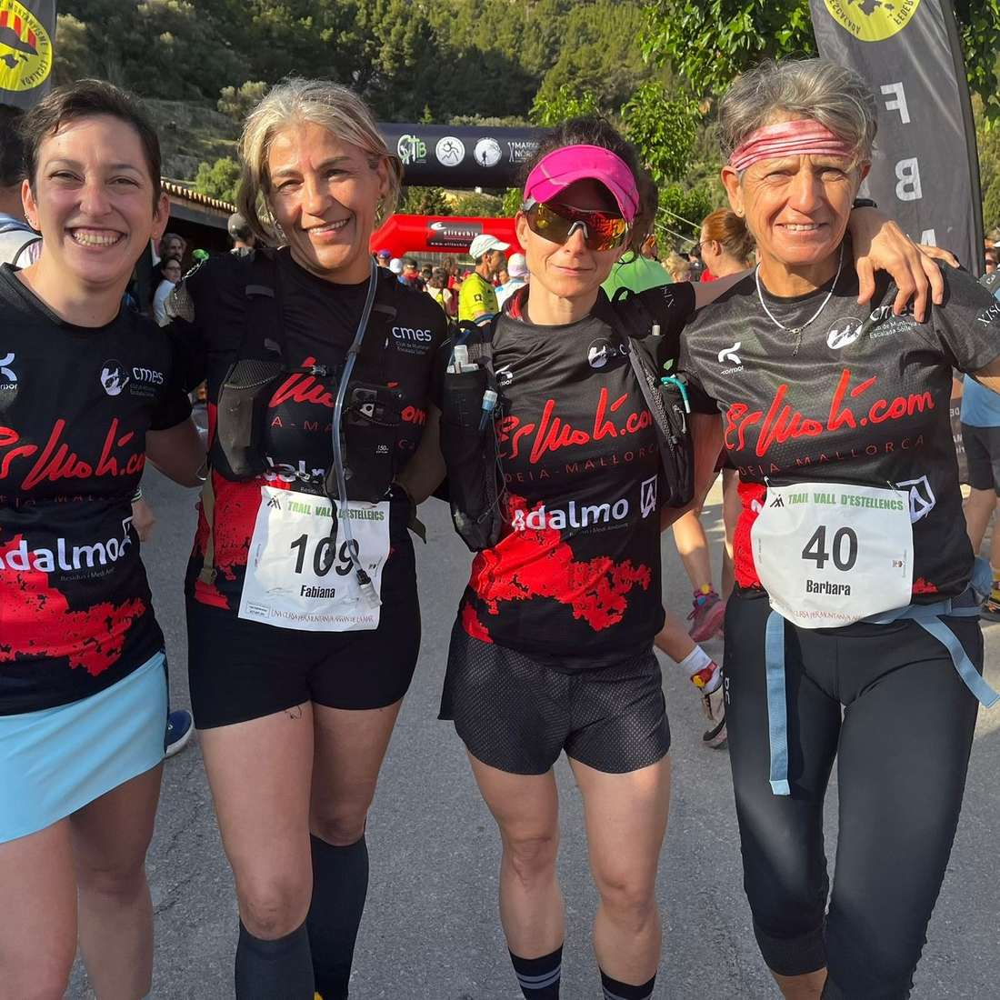
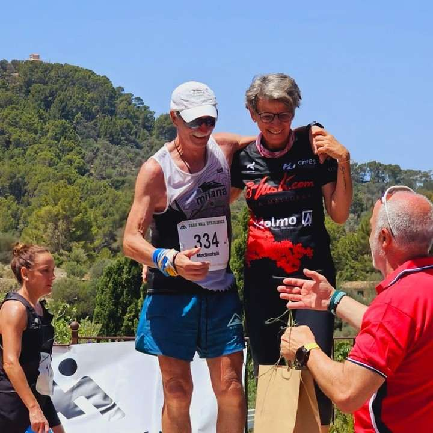

Una representació de corredors del CMES no s'ha volgut perdre avui dematí l'estrena de la cursa Vall d'Estellencs.

Tots ells han gaudit del recorregut dissenyat per l'organització en les dues distàncies que s'havien preparat.

Aquests han estat els resultats de tots ells:

▶Cursa 23 quilòmetres

62.- Bàrbara Matt 3:44:43

78.- Mónica Gaska 3:55:04

103.- Fabiana Peña 4:26:15

▶Cursa 12 quilòmetres

57.- Chris Clayton 2:06:26

61.- Jana Gibalova 2:09:25

62.- Isidro Marín 2:09:50

83.- Xisca Coll 2:17:33

88.- Oana Oancea 2:21:47

A més, Bàrbara Matt ha estat la primera classificada de la categoria F60.

Enhorabona a tots!!

