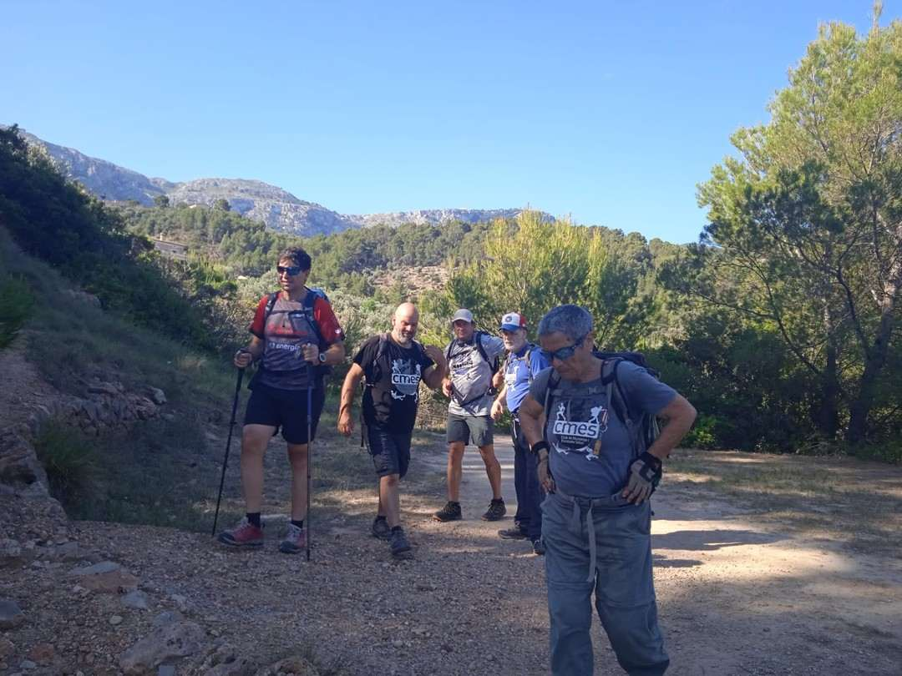
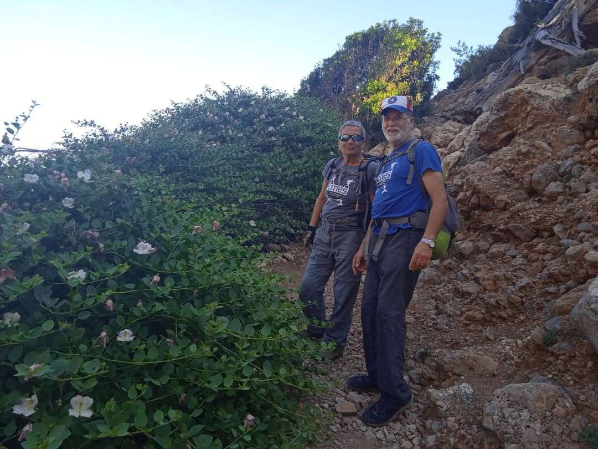
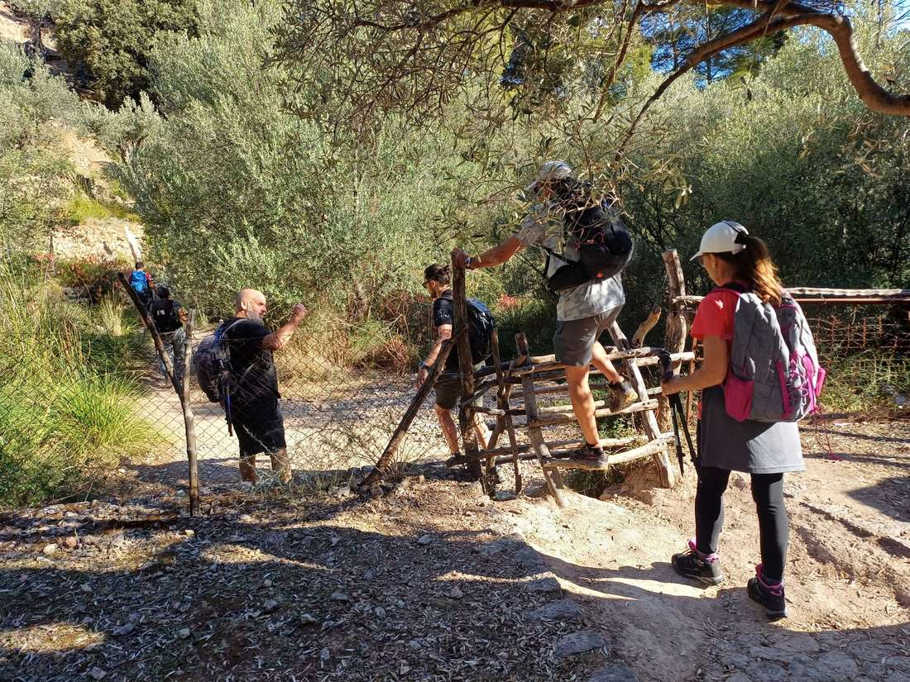
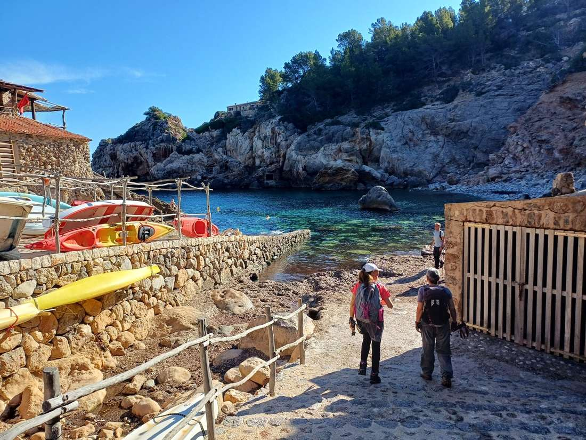
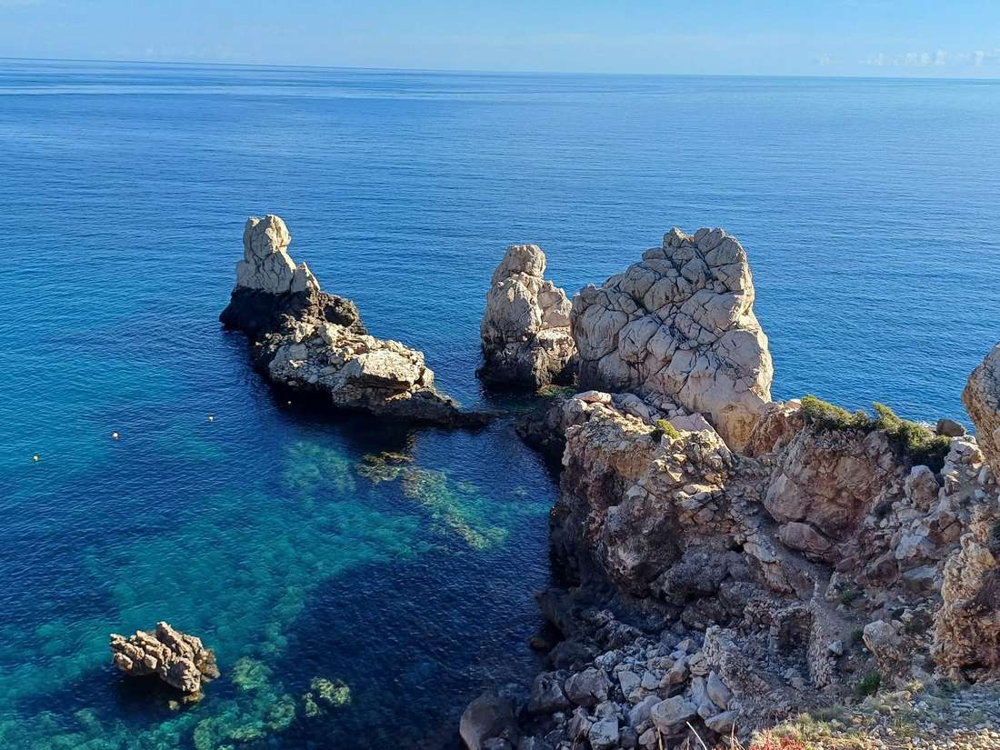

La secció de Senderisme va completar ahir diumenge una sortida pel tram de costa situat entre Deià i Sóller. Es va baixar fins a la Cala de Deià i es va transitar pel camí dels Pintors fins a Llucalcari. Seguidament el grup es va dirigir cap el camí de Castelló per transitar pel Pla de sa Creu, el pas de s'Osca i acabar la caminada a la font de Sa Senyora.

