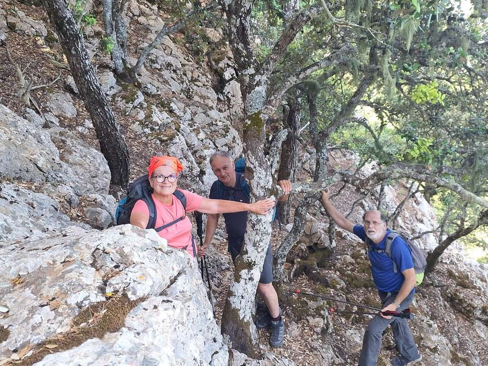
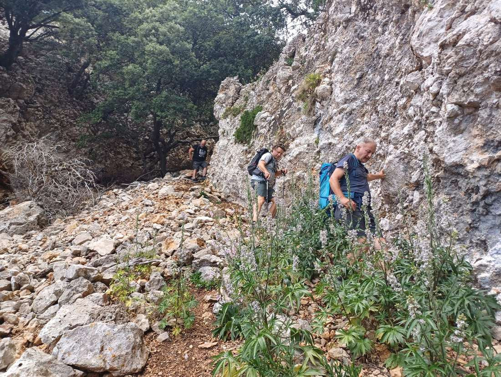
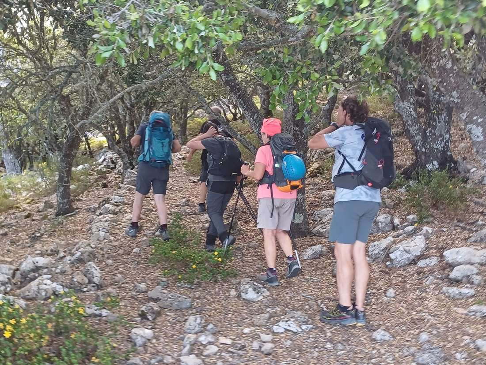

La secció de Senderisme va realitzar ahir una nova sortida del seu calendari d'activitats. Els participants varen recórrer una variant del GR 221 que va incloure assolir els Puntals de Planícia (893 metres) des d'Estellencs a través del Pas de Sa Rata. El camí de retorn es va fer a través d'una llarga canal, el Sant des Fonollar i el Salt del Putxet.

