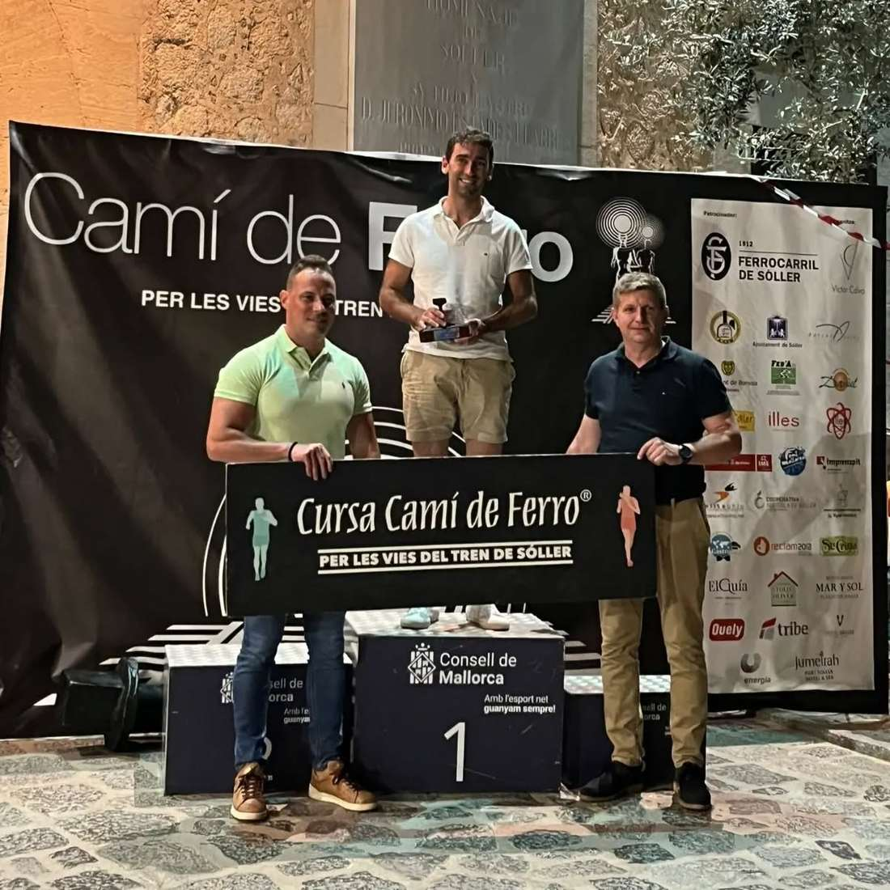
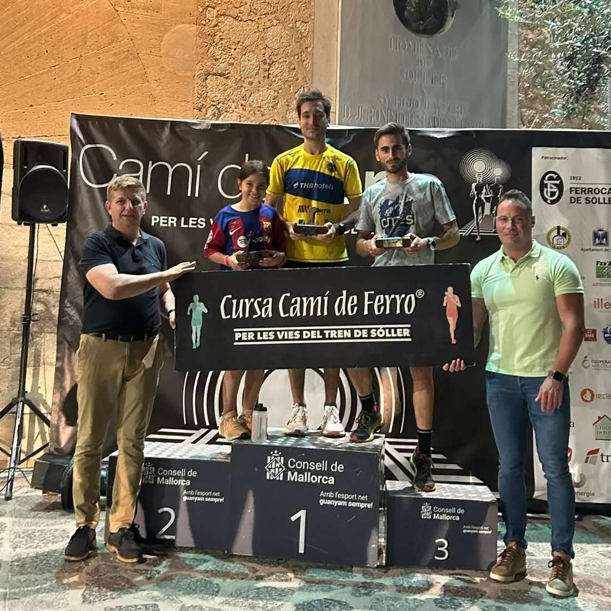

Joan Torrens va guanyar ahir per segon any consecutiu la versió de 13 quilòmetres de la cursa Camí de Ferro. Amb un temps de 46:51 va ser el més ràpid en cobrir el traçat ferroviari que separa l'estació de Bunyola de la de Sóller.

A més d'ell, altres corredors del CMES també aconseguiren pujar al podi en les seves categories d'edat: Dani Vidal fou tercer Sub 23 i Pere Estarelles, segon V40.

Aquests foren els resultats dels participants del CMES:

1.- Joan Torrens 46:51 🥇

7.- Dani Vidal 50:34 🥉 Sub 23

10.- Pere Estarelles 51:39 🥈V40

19.- Pep Pons 55:42

73.- Toni Gamundí 1:09:55

89.- Isidro Marín 1:12:58

96.- Tolo Seguí 1:14:43

119.- Pere Amengual 1:22:14

127.- Sergi Salvà 1:23:49

144.- Albert Salvà 1:28:05

Enhorabona a tots!!

